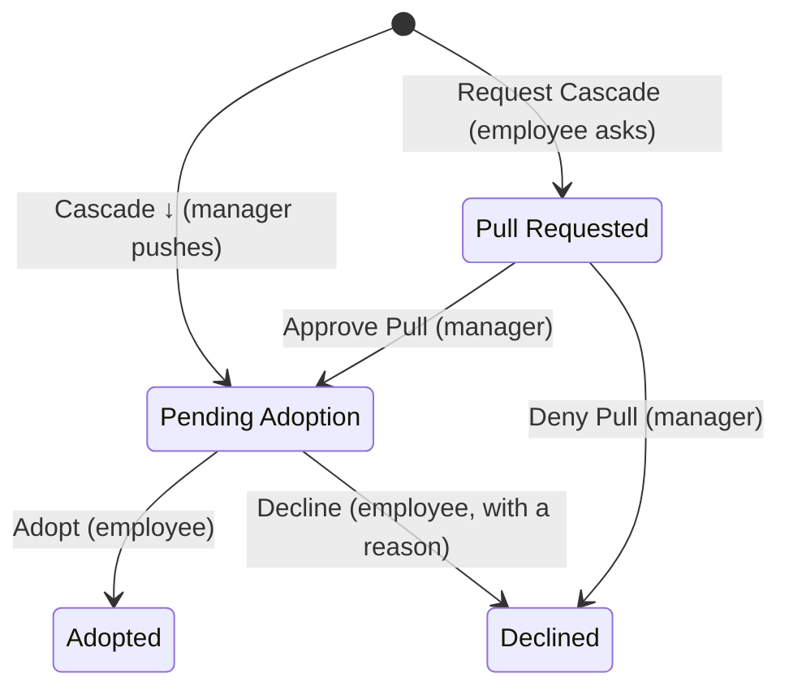

**Cascading** is how a target travels down the reporting line. A manager with a KES 10,000,000 revenue target can hand KES 4,000,000 of it to Employee A. Employee A then holds a target of their own, linked to the manager's. Each target in the chain is scored on its holder.

There are two kinds of link, shown as **Link to Source**:

- **Share of source** — a slice of a quantitative target, in the same unit. It uses up part of the source's value. Only a target with **Apportion when cascading** switched on can be shared.
- **Supporting target** — any other target that helps achieve the source, such as an SLA or a milestone. It doesn't use up any of the source's value.

## Push, pull, adopt, decline

- **Push.** The manager clicks **Cascade ↓** on their target. The **Push Cascade to Team** window lists their direct reports. They tick who gets what, choose a share or a supporting target, and set the value. Each person gets a draft target and an *Adopt Cascade* to-do.
- **Pull.** An employee can ask for part of their direct manager's live target. On My Targets they click **↑ Request Cascade from Supervisor**, say what they want and why, and click **Submit Request**. The manager gets a *Review Pull Request* to-do and clicks **Approve Pull** or **Deny Pull**.
- **Adopt.** The employee clicks **Adopt** on the pushed target. It becomes **Active** on their scorecard and the manager's own figure shrinks by that amount.
- **Decline.** The employee clicks **Decline**, writes a reason under **Decline Reason**, and clicks **Confirm Decline**. The manager gets a *Resolve Declined Cascade* to-do and can push again.

The **Cascade Status** on a target shows where it is: **Not Cascaded**, **Pull Requested**, **Pending Adoption**, **Adopted** or **Declined**. Reminders go out every few days while a cascade waits. After the period's target-setting deadline, adopting a cascade adds a target to a live scorecard, so it waits for approval like any other scorecard change.

## What it does to the manager's target

Shares only come off the manager's figure once they are **adopted**. On the manager's target, the **Allocation** section shows:

| Label | Example | Meaning |
|---|---|---|
| **Target Value** | 10,000,000 | The whole target. |
| **Allocated** | 7,000,000 | Shares pushed, adopted or requested: 4,000,000 adopted plus 3,000,000 still pending. |
| **Remaining** | 3,000,000 | Not yet handed out. Below zero means **Over-allocated**. |
| **Cascaded (Adopted)** | 4,000,000 | Shares the team has adopted. |
| **Measured On** | 6,000,000 | What the manager is personally scored against: the target value less the adopted shares. |
| **Team Result (not scored)** | | The manager's own result plus the team's results on their shares. For information only. |

**Yours to deliver** sums it up, for example *Keep 6,000,000 of 10,000,000 · 4,000,000 cascaded to …*. The adopted shares are scored on the people who hold them and reach the manager through their [team score](/accountability/concepts/scores/).

When everything has been adopted, the target is **Fully cascaded — measured through your team**. It has no score of its own and can't be reviewed directly. It still counts in the manager's own score for the days before it was fully cascaded.

**Trace Cascade** on a target opens a tree of the whole chain, with each holder's progress and where it is falling behind. **Accountability › My Team › Cascade Management** shows every cascade a manager has sent.

:::note[Good to know]
The **Adopt** and **Decline** buttons show to anyone who can open the pushed target, not only the person it was pushed to. Only the recipient should use them. If someone else adopts or declines by mistake, ask the manager to push again.
:::

## Tasks that use this

- [Push a target down, or approve a pull](/accountability/how-to/line-managers/push-and-pull-targets/)
- [Check my targets](/accountability/how-to/everyone/my-targets/) (adopt, decline or request a share)
- [Cascade workflow](/accountability/workflows/cascade/)
- [Check compliance and session coverage](/accountability/how-to/hr-admin/compliance-and-coverage/)
