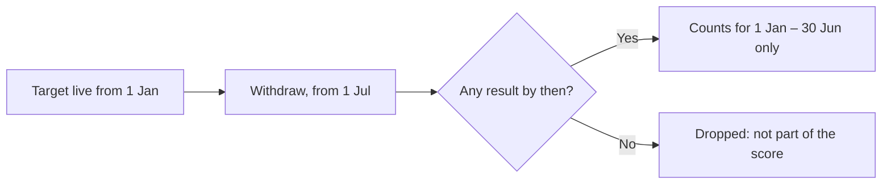

import Illustration from '../../../../components/Illustration.astro';

Three things keep a person or a target out of the score: an **exemption** for the person, **withdrawing** a target, and marking a target as a **development** target.

## Exempt staff

Some people shouldn't be measured for a while: an intern, someone on long leave, a new joiner still settling in. HR or an accountability administrator exempts them on their employee record, in the **Performance** tab of the Employees app.

<Illustration name="accountability/concept-exemption" caption="An exemption on the employee form. The numbers match the list below." />

1. **The banner** — shown while the person is exempt today.
2. **Exempt from Accountability** — switches the exemption on. **Exempt From** (blank means since joining) and **Exempt Until** (blank means open-ended) set the dates.
3. **Exemption Reason** — required.

While someone is exempt:

- no targets are expected and no score is worked out. Someone exempt for the whole period so far has the scoring mode **Exempt**;
- they are left out of their manager's team score and headcount, cascades, review sessions (with **All my direct reports**), team coverage metrics, progress briefs and snapshots;
- any target created for them is marked **Development (not scored)**.

On Team Scores and Team Targets, exempt staff are hidden unless you tick **Show exempt staff**. They never count in the figures either way.

## Development targets

A target marked **Development (not scored)** is a learning or growth goal. It can be tracked and reviewed like any other target, but it never counts towards a score and has no rating. Targets created while a person is exempt get this mark automatically. Only HR and accountability administrators can change it.

A development target can't be rebalanced or withdrawn: those only apply to scored targets.

## Withdrawn targets

Sometimes a target stops making sense part-way through the year: a project is cancelled, or the person changes role. The manager (or HR, or an administrator) clicks **Withdraw** next to the target's weight. This opens a scorecard change with a **From** date and a reason. Before the target-setting deadline it applies at once; after it, it waits for approval.

A withdrawn target:

- stays on the scorecard with the note *Withdrawn from the scorecard from* a date: *any result counts for the time it was live*;
- counts in the score only for the days it was live, so its share of score shrinks. The other targets' shares grow to fill the gap;
- is **dropped** if it ended with no result. It then has no share and is not part of the score;
- takes any shares still waiting to be adopted or approved down with it;
- no longer shows in anyone's My Actions.

The employee is asked to [acknowledge the new priorities](/accountability/concepts/weights-and-share-of-score/). An employee can't withdraw their own target, but can click **Propose a change** to ask their manager.

**Closing** a target works in a similar way: it counts up to the date it was closed, if it has a result.

:::note[Good to know]
Only a draft with no reviews can be deleted. For any other target, use **Withdraw**: that way its result keeps counting for the time it was live.
:::

## Tasks that use this

- [Exempt a member of staff](/accountability/how-to/hr-admin/exempt-staff/)
- [Withdraw a target](/accountability/how-to/line-managers/withdraw-a-target/)
- [Request a scorecard change](/accountability/how-to/line-managers/request-a-scorecard-change/)
- [Scorecard change request workflow](/accountability/workflows/scorecard-change-request/)
