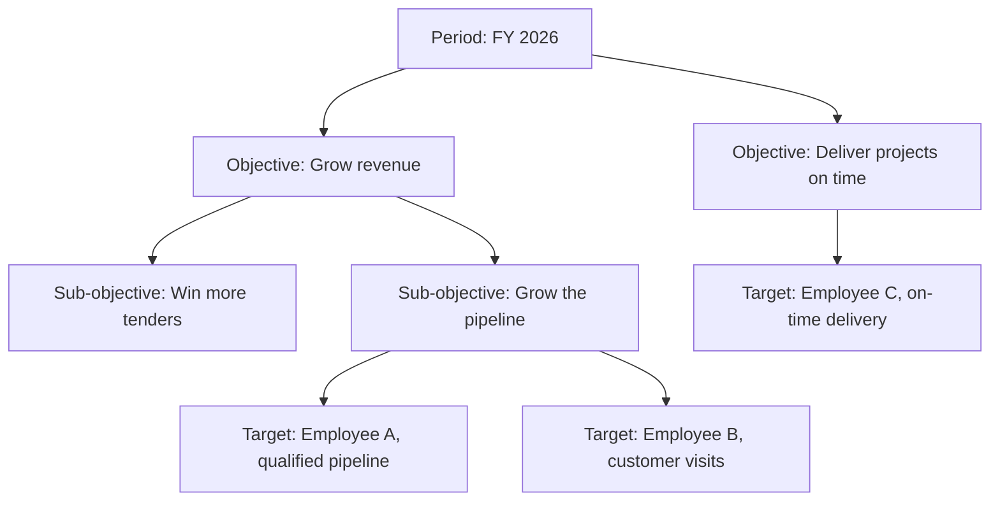

A **period** is the performance year, for example **FY 2026**. Every target, review and score belongs to one period. A period has a **Period Name**, a **Start Date**, an **End Date** and a **Target-Setting Deadline**, and its **Status** is **Draft**, **Active** or **Closed**. Only one period can be active at a time. Accountability administrators open and close periods under **Accountability › Organisation › Periods**.

The **Target-Setting Deadline** matters all year. Up to that date, managers can add, change and remove targets freely. After it, every change to a live scorecard becomes a scorecard change request that needs approval, and targets created after it are marked **Late Set**.

**Objectives** are the goals inside a period, such as *Grow revenue* or *Deliver projects on time*. They form a tree: a top-level objective can have **Sub-objectives**, each with its own **Owner** and **Department**. Every target sits under exactly one objective, so you can see how each person's work adds up to the company's goals. Line managers and administrators keep objectives under **Accountability › Organisation › Objectives**.

## Key terms on screen

| Label | What it means |
|---|---|
| **Target-Setting Deadline** | After this date, changes to live targets need approval. |
| **Copy Last Year's Objectives** | A button on the period. It copies the previous period's objective tree, owners and weights as drafts. Running it again only adds what is missing. |
| **Parent Objective** / **Sub-objectives** | Where the objective sits in the tree. |
| **Default Weight for New Targets** | The starting weight for a new target under this objective when the person has no other live target there. It is not used in any score. |
| **Achievement Threshold (%)** | The average an objective needs to count as achieved. 70 by default. |
| **Your Level** | The average score of the measured targets under this objective owned by you and the people below you. |
| **Org** | The same average across the whole organisation. |
| **Measurement** | **Measured**, **Not yet measured** or **No targets set**. |
| **Achievement** | Set once the objective is closed: **Achieved**, **Partial Achievement** (at least three-quarters of the threshold), **Not Achieved**, **Not Measured** or **Not Set**. |

The averages count only targets that have a result. A target that hasn't been reviewed yet doesn't pull the average down. How the figures are worked out is in [Objective achievement](/accountability/calculations/objective-achievement/).

## When a period closes

- Everyone's final [snapshot](/accountability/concepts/snapshots-and-as-at/) is frozen as at the period's last day.
- Any scorecard change request still open is cancelled.
- Objective averages and achievement are frozen and stop changing.
- Nothing can be rebalanced, withdrawn, added or reordered any more.

:::note[Good to know]
The period form says targets *activated* after the deadline are flagged as late-set. In fact, **Late Set** is decided by the date the target was *created*. A draft created before the deadline and activated after it is not flagged.
:::

## Tasks that use this

- [Open and close a period](/accountability/how-to/hr-admin/open-and-close-periods/)
- [Set up objectives](/accountability/how-to/hr-admin/objectives/)
- [Period workflow](/accountability/workflows/period/) and [Objective workflow](/accountability/workflows/objective/)
- [Propose next year's targets](/accountability/how-to/line-managers/propose-next-years-targets/)
