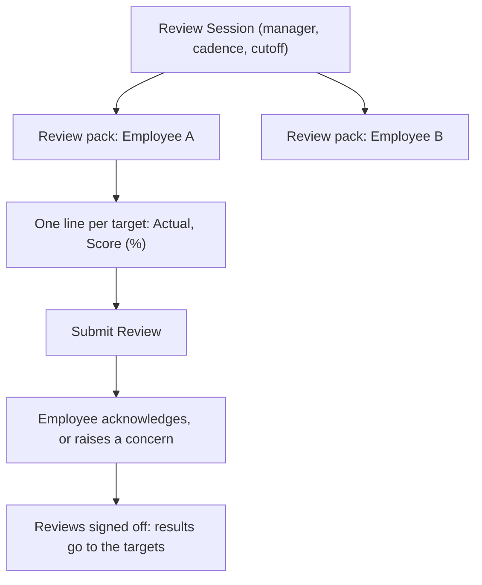

A **review** records one result for one target over one window, such as *Invoiced revenue, Q3 2026: KES 9,000,000*. When a review is signed off, its result is written to the target and the scores are worked out again. Reviews are the only way a result enters a score.

Reviews come about in three ways:

1. **In a review session** (the usual way). Once a month or quarter, a manager reviews all their direct reports together. Each person gets one **review pack** holding a line for each of their targets.
2. **Automatically from a metric.** After a window ends, the system creates a draft review with the fetched value, and the manager confirms it. See [Metrics](/accountability/concepts/metrics/).
3. **One at a time.** On a target in **Pending Review**, the direct manager clicks **Conduct Review**, enters the result and sends it to the employee.

## Review sessions and review packs

A **review session** belongs to one manager (the **Reviewer**). It has a **Review Cadence** and a **Review Cutoff**: the last day of the month, quarter or other window being reviewed. The window must have ended. A quarterly session also picks up monthly, weekly and daily targets, because it includes every finer cadence. **Scope** is **All my direct reports** (exempt staff are left out) or **Selected direct reports**. Sessions follow the org chart: a manager can only review their own direct reports.

A session's **Status** is **Draft**, **In Progress** or **Done**. **Populate & Start** loads everyone's targets. The manager then fills in each pack. Once every pack is submitted, the session moves to **Done** by itself.

A **review pack** (shown as **My Review** to the employee and **Employee Review** to the manager) holds one line per target. Each line has an **Actual** and a **Score (%)**, and its **Status** is **Pending**, **Done**, **Not Applicable** or **Skipped**. The manager can type the actual, click **Fetch** for a metric target, or **Skip** a line. A pack can't be submitted while any line is still **Pending**. When the manager clicks **Submit Review**, each line's weight is locked and the employee is asked to respond.

## What the employee does

The employee opens the pack under **My Performance › My Reviews**, or on the portal, and has until the **Acknowledge By** date (5 days by default) to either:

- click **Acknowledge** — the pack is closed and its reviews are signed off; or
- click **Raise a Concern** about specific lines — the manager answers by revising or keeping the scores. If the scores are kept, the employee can acknowledge, or **Escalate** to the manager's own manager (or the escalation contacts, or HR).

A reminder goes out 2 days before the deadline. If the employee does nothing, the pack is **Signed Off Automatically**. While a concern or escalation is open, nothing is signed off. The step-by-step path is in the [review pack workflow](/accountability/workflows/review-pack/) and the [review concern workflow](/accountability/workflows/review-concern/).

## Key terms

| Label | Meaning |
|---|---|
| **Review Cutoff** | The last day of the window the session reviews. |
| **Covers From** / **Covers To** | The window a review or line covers. A monthly target in a Q3 session covers September. |
| **Avg Score (%)** | On a pack: the average of the counted lines, each by its weight. Pending lines with no value count as 0; skipped and not-applicable lines are left out. On a session: the simple average of the packs, each person counting once. |
| **Not Applicable** | Nothing to measure in the window. The line or review is closed straight away and left out of every score. |
| **Waiting On** | Whose move it is: **Reviewer's Move**, **Employee's Move**, **With Escalation** or **Closed**. |
| **Manager (at the time)** | The manager on the last day the review covers. A review stays with that manager even if the employee later moves teams. |

The sums behind the averages are in [Review and session averages](/accountability/calculations/review-averages/).

:::note[Good to know]
- In the **Conduct Review** window, the button labelled **Sign Off** sends the review to the employee to acknowledge. It is not signed off until the employee acknowledges it, or the acknowledgment window passes.
- **Mark Done** on a session closes it at once, without checking the packs. Packs still in Draft stay in Draft and the employees are not told. Use **Submit All Reviews** instead, unless you mean to abandon the remaining packs.
:::

## Tasks that use this

- [Respond to my review](/accountability/how-to/everyone/respond-to-my-review/)
- [Plan a review session](/accountability/how-to/line-managers/plan-a-review-session/)
- [Conduct a review](/accountability/how-to/line-managers/conduct-a-review/)
- [Track reviews on the Team Reviews board](/accountability/how-to/line-managers/team-reviews-board/)
- [Decide scorecard changes and escalations](/accountability/how-to/hr-admin/decide-changes-and-escalations/)
- [Review analysis](/accountability/reports/review-analysis/)
