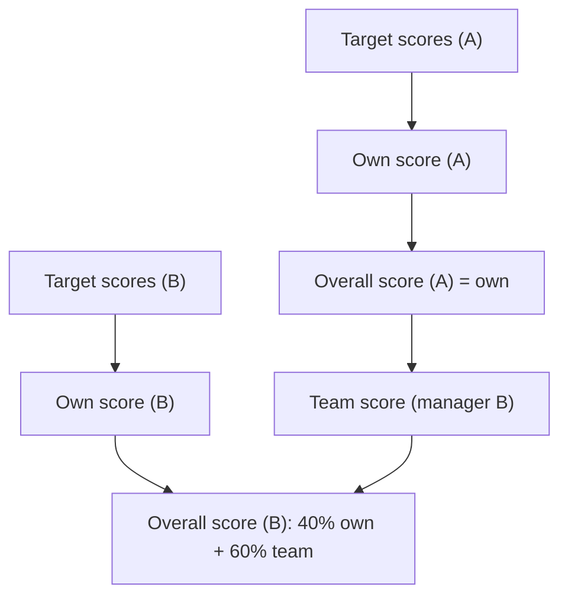

import Illustration from '../../../../components/Illustration.astro';

Everyone in the framework has one score record per period. It holds up to three figures:

- **Own score** — how you did on your own targets. It is the average of your targets' scores, each counted by its [share of score](/accountability/concepts/weights-and-share-of-score/). Only targets with a result count.
- **Team score** — for managers: how the people reporting to you did, using each person's overall score.
- **Overall score** — the figure everyone is judged on. For most staff it equals the own score. For managers with a team it blends own and team: by default **40%** own and **60%** team.

The overall score is labelled **Overall** on Team Scores, **Composite** on the Performance Overview and **Composite Score (%)** on the score record. They are the same figure.

## How a manager's team score works

Each person who reported to you counts by how much of the period they spent in your team. Someone in your team all year counts in full. Someone who joined halfway counts half. People with no score yet, and days when someone was exempt, are left out. If a person moved teams during the year, only the reviews from their time with you count towards your team score.

So the overall score passes up the reporting line: Employee A's overall score feeds Employee B's team score, which feeds B's overall score, which feeds B's manager's team score, and so on up to the MD.

<Illustration name="accountability/concept-team-scores" caption="Team Scores, where managers see Overall, Own and Team for each person. The numbers match the list below." />

1. **Whose scores** — **Direct reports**, **Whole reporting line**, or **Everyone** (HR and administrators). The as-at list picks a past month end.
2. **One row per person** — **Overall**, **Own** and **Team**. A person with nobody reporting to them shows no team figure.
3. **How the team score is reached** — open a manager's row to see each team member's score and how much they count.
4. **The split** — how own and team are blended in the overall score, from the settings.

## Which kind of score you get

The system decides this from the org chart:

| Scoring Mode | Who | Overall score |
|---|---|---|
| **Leaf / Individual Contributor** | Has a manager, and fewer than 2 people taking part reporting to them. | Own score. |
| **Middle** | Has a manager, and at least 2 people taking part reporting to them. | 40% own + 60% team. |
| **Top Level** | Has people reporting to them and no manager (the MD). | 40% own + 60% team. |
| **Standalone (Flagged)** | No manager and nobody reporting to them. The people named in the settings are told, so the org chart can be fixed. | Own score. |
| **Exempt** | Exempt for the whole period so far. | No score. See [Exempt staff](/accountability/concepts/exempt-withdrawn-development/). |

The 40/60 split and the minimum of 2 reports are settings an administrator can change.

## When scores change

Scores are worked out again every night, and straight away when a review is signed off, a milestone stage is confirmed or a weight changes. A change also moves the scores of every manager above you. The provisional value on a metric target never changes a score: only reviews do.

Your score also shows next to a [rating](/accountability/concepts/ratings-and-briefs/), and **vs Previous Period** compares it with your score in the last closed period.

:::note[Good to know]
- Target scores stop at 100%, so a strong result on one target can't make up for more than its own share.
- A live target with no result yet doesn't count. Early in the year your own score may rest on only one or two targets.
:::

## Tasks that use this

- [See my performance](/accountability/how-to/everyone/see-my-performance/)
- [See my team's scores](/accountability/how-to/line-managers/team-scores/)
- [Own, Team and Overall score: the calculation](/accountability/calculations/own-team-overall/)
- [Performance Overview](/accountability/reports/performance-overview/)
