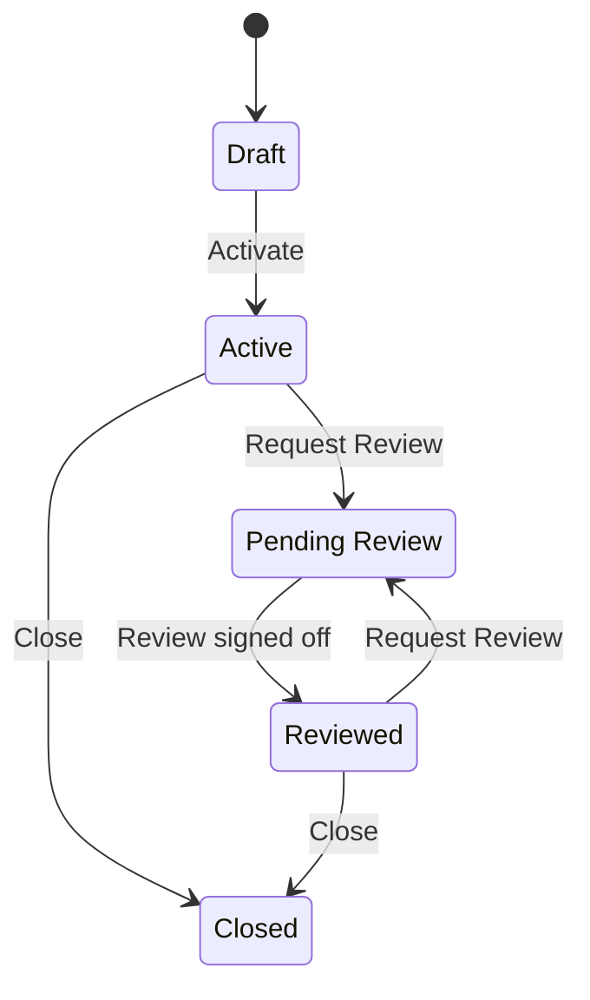

import Illustration from '../../../../components/Illustration.astro';

A **target** is one thing a person is measured on in a period, such as *Grow qualified pipeline to KES 30,000,000* or *Answer support tickets within 24 hours*. Each target belongs to one employee and sits under one [objective](/accountability/concepts/periods-and-objectives/). Together, a person's targets make up their scorecard.

Every target has a **Review Cadence** (**Daily**, **Weekly**, **Monthly**, **Quarterly**, **Semi-Annual** or **Annual**). It decides how often the target is reviewed and which month, quarter or other window each review covers. It also has a **Weight** that says how much it counts against the person's other targets. See [Weights, share of score and priorities](/accountability/concepts/weights-and-share-of-score/).

You see your own targets under **Accountability › My Performance › My Targets**. Line managers see their team's under **My Team › Set targets › Team Targets**.

<Illustration name="accountability/concept-target-form" caption="A target form. The numbers match the list below." />

1. **Status** — where the target is in its life (see below).
2. **Assignment** — the **Employee**, the **Objective**, the **Period** and the **Weight**.
3. **Target Type** — how it is measured and scored.
4. **Share of Score** — how much of the person's score this target carries.
5. **Data Source** — the **Metric** that fetches the result, or blank (*Entered manually*).
6. **Progress** — the latest **Actual Value** and the **Score (%)**.

## The three kinds of target

| Target Type | Use it for | What you set | How it scores |
|---|---|---|---|
| **Quantitative** | A number to reach: revenue, visits, awards. | **Target Value**, **Unit**, **Direction** (**Higher is Better** or **Lower is Better**). | The actual against the target value, up to 100%. |
| **Threshold / SLA** | A service level to stay within: response time, compliance rate. | **SLA Direction**, **Compliance Floor**, **Ideal Target (Full Credit)**, and **Upper Bound** for a range. | Each review is scored on the band. The target's score is the average of its signed-off reviews. |
| **Milestone / Task** | Dated stages to deliver: a rollout, a policy, a certification. | **Scoring Mode**, **Start** and **End** dates, and the stages. | From the confirmed stages, or the manager's **Supervisor Score (0–100)**. |

**SLA Direction** has three options: **At or above floor (quality SLA)**, **At or below ceiling (cost / time SLA)** and **Within range (band compliance)**. **Scoring Mode** for milestone targets is **Weighted milestones (partial credit)**, **Binary — done / not done** or **Supervisor assessment (0–100)**. The exact sums are in [How a target's score is calculated](/accountability/calculations/target-scores/) and [How a milestone target is scored](/accountability/calculations/milestone-scores/).

### Milestone stages

A milestone target lists its stages, each with a **Start**, a **Due** date and a **Weight (%)**. On weighted targets the stage weights must add up to 100 before the target can be activated. The owner clicks **Mark Done** when a stage is finished. The stage then waits as **Awaiting Confirmation** until their manager clicks **Confirm** (or **Send Back**). Only **Confirmed** stages count towards the score.

## Manual or metric-driven

A target gets its result in one of two ways:

- **Entered manually.** The **Metric** field is blank. The manager types the actual when reviewing.
- **Metric-driven.** An administrator attaches a **Metric** that reads the figure from Odoo, for example from CRM or the Tender Tracker. You see a provisional **Current value** that refreshes every night. A review can fetch the value, and the system can create the review for the manager to confirm. See [Metrics: targets that update themselves](/accountability/concepts/metrics/).

Either way, a result only counts once a review records it. Milestone targets never use a metric: their result comes from the stages.

## Statuses

| Status | What it means |
|---|---|
| **Draft** | Being set up. It doesn't count yet. Staff can create their own drafts with **+ New Target** on My Targets; their manager gets an *Activate Target* to-do. |
| **Active** | Live on the scorecard. |
| **Pending Review** | Someone clicked **Request Review**. The manager is asked to review it. |
| **Reviewed** | A review has been signed off. The latest result is on the target. |
| **Closed** | Finished. It still counts up to the date it was closed if it has a result. |

**Activate** and **Close** don't change the target straight away. They open a short form that records the reason: a scorecard change. Before the period's **Target-Setting Deadline** the change applies at once. After it, the change waits for approval. The full rules are in the [target workflow](/accountability/workflows/target/).

**Late Set** marks a target created after the period's target-setting deadline. It is a flag for reporting; the target scores in the normal way.

:::note[Good to know]
- For **At or below ceiling (cost / time SLA)**, enter your upper limit in the field labelled **Compliance Floor**. Anything above it scores 0.
- Scores stop at 100%. Beating a target by a wide margin gives the same score as meeting it.
- SLA results can't be typed onto the target. They come only from reviews.
:::

## Tasks that use this

- [Check my targets](/accountability/how-to/everyone/my-targets/)
- [Update a milestone](/accountability/how-to/everyone/update-a-milestone/)
- [Set targets for my team](/accountability/how-to/line-managers/set-team-targets/)
- [Set milestone dates and confirm milestones](/accountability/how-to/line-managers/milestone-dates-and-confirmations/)
- [Withdraw a target](/accountability/how-to/line-managers/withdraw-a-target/)
- [Request a scorecard change](/accountability/how-to/line-managers/request-a-scorecard-change/)
