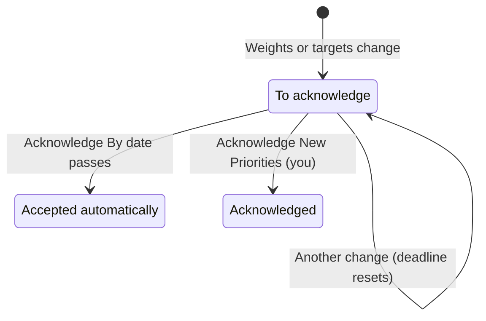

import Illustration from '../../../../components/Illustration.astro';

Each target has a **Weight**: a plain number that says how important it is compared with your other targets. A target with weight 2 counts twice as much as one with weight 1. Only the proportions matter, so weights 3, 2 and 1 give the same result as 6, 4 and 2.

Your **share of score** is what the weight means in practice: the percentage of your score that this target carries. With weights 3, 2 and 1 on three live targets, the shares from today are 50%, 33.3% and 16.7%.

## Two shares: from today, and for the whole period

Weights can change during the year, and targets can be added or withdrawn. So the system shows two figures:

- **Share From Today (%)** — what the target carries from today on, with today's weights. This is the figure in **Share of Score** on the target and in **Rebalance Weights**.
- **Share of Score (%)** — what it carries in the score for the period as a whole. It counts each weight for the days it was in force. A target added in October, or one that had a lower weight until June, carries less for the year than its weight today suggests.

<Illustration name="accountability/concept-share-of-score" caption="Weight and share of score on a target. The numbers match the list below." />

1. **Weight** — today's weight. On a draft you can type it. On a live target it can only be changed through **Rebalance Weights**.
2. **Rebalance Weights** — opens the drag tool where a manager sets everyone's shares from today. The shares must add up to 100%, each target needs at least 1%, and a reason is required. **Withdraw** takes the target off the scorecard from a date.
3. **Share of Score** — the share from today, the weight out of the total, and the target's rank (**#2 of 5**). A draft shows *Draft: counts once activated*. A withdrawn or closed target shows *No longer counts from* a date.
4. **The hint** — the share for the whole period, and how many points a 10-point gain on this target adds to your score. For a manager it also says how much that adds to the overall score.

The coloured bar under the share shows all your targets side by side, coloured by objective. Hatched parts are targets that have no result yet.

## Where weights come from

- A new target starts at the average weight of your live targets under the same objective, so it sits level with them. If you have none there, it starts at the objective's **Default Weight for New Targets**.
- Your manager sets the weights. On a draft they type it. Once the target is live they use **Rebalance Weights**.
- When a target is added, withdrawn or closed part-way through the period, the manager sees a **New Balance** window, or gets a *Review the Balance* to-do. They choose **Keep as is** or rebalance.
- Every change is kept in the target's **Weight History**: what changed, from when, the reason, and the score before and after. Nobody can edit or delete it.

## New priorities to acknowledge

When your weights change, or a target is added, withdrawn, closed or changed after the period has started, your priorities have changed. The system groups these changes into one **Priority Change** and asks you to acknowledge it: *Your priorities changed: please acknowledge.*

The **Acknowledge By** date is 5 days away by default and moves on each time something else changes. **What Changed** lists the changes and **Your Score Now** shows the result. Acknowledging doesn't change any figures. It records that you have seen the new balance.

:::note[Good to know]
A live target with no result yet still shows its share of score, but it adds nothing to your score until a value is in. The hint says *Not scored yet: it carries its share once a value is in.* Until then, your score is worked out from the targets that do have results.
:::

## Tasks that use this

- [Acknowledge new priorities](/accountability/how-to/everyone/acknowledge-new-priorities/)
- [Rebalance weights](/accountability/how-to/line-managers/rebalance-weights/)
- [Withdraw a target](/accountability/how-to/line-managers/withdraw-a-target/)
- [Time-weighted weights](/accountability/calculations/weights-over-time/) and [Share of score](/accountability/calculations/share-of-score/)
