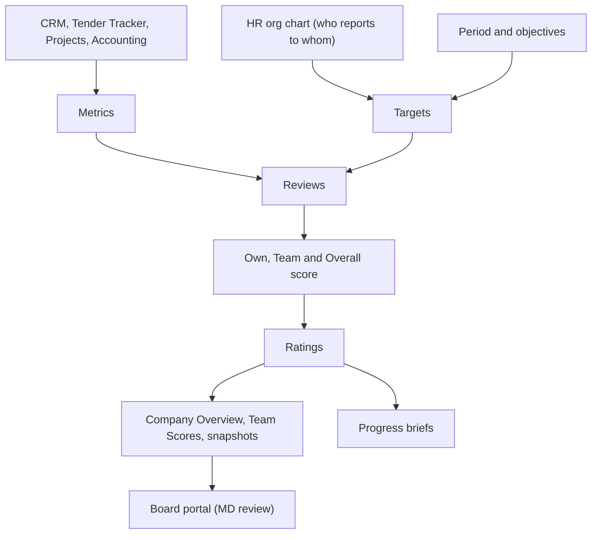
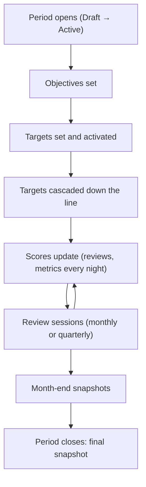

The **Accountability Framework** is how Tritel sets, tracks and reviews everyone's performance in Odoo. Each year has a **period** (for example FY 2026). Inside it, leadership sets **objectives**, and every member of staff holds **targets** under those objectives. Managers pass targets down the reporting line, results are recorded in **reviews**, and each person gets a **score** and a **rating**.

You find it in the **Accountability** app. Which menus you see depends on your role. Everyone has **Company Overview** (where the company stands today; the app opens on it), **My Performance** (your own targets, reviews and score history, and progress briefs once they are switched on) and **My Actions** (everything waiting for you). Line managers also get **My Team**, HR gets **People** (the whole company's reviews, scores and changes), and both get **Organisation**: line managers see objectives and review coverage; HR sees review coverage, compliance and the targets library. Accountability administrators also get **Configuration** (periods, metrics and settings). See [Accountability menus](/accountability/menus/) for the full list by role. You can also follow your own figures on the portal at **/my/performance**.

## How the parts fit together

Most figures come from the work you already record in Odoo. A **metric** reads them and proposes the result for a target. Reviews make the result official. Scores, ratings and reports are worked out from the reviewed results.

- The **org chart** in the Employees app decides who your manager is, who sees your figures and who reviews you. Nobody hands out access by hand, except the accountability administrators.
- **Metrics** read CRM opportunities, tenders, projects, invoices and the reviews themselves. See [Metrics](/accountability/concepts/metrics/).
- **Reviews** record a result for a target over a month, quarter or other window. See [Reviews, review sessions and review packs](/accountability/concepts/reviews/).
- **Scores** and **ratings** are worked out every night, and straight away when a review is signed off. See [Own, Team and Overall score](/accountability/concepts/scores/) and [Ratings and progress briefs](/accountability/concepts/ratings-and-briefs/).

## Who uses it

| Who | What they do |
|---|---|
| **Everyone** | Checks their targets, marks milestone stages done, acknowledges new priorities, responds to reviews. |
| **Line managers** (anyone with at least one person reporting to them) | Set and activate their team's targets, pass targets down, rebalance weights, run review sessions, confirm milestones, watch Team Scores. This access comes automatically from the org chart. |
| **HR** | Exempts staff, keeps the targets library, approves scorecard changes, decides escalated reviews, and follows everyone's reviews and scores under **People**. |
| **Accountability administrators** | Open and close periods, set up metrics and settings, fix access. This role is given by hand. |
| **MD and board** | The MD is reviewed each quarter by a named board member on the board portal. |

## The year in one picture

1. **The period opens.** An administrator creates the period, sets its **Target-Setting Deadline** and activates it. Only one period is active at a time. See [Periods and objectives](/accountability/concepts/periods-and-objectives/).
2. **Objectives are set.** Leadership agrees the objective tree. Last year's objectives can be copied across.
3. **Targets are set.** Managers create and activate targets for their team. Up to the deadline, changes take effect at once. After it, each change needs approval. See [Targets](/accountability/concepts/targets/).
4. **Targets are cascaded.** Managers push parts of their targets to their reports, who adopt or decline them. See [Cascading targets](/accountability/concepts/cascading/).
5. **Scores update all year.** Every signed-off review, confirmed milestone and weight change moves the score. Metric targets also show a provisional value that refreshes every night.
6. **Review sessions run.** Each month or quarter, managers review their direct reports in one session. Each person gets a review to acknowledge or question.
7. **Snapshots are taken.** Shortly after each month end the system freezes everyone's position, so it can be compared later. See [Snapshots and "as at" figures](/accountability/concepts/snapshots-and-as-at/).
8. **The period closes.** An administrator closes it. Everyone's final snapshot is frozen as at the last day, and any open scorecard change requests are cancelled.

## Where to start

| You are | Start here |
|---|---|
| Any member of staff | [Everyone](/roles/everyone/) |
| A line manager or head of department | [Line managers](/roles/line-managers/) |
| An account manager, Bid Liaison or Head of Commercial | [Commercial](/roles/commercial/) |
| In Technical Presales or Channel | [Channel](/roles/channel/) |
| A project manager or Head of Delivery | [Delivery](/roles/delivery/) |
| In Finance & Accounts | [Finance and Accounts](/roles/finance-and-accounts/) |
| In HR, or an accountability administrator | [HR](/roles/hr/) |
| The MD or a board member | [MD and board](/roles/md-and-board/) |

The [glossary](/reference/glossary/) explains every term used in this section.
