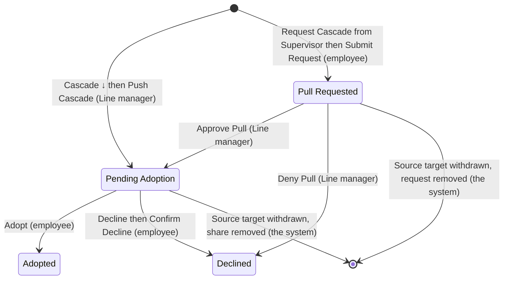

**Cascading** passes part of a manager's target down to the people in their team. A manager can **push** a share down, or a team member can **pull** one up by asking for it. Either way, the team member gets a new target of their own (a "share"), which starts as a draft. Its **Cascade Status** tracks where the hand-over has got to.

| Status | What it means | Moves to | Who moves it |
|---|---|---|---|
| **Not Cascaded** | An ordinary target that didn't come from a cascade. | — | — |
| **Pull Requested** | A team member asked for part of their manager's live target. The share exists as a draft and waits for the manager. | **Pending Adoption** with **Approve Pull** (or **Approve** in My Actions); **Declined** with **Deny Pull** (or **Deny**) | Line manager who owns the source target |
| **Pending Adoption** | The manager pushed a share down, or approved a pull. The share is a draft until the team member accepts it. | **Adopted** with **Adopt**; **Declined** with **Decline**, then **Confirm Decline** | The team member who received it |
| **Adopted** | Accepted. The share is now **Active** on the team member's scorecard. | — | — |
| **Declined** | Turned down, with a reason, or a pull request that was denied. The share stays a draft and doesn't count. | — (the manager can push again) | — |

## What the system does automatically

- **Push:** the team member gets an **Adopt Cascade** to-do and a notice. The to-do is due after the **Cascade Action Deadline (days)** setting (3 days by default).
- **Pull request:** the manager gets a **Review Pull Request** to-do. When they approve it, the team member gets an **Adopt Cascade** to-do.
- **Adopt:** the share becomes **Active**, and the source owner gets a message. If the period has started and the team member now has two or more live targets, their manager is asked to review the balance of weights.
- **Adopt after the target-setting deadline:** adopting becomes a scorecard change of the kind **Adopt a cascade**, which is sent for approval. The share stays **Pending Adoption** until it is approved. See the [scorecard change request workflow](/accountability/workflows/scorecard-change-request/).
- **Decline:** the reason is posted on the source target, and the source owner gets a **Resolve Declined Cascade** to-do. Pushing to the same person again closes that to-do.
- **Push again to someone who already holds a share:** the existing share is topped up instead of creating a second one. If the share is already live, the top-up goes through a scorecard change request.
- **Reminders:** every day, shares that have waited longer than the **Cascade Reminder Interval (days)** setting (3 by default; 0 switches it off) get a reminder. The team member is reminded to adopt or decline; the manager is reminded about pull requests. Each item is reminded at most once per interval. Managers can also remind people themselves: **Remind** in **My Actions**, **Send Reminder** on **Compliance** (administrators), or **Remind All** on **Cascade Management**.
- **Source target withdrawn:** shares still waiting (pending adoption or pull requested, with no reviews) are removed, and the team member is told.

:::note[Good to know]
**Adopt** and **Decline** are shown to anyone who can open the share, not only to the person it was cascaded to, and **Approve Pull** and **Deny Pull** to any line manager who can open it. Leave these buttons to the person the share is for, and to the manager who owns the source target.
:::

## Related tasks

- [Push a target down, or approve a pull](/accountability/how-to/line-managers/push-and-pull-targets/)
- [Cascading targets](/accountability/concepts/cascading/)
- [Target workflow](/accountability/workflows/target/)
