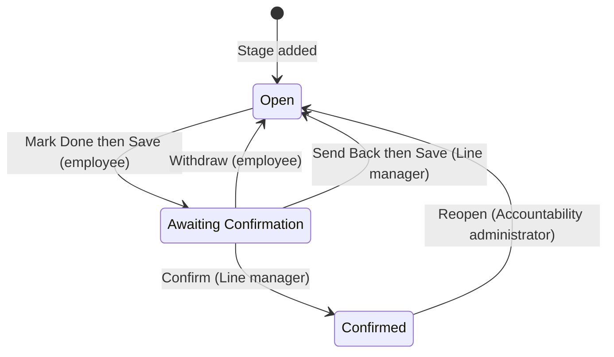

A **milestone target** is split into **stages**, such as "Survey", "Install" and "Handover". The owner marks a stage done, and their manager confirms it. Only **confirmed** stages count towards the score, so a tick on its own never moves the score.

This workflow applies to milestone targets scored as **Weighted milestones (partial credit)** or **Binary — done / not done**, while the target is live and the period is **Active**. Targets scored as **Supervisor assessment (0–100)** are scored by the manager instead.

| Status | What it means | Moves to | Who moves it |
|---|---|---|---|
| **Open** | Not finished yet. If it was sent back, **Sent Back Because** shows the manager's reason. | **Awaiting Confirmation** with **Mark Done** | The target's owner |
| **Awaiting Confirmation** | The owner says it is finished, on the **Completed On** date they gave. It doesn't count yet. | **Confirmed** with **Confirm**; **Open** with **Send Back** (manager) or **Withdraw** (owner) | Line manager (the owner's manager); the owner |
| **Confirmed** | Accepted. The stage counts towards the score from now on, and it can no longer be edited. | **Open** with **Reopen** | Accountability administrator |

Who confirms: the owner's manager. If the manager has no active user account, any accountability administrator can confirm. The owner can never confirm their own stage.

## What the system does automatically

- **Mark Done:** the date you enter can't be in the future (*The completed date can't be in the future.*). The confirmer gets one **Confirm Milestone Stage** to-do for the target while any stage is waiting. It closes when nothing is waiting any more.
- **Confirm:** the score is recalculated straight away, and the owner gets a notice: *Your stage Install on Customer A rollout has been confirmed.*
- **Send Back:** a reason is required. The owner gets a notice with it, and the stage is **Open** again.
- **Reopen:** asks *Undo this confirmation? The stage stops counting towards the score.* The score is recalculated.
- **Reminders** (daily, fixed, not a setting): the owner is reminded 7, 3 and 1 days before an open stage is due. Once a stage is overdue, the owner and their manager are told 1 day after the due date and then every 7 days (day 1, 8, 15 and so on).
- **Timing** on each stage reads, for example, **Due in 3 day(s)**, **Overdue by 2 day(s)** or **Completed 4 day(s) late**. A stage counts as **Due Soon** within 7 days of its due date.

:::note[Good to know]
Once the period is closed, or the target is no longer live, stages can't be marked, confirmed or sent back. You see *This stage can't be updated: its target isn't live, or the period is closed.*
:::

## Related tasks

- [Update a milestone](/accountability/how-to/everyone/update-a-milestone/)
- [Set milestone dates and confirm milestones](/accountability/how-to/line-managers/milestone-dates-and-confirmations/)
- [How a milestone target is scored](/accountability/calculations/milestone-scores/)
