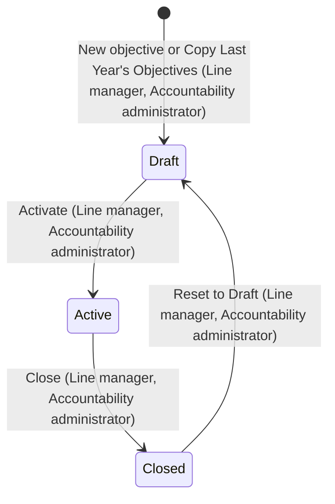

An **objective** is a goal for the period, such as "Grow recurring revenue". Targets sit under objectives, and objectives can have sub-objectives. Each objective has its own status, changed with the buttons at the top of the objective form.

| Status | What it means | Moves to | Who moves it |
|---|---|---|---|
| **Draft** | Being set up. A draft objective is left out of the period's overall objective average. Objectives copied from last year start here. | **Active** with **Activate** | Line manager or accountability administrator |
| **Active** | Live. Its targets count, and its **Org Average (%)** and **Measurement** update as results come in. **Achievement** shows **Not Set**. | **Closed** with **Close** | Line manager or accountability administrator |
| **Closed** | Finished. The system decides its **Achievement** (see below). | **Draft** with **Reset to Draft** | Line manager or accountability administrator |

Everyone else can open objectives but can't change them.

## What the system does automatically

There are no emails or to-dos for objective status changes. What changes is the **Achievement** field:

- While the objective is **Draft** or **Active**, **Achievement** is **Not Set**.
- When it is **Closed**, the system compares its **Org Average (%)** with its **Achievement Threshold (%)** (70 by default):
  - **Achieved**: the average is at or above the threshold. Example: threshold 70, average 74%.
  - **Partial Achievement**: the average is at least three quarters of the threshold. Example: threshold 70, average 55% (the line is 52.5%).
  - **Not Achieved**: below that.
  - **Not Measured**: no target under it has a result yet.
- **Reset to Draft** sets **Achievement** back to **Not Set**.

The full rule, with more examples, is in [Objective achievement](/accountability/calculations/objective-achievement/).

:::note[Good to know]
- The **Activate**, **Close** and **Reset to Draft** buttons work for any line manager on any objective, not only the ones they own. Agree within your department who changes an objective's status.
- Close your objectives **before** the period is closed. Once a period is closed its figures are frozen, so an objective closed afterwards keeps **Achievement** at **Not Set**.
:::

## Related tasks

- [Set up objectives](/accountability/how-to/hr-admin/objectives/)
- [Periods and objectives](/accountability/concepts/periods-and-objectives/)
- [Period workflow](/accountability/workflows/period/)
