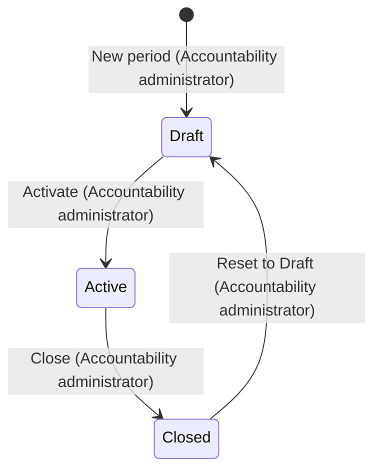

A **period** is the performance year, for example FY 2026. Every objective, target, review and score belongs to one. Only an accountability administrator can open or close a period, in **Accountability › Configuration › Periods**.

Only one period can be **Active** at a time in each company.

| Status | What it means | Moves to | Who moves it |
|---|---|---|---|
| **Draft** | The period is being set up. You can add objectives, for example with **Copy Last Year's Objectives**, and prepare draft targets. Nothing is scored automatically yet. | **Active** with **Activate** | Accountability administrator |
| **Active** | The live year. Scores are recalculated every night, automatic metric reviews run, milestone stages can be marked done and confirmed, and progress briefs and month-end snapshots are made. | **Closed** with **Close** | Accountability administrator |
| **Closed** | The year is finished. Scorecards can no longer change, and the figures recorded for the period are kept as they are. | **Draft** with **Reset to Draft** | Accountability administrator |

## What the system does automatically

- **When you click Activate:** the system checks that no other period is active in the company. If one is, you see *Only one period can be active at a time per company. "FY 2025" is currently active.* Close the old period first.
- **While the period is Active:** a daily job recalculates every score and rating, sends review reminders and signs off overdue reviews. A nightly job creates automatic reviews for targets that update themselves.
- **When you click Close:**
  - Every scorecard change request still open in the period (draft, proposed or waiting for approval) is cancelled. The people who raised it, and the approvers, get a message saying the period was closed before the change was decided.
  - The system freezes a final performance snapshot for everyone with targets in the period, as at the period's last day.
  - From then on, any attempt to change a scorecard shows *FY 2026 is closed: withdrawing a target is no longer possible for 'Grow qualified pipeline'.* (the wording changes with the action).
- **Copy Last Year's Objectives** (accountability administrators and HR) copies the previous period's objectives as drafts. Running it again only adds what is missing. The button is hidden once the period is closed.

:::note[Good to know]
- **Close** acts at once. There is no "are you sure?" question, so check the period name before you click it.
- **Reset to Draft** puts a closed period back to **Draft**, not **Active**. Change requests that were cancelled when it closed stay cancelled, and the final snapshots stay as they were taken.
- Close each objective before you close the period. An objective's **Achievement** is worked out when the objective closes, and the figures of a closed period are frozen. See the [objective workflow](/accountability/workflows/objective/).
:::

## Related tasks

- [Open and close a period](/accountability/how-to/hr-admin/open-and-close-periods/)
- [Set up objectives](/accountability/how-to/hr-admin/objectives/)
- [Periods and objectives](/accountability/concepts/periods-and-objectives/)
- [Snapshots and "as at" figures](/accountability/concepts/snapshots-and-as-at/)
