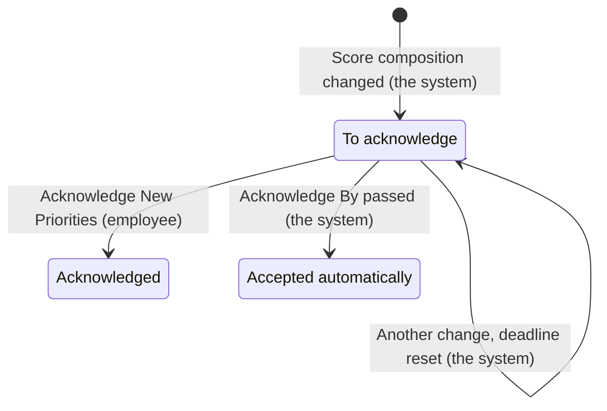

Your **priorities** are how much each of your targets counts towards your score (its share of score). When they change during the period, for example because your manager rebalanced your weights or a target was added or withdrawn, the system opens a **Priority Change** for you to read and acknowledge. It shows **What Changed** and **Your Score Now**. Your past reviews are never affected: they keep the weights they were submitted with.

| Status | What it means | Moves to | Who moves it |
|---|---|---|---|
| **To acknowledge** | Your score composition changed. Read **What Changed** and acknowledge it by the **Acknowledge By** date. Further changes join the same record. | **Acknowledged** with **Acknowledge New Priorities** (or **Acknowledge** in My Actions); **Accepted automatically** after the deadline | The employee only; the system |
| **Acknowledged** | You confirmed you have seen the new priorities. | — | — |
| **Accepted automatically** | Nobody acknowledged it by the deadline, so the system accepted it. | — | — |

Your manager and HR can see your priority changes in **Accountability › My Team › Priority Changes**, but only you can acknowledge them.

## What the system does automatically

- **What opens one:** a change to how your live targets count: a weight changed with **Rebalance Weights**, a target withdrawn, a target's value changed through a [scorecard change request](/accountability/workflows/scorecard-change-request/), and, once the period has started, a target added, closed or fully cascaded to the team.
- **One open record per person and period:** if you already have one **To acknowledge**, new changes are added to it instead of opening another.
- **Deadline:** **Acknowledge By** is today plus the **Acknowledgment Window (days)** setting (5 days by default; the same setting as for reviews). It is reset every time another change is added.
- **Messages:** you and your manager get *Your priorities changed: please acknowledge.* with the list of changes, the reason and the deadline. You also get an **Acknowledge your new priorities** to-do, due on the deadline.
- **Reminders:** there is no automatic reminder. Your manager (or an accountability administrator) can click **Remind** on the item in **My Actions**, which sends you *Reminder from Employee B: please acknowledge your new priorities by 20 Nov 2026 (…).*
- **Automatic acceptance:** the daily job accepts it the day after **Acknowledge By**, and removes your to-do.

:::note[Good to know]
Acknowledging, or being accepted automatically, doesn't change any score. Your scores were already recalculated when the change itself was made. If you think a change is wrong, talk to your manager, or use **Propose a change** on the target.
:::

## Related tasks

- [Acknowledge new priorities](/accountability/how-to/everyone/acknowledge-new-priorities/)
- [Rebalance weights](/accountability/how-to/line-managers/rebalance-weights/)
- [Weights, share of score and priorities](/accountability/concepts/weights-and-share-of-score/)
