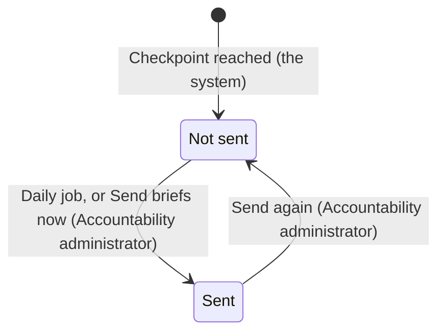

A **progress brief** is a short email that tells an employee how their running-total targets are pacing at a checkpoint (a month end or a quarter end): the actual, what was expected by then, the gap, the rating on pace and where that pace leads by the end of the period. Their manager is copied. Each brief has a simple status: **Not sent** or **Sent**.

Briefs are switched off until an accountability administrator turns on **Send progress briefs** in **Accountability › Organisation › Settings**.

| Status | What it means | Moves to | Who moves it |
|---|---|---|---|
| **Not sent** | The brief has been written but not emailed. In practice this lasts only a moment: the system sends a brief as soon as it creates it. | **Sent** | The system (daily job), or an accountability administrator with **Send briefs now** |
| **Sent** | Emailed to the employee and copied to their manager. **Sent On** shows when. | **Sent** again with **Send again** (it passes through **Not sent** and is emailed straight away) | Accountability administrator |

## What the system does automatically

- **Checkpoints:** the **Brief checkpoints** setting is **Monthly** (month ends) or **Quarterly** (quarter ends counted from the period start). The default is **Monthly**.
- **Daily job:** when briefs are switched on, it looks at the latest checkpoint of each active period. If that checkpoint was in the last 7 days, it writes and sends a brief for every employee who has running-total targets and isn't exempt on that date. The 7 days are fixed, not a setting.
- **One brief per checkpoint:** each employee gets at most one brief per checkpoint. Anyone who already has it is skipped.
- **Sending:** an email *Your progress brief · as at 31 Oct 2026* goes to the employee's work email with the manager's work email in copy, and both get a notification in their Odoo inbox.
- **Who can read briefs:** the employee and their manager, in **Accountability › My Performance › Progress Briefs**. HR and accountability administrators can read all of them.

:::note[Good to know]
- **Send briefs now** sends the briefs for the latest checkpoint whatever its age, and works even while **Send progress briefs** is switched off.
- **Send again** emails the same brief again. It doesn't recalculate the figures: the brief shows the position as at its checkpoint.
:::

## Related tasks

- [Read my progress briefs and snapshots](/accountability/how-to/everyone/read-briefs-and-snapshots/)
- [Change the Accountability settings](/accountability/how-to/hr-admin/settings/)
- [Ratings and progress briefs](/accountability/concepts/ratings-and-briefs/)
