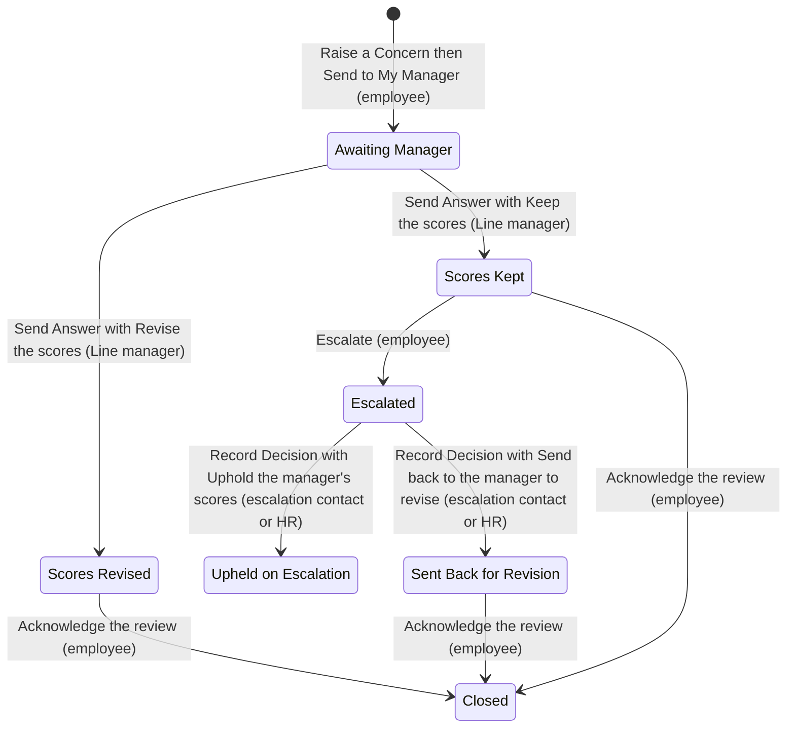
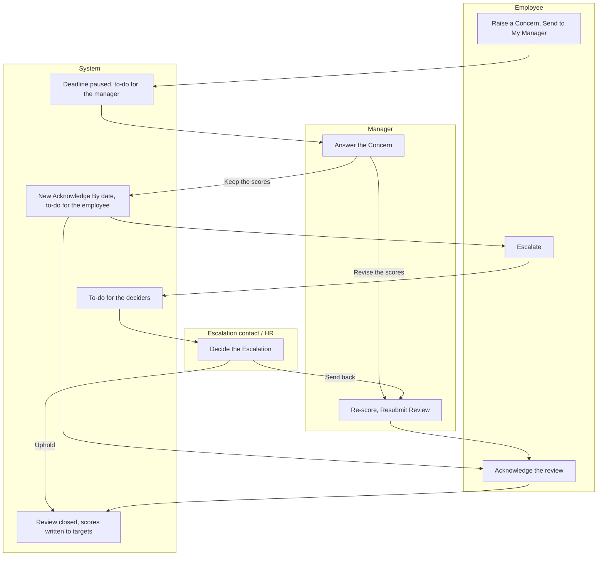

When an employee disagrees with scores in their review, they **raise a concern** about specific targets. The concern is a record of that dispute: what was questioned, the values at the time, the manager's answer and, if it went further, the escalation decision. You find it in the **Concerns** tab of the review. Each concern has its own status, alongside the review's status in the [review pack workflow](/accountability/workflows/review-pack/).

| Status | What it means | Moves to | Who moves it |
|---|---|---|---|
| **Awaiting Manager** | The employee ticked the targets they question and explained why. **Values When Raised** keeps each target's actual and score at that moment. | **Scores Revised** or **Scores Kept** with **Answer the Concern**, then **Send Answer** | Line manager (the reviewer) or accountability administrator |
| **Scores Revised** | The manager agreed to look again. The questioned targets are reopened for re-scoring, and the review is resubmitted to the employee. | **Closed** when the employee acknowledges the review | Employee |
| **Scores Kept** | The manager kept the scores and replied (**Manager's Reply**). | **Escalated** with **Escalate**; **Closed** when the employee acknowledges | Employee |
| **Escalated** | The employee asked for a decision. **Escalated To** shows who decides. | **Upheld on Escalation** or **Sent Back for Revision** with **Decide the Escalation**, then **Record Decision** | The people it was escalated to, HR, or an accountability administrator |
| **Upheld on Escalation** | The decider kept the manager's scores. The review closes (**Closed after Escalation**). | — | — |
| **Sent Back for Revision** | The decider sent the review back to the manager to re-score. | **Closed** when the employee acknowledges the revised review | Employee |
| **Closed** | The employee acknowledged the review after the answer or decision. | — | — |

## Who does what

## What the system does automatically

- **Raise a Concern:** only targets still awaiting acknowledgment can be ticked (*Choose at least one target that is awaiting your acknowledgment.*). The review's deadline is removed, and the reviewer gets a note and an **Answer review concern** to-do, due in 3 days.
- **Revise the scores:** the reviews of the questioned targets are withdrawn and those lines go back to **Pending**. Only they can be edited. The employee is told the manager will revise. When the manager clicks **Resubmit Review**, the employee gets a new **Acknowledge By** date and a new to-do.
- **Keep the scores:** the employee gets the reply, a new **Acknowledge By** date (today plus the **Acknowledgment Window (days)** setting, 5 by default) and a **Respond to kept scores** to-do.
- **Escalate:** the decider is the reviewer's own manager. If there is none, it is the **Review Escalation Contacts** named in the settings, and if there are none, HR. The employee and the reviewer are never deciders. Deciders are added as followers of the review, get a **Decide escalated review** to-do due in 3 days, and stop following once they have decided. If nobody can be found, the employee sees *Nobody is set up to handle escalations. Ask an administrator to set Review escalation contacts in the accountability settings.*
- **Uphold:** the review closes as **Closed after Escalation**. The scores are signed off and written to the targets. Both the employee and the reviewer are told.
- **Send back:** the questioned targets are reopened, and the reviewer gets a **Revise escalated review** to-do.
- **Response (days)** (raised to answered) and **Decision (days)** (escalated to decided) are recorded for reporting.

:::note[Good to know]
- If the employee doesn't respond after **Scores Kept** or **Scores Revised**, the review is signed off automatically after its deadline, but the concern keeps the status it had (**Scores Kept** or **Scores Revised**). It only shows **Closed** when the employee acknowledges.
- After a revised review is resubmitted, the employee can raise a new concern. That starts a new concern record; the earlier one keeps the status **Scores Revised**.
- Only the employee can raise a concern or escalate. Managers, HR and administrators can't do it for them.
:::

## Related tasks

- [Respond to my review](/accountability/how-to/everyone/respond-to-my-review/)
- [Conduct a review](/accountability/how-to/line-managers/conduct-a-review/)
- [Decide scorecard changes and escalations](/accountability/how-to/hr-admin/decide-changes-and-escalations/)
- [Review pack workflow](/accountability/workflows/review-pack/)
