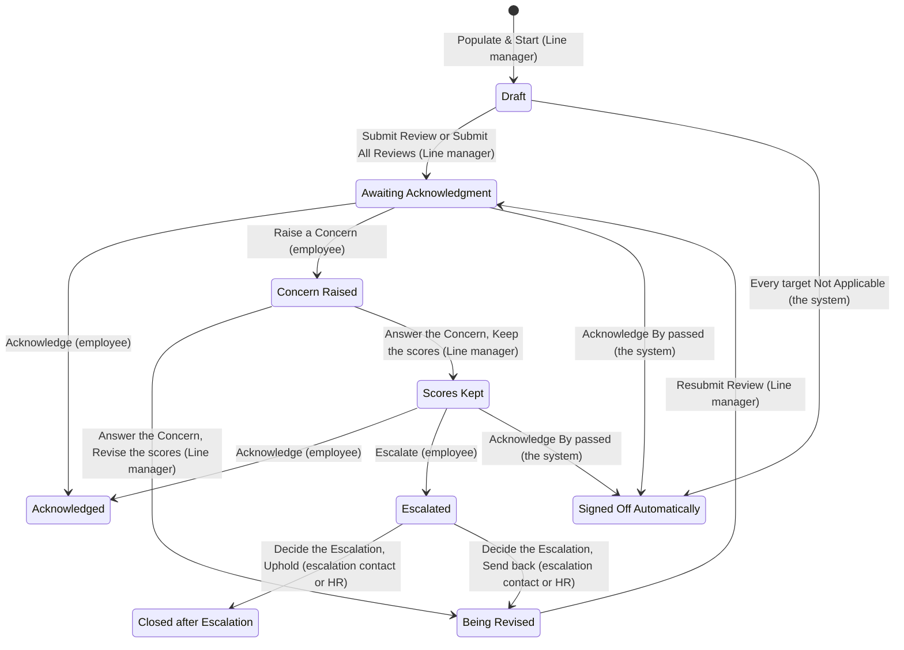
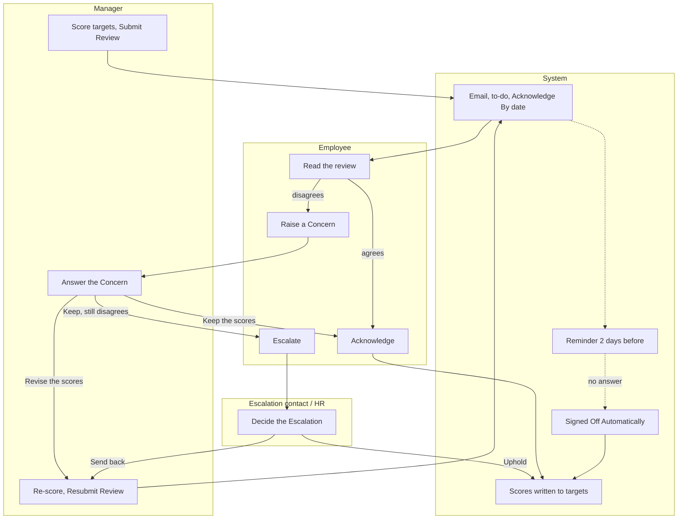

A **review pack** (shown on screen as a **review**) is one employee's results in one review session: every target, its actual, score and rating, and the manager's comment. The manager scores and submits it; the employee acknowledges it or raises a concern. If they still disagree after the manager answers, they can escalate it for a decision. The deadline is always the **Acknowledge By** date on the review.

| Status | What it means | Moves to | Who moves it |
|---|---|---|---|
| **Draft** | The manager is scoring the targets. The employee can't see it yet. | **Awaiting Acknowledgment** with **Submit Review** (or the session's **Submit All Reviews**); **Signed Off Automatically** if every target is not applicable | Line manager (the session's reviewer); the system |
| **Awaiting Acknowledgment** | Submitted. The employee has until **Acknowledge By** to respond. | **Acknowledged** with **Acknowledge**; **Concern Raised** with **Raise a Concern**; **Signed Off Automatically** after the deadline | Employee; the system |
| **Concern Raised** | The employee questioned some targets. The deadline is paused. | **Being Revised** or **Scores Kept** with **Answer the Concern** | Line manager (the reviewer) or accountability administrator |
| **Being Revised** | The manager is re-scoring the questioned targets. Only those lines can be edited. | **Awaiting Acknowledgment** with **Resubmit Review** | Line manager (the reviewer) |
| **Scores Kept** | The manager kept the scores and replied. A new **Acknowledge By** date is set. | **Acknowledged** with **Acknowledge**; **Escalated** with **Escalate**; **Signed Off Automatically** after the deadline | Employee; the system |
| **Escalated** | The employee asked for a decision. The deadline is paused. | **Closed after Escalation** (uphold) or **Being Revised** (send back) with **Decide the Escalation** | The people it was escalated to, HR, or an accountability administrator |
| **Acknowledged** | Closed by the employee. | — | — |
| **Signed Off Automatically** | Closed by the system because the deadline passed, or because there was nothing to acknowledge. | — | — |
| **Closed after Escalation** | Closed because the escalation upheld the manager's scores. | — | — |

In all three closed statuses the reviews are signed off: each target's actual is written to the target and the scores are recalculated.

Only the employee can **Raise a Concern** or **Escalate**. Accountability administrators can also **Acknowledge** on the employee's behalf. The employee can do all three on the portal too, at **/my/performance/reviews**.

## Who does what

## What the system does automatically

- **Submit Review** refuses while any target line is still **Pending**: *Employee A: 1 target(s) are still pending. Enter a value (or press Done to accept 0), skip them or mark them not applicable before submitting:* followed by the list of targets. On submit, each target's weight is locked as **Weight as Submitted**, so later weight changes don't move the review.
- **On submit:** the employee gets a message with a portal link (*Your review is ready: …*) and an **Acknowledge your review** to-do due on the **Acknowledge By** date. That date is today plus the **Acknowledgment Window (days)** setting, 5 days by default.
- **Reminder:** 2 days before **Acknowledge By**, the daily job reminds the employee once. Managers can send one any time with **Send Reminder** on the review, or **Remind** on the **Team Reviews** board. The 2 days are fixed.
- **Automatic sign-off:** the day after **Acknowledge By**, the daily job signs the review off (**Signed Off Automatically**). This applies in **Awaiting Acknowledgment** and **Scores Kept** only. While a concern or escalation is open there is no deadline.
- **Concern raised:** the reviewer gets an **Answer review concern** to-do, due in 3 days.
- **Scores kept:** a new **Acknowledge By** date (today plus the window) and a **Respond to kept scores** to-do for the employee.
- **Revised and resubmitted:** the employee gets *Your review was revised…*, a new window and a new to-do.
- **Escalated:** it goes to the reviewer's own manager. If there is none, it goes to the **Review Escalation Contacts** in the settings, and if there are none, to HR. The employee and the reviewer are never the deciders. Each decider gets a **Decide escalated review** to-do, due in 3 days.
- **Sent back after escalation:** the reviewer gets a **Revise escalated review** to-do.
- **Closed:** the reviewer is told when the employee acknowledges or the system signs off.

### Target lines inside a review

Each target in a review has its own line status while the manager scores:

| Line status | What it means | Moves to | Who moves it |
|---|---|---|---|
| **Pending** | Not scored yet. If submitted like this it would count as 0%, so submitting is blocked. | **Done** by entering an **Actual**, by **Fetch** or by the tick (to accept 0); **Not Applicable** when **Fetch** finds nothing to measure; **Skipped** with **Skip** | Line manager (the reviewer) |
| **Done** | Scored. Counts in the review average. | **Pending** with **Reopen** (while the review is a draft), or when a concern reopens it | Line manager; the system |
| **Not Applicable** | Nothing to measure in this window. Left out of every average. | **Pending** with **Reopen** | Line manager |
| **Skipped** | Left out of this review on purpose. Left out of the average. | **Pending** with **Reopen** | Line manager |

:::note[Good to know]
- Only one concern can be open at a time, and **Escalate** appears only after the manager has kept the scores.
- HR and accountability administrators can decide any escalation, even when they weren't the person it was sent to.
- The pack shows **Waiting On** (**Reviewer's Move**, **Employee's Move**, **With Escalation** or **Closed**) and an **Age** band: **Fresh** under 3 days in a step, **Ageing** from 3 days, **Stale** from 6 days. These bands are fixed.
:::

## Related tasks

- [Respond to my review](/accountability/how-to/everyone/respond-to-my-review/)
- [Conduct a review](/accountability/how-to/line-managers/conduct-a-review/)
- [Track reviews on the Team Reviews board](/accountability/how-to/line-managers/team-reviews-board/)
- [Decide scorecard changes and escalations](/accountability/how-to/hr-admin/decide-changes-and-escalations/)
- [Review concern workflow](/accountability/workflows/review-concern/)
- [Review and session averages](/accountability/calculations/review-averages/)
