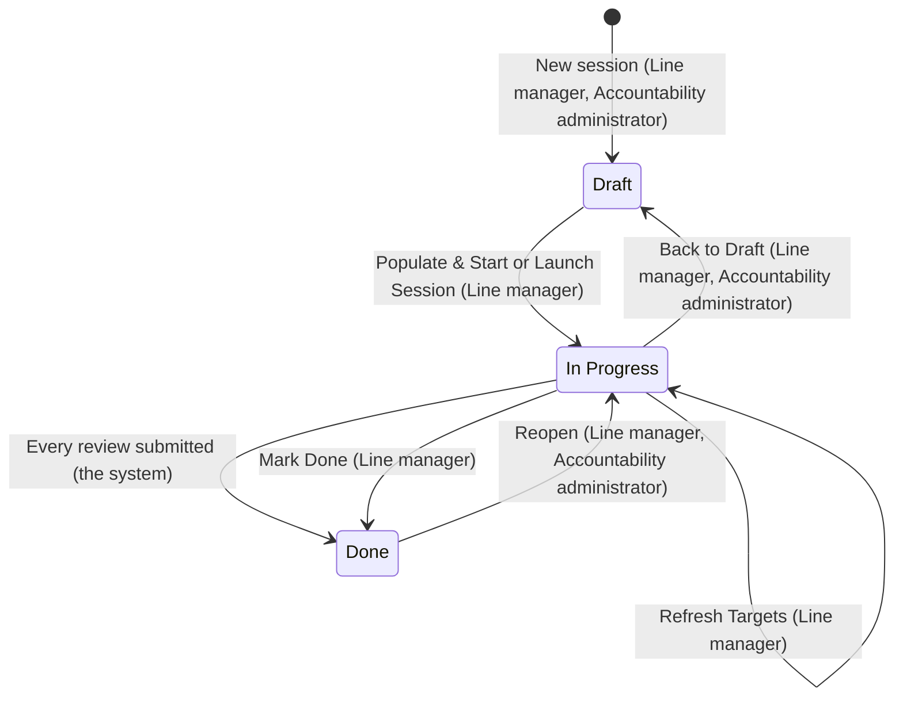

A **review session** is a manager's batch review of their direct reports for one review window, for example "Sep 2026 — Monthly Review". It holds one **review** (review pack) per employee, and each review lists that employee's targets at the session's cadence or finer. The session's status tells you whether it is being set up, being worked on, or finished.

Line managers run sessions for their own direct reports in **Accountability › My Team › Review Sessions**. Accountability administrators can run one for any reviewer. HR can open every session but can't change them.

| Status | What it means | Moves to | Who moves it |
|---|---|---|---|
| **Draft** | Being set up: **Review Cadence**, **Review Cutoff** and **Scope** can still change. | **In Progress** with **Populate & Start** (loads every eligible target) or **Launch Session** (loads nothing yet) | The reviewer (line manager) or an accountability administrator |
| **In Progress** | The reviewer is scoring targets and submitting reviews. **Refresh Targets** adds targets that became eligible; it never changes lines already scored. | **Done** automatically once every review with targets is submitted, or with **Mark Done**; **Draft** with **Back to Draft** | The system; the reviewer or an accountability administrator |
| **Done** | Finished. **Completed On** is stamped. | **In Progress** with **Reopen** | The reviewer or an accountability administrator |

## What the system does automatically

- **Submitting reviews:** **Submit All Reviews** submits every review whose targets are all scored and lists the ones still blocked by pending targets. You can also submit one employee at a time with **Submit Review** on their review. When the last review with targets is submitted, the session moves to **Done** by itself. What happens to each review then is in the [review pack workflow](/accountability/workflows/review-pack/).
- **Late:** a session that isn't **Done** more than 7 days after its **Review Cutoff** is marked **Late**, with **Days Late** counted from the cutoff. The 7 days are fixed, not a setting. **Session Coverage** counts a window as "run on time" only when its session was **Done** within 7 days of the cutoff.
- **Back to Draft** asks for confirmation, then removes lines for people outside your direct reports and lines not yet scored (**Refresh Targets** adds them back). Scored lines are kept.
- **Changing the cutoff or cadence of a draft session** clears the figures on lines already scored, because they described the old window. A note on the session records it.
- **Back to Draft** and **Reopen** are refused once any review has been created from the session: *2 review(s) from this session have already been created (2 pending acknowledgment). A session can only be moved back while nothing has been finalised.*

:::note[Good to know]
**Mark Done** closes the session at once, with no checks. Reviews still in **Draft** stay in **Draft**, and those employees are not notified. To send everyone their review, use **Submit All Reviews** instead: the session closes itself when the last review goes out.
:::

## Related tasks

- [Plan a review session](/accountability/how-to/line-managers/plan-a-review-session/)
- [Conduct a review](/accountability/how-to/line-managers/conduct-a-review/)
- [Track reviews on the Team Reviews board](/accountability/how-to/line-managers/team-reviews-board/)
- [Session Coverage](/accountability/reports/session-coverage/)
