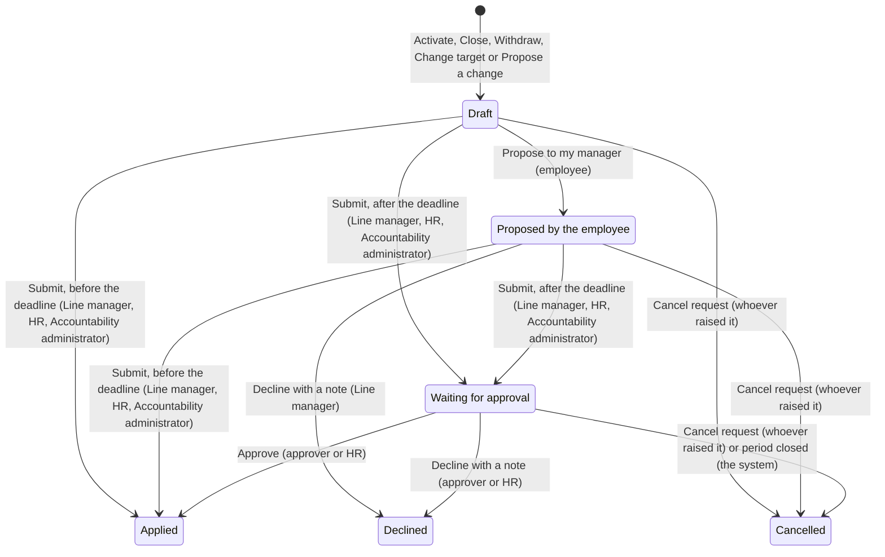

Once a target is live, its value, thresholds and place on the scorecard can't simply be edited. Every change goes through a **scorecard change request**, which records the reason and shows the **Effect** on the person's overall rating score before anything happens. There are five kinds of change:

| Change | Started by |
|---|---|
| **Add to the scorecard** | **Activate** on a draft target |
| **Adopt a cascade** | **Adopt** on a cascaded share, after the target-setting deadline (the system raises it) |
| **Withdraw** | **Withdraw**, next to the target's weight |
| **Close** | **Close** on the target |
| **Change what it is measured against** | **Change target** (not for milestone targets) |

Whether a request needs approval depends on one date: the period's **Target-Setting Deadline**. Up to and including that day, a manager's request is applied at once. After it, the request waits for approval.

| Status | What it means | Moves to | Who moves it |
|---|---|---|---|
| **Draft** | The request window is open and being filled in. A reason is always required. | **Proposed by the employee** with **Propose to my manager**; **Applied** or **Waiting for approval** with **Submit** | The employee proposes; the line manager, the manager who cascaded the target, HR or an accountability administrator submits |
| **Proposed by the employee** | The employee asked their manager to withdraw, close or change one of their targets. Nothing has changed yet. | **Applied** or **Waiting for approval** with **Submit**; **Declined** with **Decline** | Line manager (or HR, or administrator) |
| **Waiting for approval** | Submitted after the target-setting deadline. The **Approvers** must decide. | **Applied** with **Approve**; **Declined** with **Decline** | An approver or anyone in HR, but never the person who submitted it |
| **Applied** | The change has been made on the target, with the reason. Scores are recalculated. | — | — |
| **Declined** | Not made. **Note on the decision** says why. | — | — |
| **Cancelled** | Withdrawn by whoever raised it, or cancelled because the period was closed. | — | — |

**Who approves:** the submitter's own manager, plus everyone in HR. If nobody fits, accountability administrators approve. If the submitter has no employee record, the employee's manager's manager takes the first place. Any one of them can decide.

## What the system does automatically

- **Propose to my manager:** the manager gets a **Scorecard change proposed** to-do. Employees can propose only a withdrawal, a closure or a change of value.
- **Submit after the deadline:** each approver gets an **Approve scorecard change** to-do. Approving or declining closes the to-dos for everyone.
- **Applied:** the change is made on the target, a note *Scorecard change applied: … Reason: …* is posted on it, and scores are recalculated. If the change alters how much the person's targets count, they get a [priority change](/accountability/workflows/priority-change/) to acknowledge.
- **Declined:** the person who submitted it and the employee who proposed it are notified with the note.
- **One at a time:** a target can have only one open request (proposed or waiting). A second one shows *'Grow qualified pipeline' already has an open change request (Withdraw · Grow qualified pipeline, waiting for approval). Decide or cancel it first.*
- **Period closed:** any request still in **Draft**, **Proposed by the employee** or **Waiting for approval** is cancelled, and the people involved are told.
- **Monthly digest:** on the 1st of each month, HR receives an email, *Scorecard changes · October 2026*, listing last month's applied, declined and waiting requests.
- **Activate on several targets at once** from a list creates and submits one request per target, with the reason *Added from the list*.

:::note[Good to know]
- The **Effect** box shows the overall rating score before and after the change. A target that is added or adopted counts once it has a result, so until then the score doesn't move, but the other targets' shares shrink.
- Accountability administrators can submit requests, but they approve only when there is no manager and nobody in HR to do it.
:::

## Related tasks

- [Request a scorecard change](/accountability/how-to/line-managers/request-a-scorecard-change/)
- [Withdraw a target](/accountability/how-to/line-managers/withdraw-a-target/)
- [Decide scorecard changes and escalations](/accountability/how-to/hr-admin/decide-changes-and-escalations/)
- [Target workflow](/accountability/workflows/target/)
