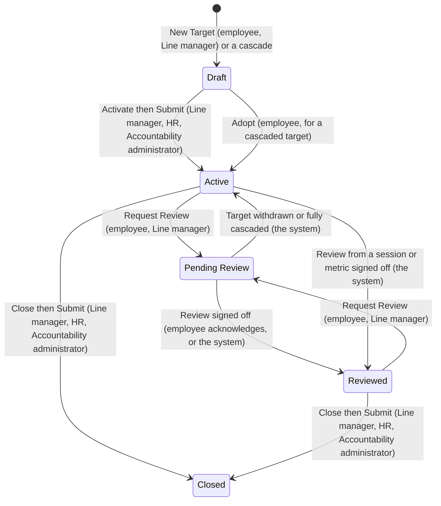

A **target** is one measurable thing on a person's scorecard, such as "Grow qualified pipeline to 100,000,000". Its status shows whether it is still being agreed, live, waiting for a review, or finished. Once a target is live, every change to it goes through a [scorecard change request](/accountability/workflows/scorecard-change-request/), so the reason and the effect on the score are recorded.

| Status | What it means | Moves to | Who moves it |
|---|---|---|---|
| **Draft** | Proposed, not yet on the scorecard. It doesn't count towards any score. A draft can still be edited freely, and deleted if it has no reviews. | **Active** with **Activate** (then **Submit** in the window that opens), or with **Adopt** for a cascaded target | Line manager, HR or accountability administrator; **Adopt**: the person it was cascaded to |
| **Active** | Live on the scorecard. It counts once it has a result. What it is measured against can only change through **Change target**. | **Pending Review** with **Request Review**; **Reviewed** when a review is signed off; **Closed** with **Close** | Employee or line manager; the system; line manager, HR or administrator |
| **Pending Review** | Someone has asked for a one-off review. The employee's direct manager sees **Conduct Review**. | **Reviewed** when the review is signed off; back to **Active** if the target is withdrawn or fully cascaded | Line manager conducts, employee acknowledges; the system |
| **Reviewed** | Has at least one signed-off review. Its latest result is written to the target. It is still live. | **Pending Review** with **Request Review**; **Closed** with **Close** | Employee or line manager; line manager, HR or administrator |
| **Closed** | Finished. It counts in the score for the time it was live. There is no button to reopen it. | — | — |

**Withdrawn is not a status.** When a manager clicks **Withdraw** (next to the weight), the target keeps its status but gets a **Withdrawn From** date. It stops counting from that date, and its result counts for the time it was live. See [Withdraw a target](/accountability/how-to/line-managers/withdraw-a-target/).

### The review behind "Pending Review"

**Conduct Review** creates a single review, which has its own small workflow:

| Review status | What it means | Moves to | Who moves it |
|---|---|---|---|
| **Draft** | The manager is recording the result, or the system created it from a metric and is waiting for the manager to confirm it. | **Pending Acknowledgment** when the manager clicks **Sign Off** in the **Conduct Review** window | Line manager (the employee's direct manager) or administrator |
| **Pending Acknowledgment** | The employee has been notified and must acknowledge it. | **Signed Off** with **Acknowledge**, or automatically when the acknowledgment window has passed | Employee; the system |
| **Signed Off** | Final. The result is written to the target and the score is recalculated. | — | — |

Reviews that belong to a review session follow the [review pack workflow](/accountability/workflows/review-pack/) instead, and are acknowledged together.

## What the system does automatically

- **Employee creates a draft:** their manager gets an **Activate Target** to-do. It is due after the **Cascade Action Deadline (days)** setting (3 days by default).
- **Activate after the period's target-setting deadline:** the change request needs approval before the target goes live. When it goes live, a note on the target says it was activated after the deadline.
- **A target added, withdrawn or closed after the period has started:** the employee gets a [priority change](/accountability/workflows/priority-change/) to acknowledge. If the employee has two or more live targets, the manager is asked to keep or rebalance the weights (a **New Balance** window, or a **Review the Balance** to-do).
- **Milestone targets** must be ready before they can go live: start and end dates inside the period, at least one stage, a due date on every stage inside the target's dates, and (for weighted stages) stage weights that add up to 100. Otherwise you see *'Customer A rollout' isn't ready:* followed by the list of what is missing.
- **Automatic metric reviews (nightly):** for targets that update themselves, once a review window closes and settles, the system creates a draft review for the manager with a **Confirm Metric Review** to-do, due after the **Metric Review Confirmation Deadline (days)** setting (5 by default). If there was nothing to measure, it records a **Not Applicable** review that is left out of the score. If the metric fails, the manager gets a **Fix Metric** to-do.
- **Single reviews not acknowledged:** the daily job signs them off once the acknowledgment window (5 days by default, **Acknowledgment Window (days)** in the settings) has passed since the review date.
- **Fully cascaded:** a target whose whole value has been adopted by others is reviewed through their shares, so it leaves the review queue and goes back to **Active**.

:::note[Good to know]
- The button in the **Conduct Review** window is labelled **Sign Off**, but it doesn't sign the review off. It sends the review to the employee, who then acknowledges it (or the system does after the window). The review form itself also has a **Sign Off** button, for line managers: that one signs a **Draft** review off straight away, without asking the employee.
- You don't need **Request Review** for regular reviews. A review session picks up every live target at the session's cadence, whatever its status.
- **Conduct Review** is shown only to the employee's direct manager and to accountability administrators.
:::

## Related tasks

- [Check my targets](/accountability/how-to/everyone/my-targets/)
- [Set targets for my team](/accountability/how-to/line-managers/set-team-targets/)
- [Request a scorecard change](/accountability/how-to/line-managers/request-a-scorecard-change/)
- [Withdraw a target](/accountability/how-to/line-managers/withdraw-a-target/)
- [Conduct a review](/accountability/how-to/line-managers/conduct-a-review/)
- [Targets](/accountability/concepts/targets/)
