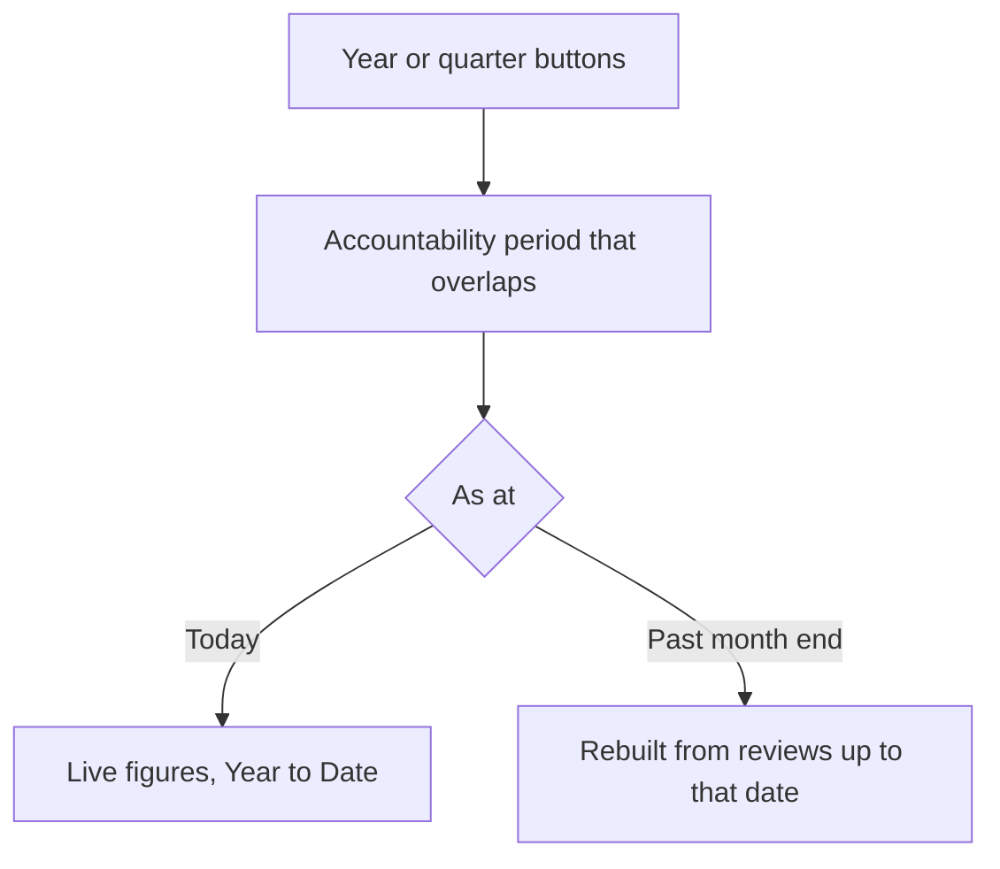

Two things change what the board sees: the **As at** selector on the Performance tab, which rebuilds the accountability figures as they stood at a past month end, and two ticks on sales and purchase orders, which keep an order out of the Financial Position.

## "As at" figures on the Performance tab

The accountability block on the **Performance** tab uses the newest accountability period that has started and overlaps the year or quarter you picked. If none does, it says *No accountability period covers the selected dates.*

Above the tiles, **As at** offers **Today** and then each month end of that period that has passed, newest first. Month ends that close a quarter are marked **· quarter end**, for example **30 Sep 2026 · quarter end**.

- **Today** shows the live figures. The heading reads **Strategic Objectives · FY 2026 · Year to Date**.
- **A past month end** rebuilds every target as it stood on that date: only reviews covering up to that date count, and the weights in force then are used. The heading reads **As at 30 Sep 2026**, and the caption says *Figures as they stood on 30 Sep 2026, rebuilt from the reviews covering up to that date.*

The tiles and the formulas are the same either way. See [Organisation score and rating](/board/calculations/organisation-score/).

:::note[Good to know]
The page says *Scores build up over the year, so the quarter buttons don't change them.* The quarter buttons change the revenue, spend and tender figures, and they pick the period, but the accountability scores are always for the year so far. To see how things stood at the end of Q2, choose **30 Jun 2026 · quarter end** under **As at**.
:::

## Orders left out of the Financial Position

The **Financial Position** counts confirmed sales and purchase orders that are not yet fully invoiced (the order backlog), as well as unpaid invoices. Finance or sales staff can mark an order on its **Other Info** tab (sales) or **Other Information** tab (purchase), under **Board Position Report**:

| Tick | Reason field | What the board sees |
|---|---|---|
| **Exclude from Board Position** | **Exclusion Reason** (required) | The order's backlog is left out of the totals. The order is still listed in the detail view, under **Excluded from position report**, with its **Reason for Exclusion**. |
| **Hide from Board Portal** | **Hide Reason** (required) | The order is left out of every Financial Position list and total, including the excluded section. |

Use **Exclude** when the board should see the order but it should not count, for example a disputed order. Use **Hide** when it should not appear at all. In Sales and Purchase, the filters **Excluded from Board Position** and **Hidden from Board Portal** find the marked orders.

:::note[Good to know]
**Hide from Board Portal** applies to the Financial Position order lists only. The order's invoices still count in **Revenue** and **Total Spend** on the Performance tab and in the outstanding invoice lists, and the order still counts in the Performance tab's order count.
:::

## Tasks that use this

- [Exclude or hide an order from the board](/board/how-to/exclude-or-hide-orders/)
- [Read the Performance tab](/board/how-to/read-performance/)
- [Read the Financial Position](/board/how-to/financial-position/)
