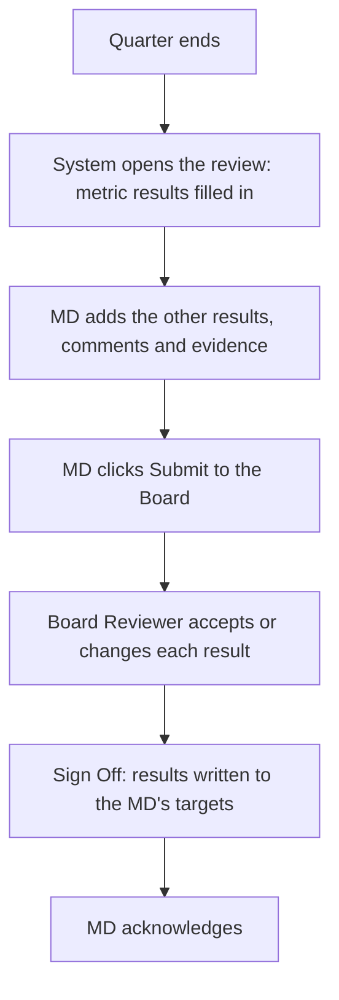

Every employee's targets are normally reviewed by their line manager. The **Managing Director** has no line manager, so their targets are reviewed by the board instead. Once an Accountability administrator names a **Board Reviewer** in Accountability Settings, the MD's targets are reviewed only this way, once a quarter.

To the system, the MD is the **top-level employee**: an employee with no manager who has people reporting to them. The portal calls this person the **Managing Director**.

After each calendar quarter ends, the system opens one **board review** for the MD. The MD adds the results the system could not calculate and submits it to the board. The Board Reviewer checks every result on the portal, accepts or changes it, and signs off. Sign-off writes the results to the MD's targets as ordinary reviews, so the MD's scores, history, snapshots and ratings work as they do for everyone else. The MD then acknowledges the sign-off.

## What goes into a review

- **The quarter.** The review is named after it, for example *Board review · Employee A · Q3 2026*, and covers 1 July to 30 September 2026 (**Quarter From** and **Quarter To**). There is one review per quarter.
- **The targets.** Each of the MD's targets in the active accountability period that was live during the quarter and is active, waiting for review or already reviewed. Targets fully passed down to others and development targets are left out. If no target qualifies, no review opens.
- **The window.** Each target is reviewed for the part of the quarter inside the period. A target measured over the year to date covers the period start to the quarter end instead, for example 1 January to 30 September 2026.
- **Results from a metric.** If the target has a metric, the system works out the result when the review opens. The line is marked **Metric** (**From a Metric** on the line) and the portal shows *Calculated by the system* with **How It Was Calculated**. The MD cannot change it; the Board Reviewer can.
- **Results the MD enters.** Lines without a metric, or whose metric could not be worked out (the line shows the **Metric Error**), need a **Result** and a **Comment** from the MD. The portal shows *Entered by Employee A*. The MD can attach **Evidence**.
- **Nothing to measure.** If the metric reported nothing to measure, the line shows **Nothing to measure** with the reason. It needs no result, and it becomes a not-applicable review at sign-off.

## The people

| Who | Part they play |
|---|---|
| **The MD** | Prepares the review in Accountability (through **My Actions** or the to-do), submits it, and acknowledges the board's sign-off. |
| **Board Reviewer** | A board member named in Accountability Settings. Gets the review on the portal under **MD Review**, checks it and signs off. |
| **Backup Board Reviewer** | Optional, named in the same place. Can sign off too once a review has waited 14 days. Whoever signs first closes it. |
| **Accountability administrators** | Name the reviewers and can read every board review under **Accountability › Organisation › Board Reviews**. |

## Key terms

| On screen | What it means |
|---|---|
| **Board Reviews** | The list of the MD's quarterly reviews in Accountability, under **Organisation** (administrators only). |
| **Being prepared**, **With the board**, **Signed off**, **Acknowledged** | The four statuses. See the [MD review workflow](/board/workflows/md-review/). |
| **Result** / **Score (%)** | The MD's or the metric's figure, and the score it gives. |
| **Board Result** / **Board Score (%)** / **Board Comment** | What the Board Reviewer signed off. |
| **Signed by the Board** | Shown on the MD's reviews in Accountability, in place of a reviewer. |

## What changes for the MD's targets

Once a Board Reviewer is named, nobody else can review the MD's targets, administrators included:

- **Request Review** is hidden on the MD's targets, and **Actual Value** can't be typed in.
- Trying anyway gives *These targets are reviewed by the board each quarter. Prepare the review under Board Reviews when it opens.* or *Results for these targets come from the quarterly board review.*
- The MD has no **Board Reviews** menu: it is under **Organisation**, for Accountability administrators only. The MD opens the review from **My Actions** (group **Board reviews**) or from the to-do.

How each line is scored is set out in [How the MD review figures are worked out](/board/calculations/md-review-figures/).

## Tasks that use this

- [Prepare and submit the quarterly review](/board/how-to/prepare-the-md-review/) (MD)
- [Review and sign off the MD's quarter](/board/how-to/review-the-md/) (Board Reviewer)
- [Acknowledge the board's sign-off](/board/how-to/acknowledge-the-board-review/) (MD)
- [Name the Board Reviewer and backup](/board/how-to/name-the-board-reviewer/) (Accountability administrator)
