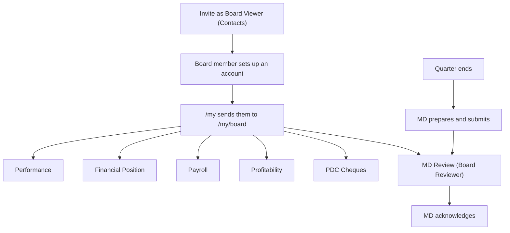

The **Board portal**, called **E-Board** on screen, is a private part of Tritel's website for the Board of Directors. It gives board members a summary of how the company is doing: sales and purchase invoices, tenders, expenses, what is owed to and by the company, payroll, the profit on won tenders and post-dated cheques waiting for signatures. Board members mostly read. They can also sign cheques, add their own commission or facilitation lines to a won tender's business case, and, for the board member named as **Board Reviewer**, sign off the Managing Director's quarter.

Board members are portal users, not Odoo staff users. When a board member opens the portal home page (**/my**), they land straight on **/my/board**.

## How the parts fit together

## The six tabs

Every board page has the same tab bar at the top. The first five tabs are there for every board member. **MD Review** appears only for a board member who has a review waiting for them or has signed one, with a yellow number for the reviews waiting. System administrators also see an **Access Log** tab.

| Tab | What it shows |
|---|---|
| **Performance** | Revenue, spend, tenders and win rate for the year or quarter you pick, plus organisation-wide accountability figures, live or as at a past month end. |
| **Financial Position** | What customers owe Tritel against what Tritel owes suppliers, today, with aging and the biggest customers and vendors. |
| **Payroll** | Gross pay, net pay, employer cost and headcount for the year, by month and by department. |
| **Profitability** | Won tenders with their estimated and actual gross profit, and the gaps in their analysis. |
| **PDC Cheques** | Post-dated cheques waiting for board signatures, with a **Sign** button on each. |
| **MD Review** | The Managing Director's quarterly reviews, for the Board Reviewer to check and sign off. |

Each tab is described in [What the board sees](/board/concepts/the-board-portal/).

## Who uses it

| Who | What they do |
|---|---|
| **Board members** | Read the tabs, sign cheques and add commission lines to won tenders. One is named **Board Reviewer**, and another can be named **Backup Board Reviewer**. |
| **The Managing Director (MD)** | Prepares a review of their own targets after each quarter in Accountability and submits it to the board, then acknowledges the board's sign-off. See [The MD's quarterly review](/board/concepts/md-quarterly-review/). |
| **Accountability administrators** | Name the Board Reviewer and backup in Accountability Settings, see every board review, and invite board members. |
| **System administrators** | Invite board members, see every board page and check the **Access Log**. |
| **Finance and sales staff** | Decide which sales and purchase orders the board sees, with **Exclude from Board Position** and **Hide from Board Portal**. See [Exclude or hide an order](/board/how-to/exclude-or-hide-orders/). |

## How a board member gets in

1. A System administrator or Accountability administrator opens the board member's contact and uses **Action › Invite as Board Viewer**. See [Invite a board member](/board/how-to/invite-board-members/).
2. If the board member has no portal account yet, they get an email, *You're invited to Tritel Executive Board Portal*, with a **Set up my account →** button. They choose a password, and the **Board Viewer** role is added when the account is created.
3. If they already have a portal account, the role is added straight away and they get *Your board portal access is ready* with an **Open Board Portal →** button.
4. From then on they sign in as any portal user does and land on the **Performance** tab.

## Where to start

- Board members: [What the board sees](/board/concepts/the-board-portal/), then the task pages for each tab.
- The Board Reviewer: [Review and sign off the MD's quarter](/board/how-to/review-the-md/).
- The MD: [Prepare and submit the quarterly review](/board/how-to/prepare-the-md-review/).
- Administrators: [Invite a board member](/board/how-to/invite-board-members/) and [Name the Board Reviewer and backup](/board/how-to/name-the-board-reviewer/).
