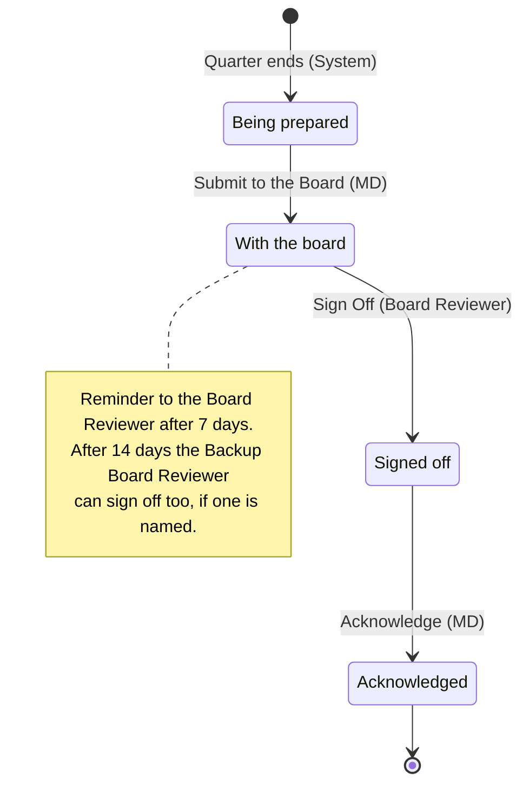
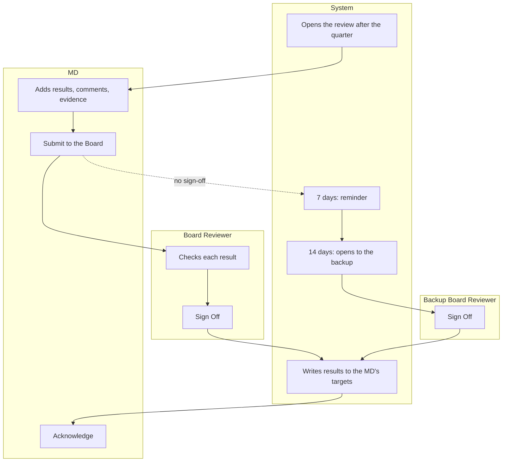

A **board review** holds the Managing Director's results for one quarter. The system opens it, the MD prepares and submits it, the Board Reviewer signs it off on the portal, and the MD acknowledges the sign-off. It only moves forward: there is no step back, cancel or reopen.

| Status | What it means | Moves to | Who moves it |
|---|---|---|---|
| **Being prepared** | Opened after the quarter. Metric results are filled in. The MD adds the other results, comments and evidence. Lines can be changed. | **With the board** with **Submit to the Board** | The MD |
| **With the board** | Submitted. Nothing can be changed. The Board Reviewer sees it under **MD Review** on the portal, with a yellow count. | **Signed off** with **Sign Off** | The Board Reviewer, or the Backup Board Reviewer once it has waited 14 days |
| **Signed off** | The board's results are written to the MD's targets as signed-off reviews. The MD can write **Your Comment**. | **Acknowledged** with **Acknowledge** | The MD |
| **Acknowledged** | Closed. The MD's comment is shown to the board member on the portal. | Nothing | |

## Who does what

## What the system does automatically

A job runs once a day.

- **Opening.** On the first run after a quarter ends (for example 1 October 2026 for Q3 2026), and only if a **Board Reviewer** is named, the system opens a review for the quarter that has just finished. It works out every metric result at that moment. If the MD has no target that was live during the quarter, no review opens. The MD gets a **Prepare Board Review** to-do, due in 7 days, and an email *Prepare your board review: Board review · Employee A · Q3 2026*.
- **On submit.** The to-do is marked done. The Board Reviewer gets an email *Board review to sign off: …* with an **Open the review** link.
- **Reminder after 7 days.** If the review is still **With the board** 7 days after it was submitted, the Board Reviewer gets one reminder: *Reminder: board review waiting: …*.
- **Backup after 14 days.** If it is still waiting 14 days after submission and a Backup Board Reviewer is named, the review is opened to the backup. The backup gets *Board review needs your sign-off: …*, and the reviewer gets *Board review opened to the backup: …*. Both can now sign off; whoever signs first closes it.
- **On sign-off.** For each target, the system creates a review with the board's result, signed off at once and marked **Signed by the Board**. A note *Signed off by Board member A in Board review · Employee A · Q3 2026.* is added to each target. Lines with nothing to measure become not-applicable reviews. The MD gets an **Acknowledge Board Review** to-do, due in 5 days, and an email *The board has signed off: …*. If the review had been opened to the backup, the other board member is told *nothing more is needed from you*.
- **On acknowledge.** The to-do is marked done and the board member who signed gets *Board review acknowledged: …*, with the MD's comment.

:::note[Good to know]
- With no Backup Board Reviewer named, the Board Reviewer gets the single 7-day reminder and nothing more is sent.
- Nothing happens automatically if the MD does not acknowledge. The sign-off already counts; acknowledging closes the review and sends the MD's comment to the board member.
- Metric results are worked out when the review opens, the day after the quarter ends. Invoices or other records posted later for that quarter are not picked up. The Board Reviewer can adjust a result before signing off.
- There is no way to send a review back once it is submitted or signed off.
:::

## Related tasks

- [Prepare and submit the quarterly review](/board/how-to/prepare-the-md-review/)
- [Review and sign off the MD's quarter](/board/how-to/review-the-md/)
- [Acknowledge the board's sign-off](/board/how-to/acknowledge-the-board-review/)
- [Name the Board Reviewer and backup](/board/how-to/name-the-board-reviewer/)
