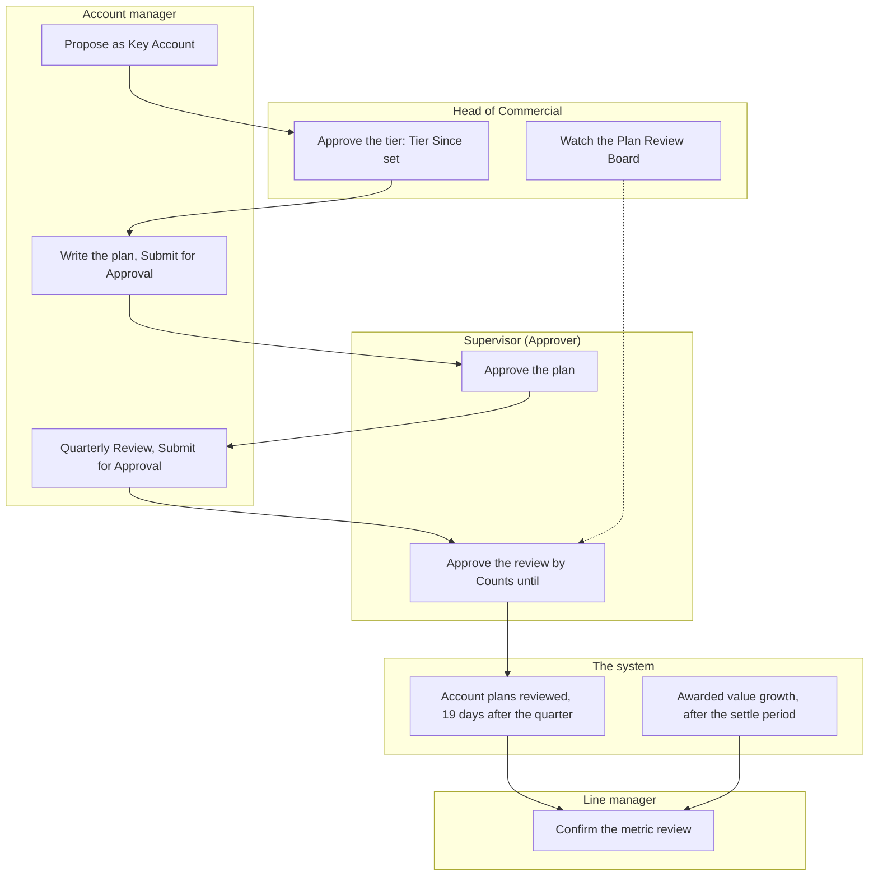

import Illustration from '../../../components/Illustration.astro';

Tritel's most important customers are its **Key account** and **Major growth** target accounts. Each one gets a yearly **account plan**, approved by the account manager's supervisor and reviewed every quarter. This journey follows one customer, Customer A, from being tiered to the account manager's quarterly score. The account manager proposes the tier and writes the plan; the Head of Commercial sets the tier; the account manager's supervisor approves the plan and each review; the system counts the approved reviews and the awarded value; the line manager confirms the review in Accountability.

## The journey at a glance

## Step by step

| # | Who | Where | What happens | Guide |
|---|---|---|---|---|
| 1 | Account manager | **Tender Manager › Tender Customers › Classify Accounts**, or the customer's form | Proposes Customer A with **Propose as Key Account** (or **Propose as Major Growth**). **My Actions** reminds them with **Customers with no tier**. | [Claim, assign and classify accounts](/tenders/how-to/customers/account-ownership/) |
| 2 | Head of Commercial | **Classify Accounts**, **Proposed Targets** filter | **Approve Proposed** makes it a target account in the proposed tier, or **Target: Key Account** sets it directly. **Tier Since** is set to today. The account counts for the KPI from the next quarter. | [Market coverage and target accounts](/tenders/concepts/market-coverage/) |
| 3 | Account manager | The customer's **Account Plan** button, or **Tender Manager › Tender Customers › Account Plans** | Writes the plan for the year (*Customer A · 2026*): the awarded value goal, strategy and risks, key people and the organogram, objectives and actions. Clicks **Submit for Approval**. The plan is due by 31 January. | [Write an account plan](/tenders/how-to/account-plans/write-an-account-plan/) |
| 4 | Supervisor | To-do *Approve account plan: Customer A · 2026*; **Account Plans** with **To approve** | Clicks **Approve**, or **Return for Changes** with a note (the account manager gets *Account plan returned: …*). The plan is **Approved**, on time or late against its **Due date**. | [Approve account plans and reviews](/tenders/how-to/account-plans/approve-plans-and-reviews/) |
| 5 | Account manager and team | **Customer Activities**, the organogram | During the quarter, every touch is logged with its **Contacts met**, which keeps **Last met** on the organogram current. | [Log a customer activity](/tenders/how-to/customers/log-a-customer-activity/), [Map the customer organogram](/tenders/how-to/account-plans/map-the-customer-organogram/) |
| 6 | Account manager | The plan, **Quarterly Review** | After the quarter ends, opens the review for the quarter just ended, fills in **Status**, **What changed this quarter** and **Next steps**, and clicks **Submit for Approval**. **My Actions** lists it under **Account plan reviews due**. | [Submit a quarterly review](/tenders/how-to/account-plans/submit-a-quarterly-review/) |
| 7 | Supervisor | **Tender Manager › Tender Customers › Plan Reviews** (opens on **To approve**), then the plan's **Quarterly reviews** tab | Approves the review by its **Due date** (**Approved on time**) or by **Counts until** (**Approved late**, still counts). The plan's chatter gets *Review **Q2 2026** approved (Green): …* and the review is locked. | [Approve account plans and reviews](/tenders/how-to/account-plans/approve-plans-and-reviews/) |
| 8 | Head of Commercial | **Tender Manager › Tender Customers › Plan Review Board** | Sees every account's plan and quarter cells (**Approved**, **Waiting n days**, **Overdue**, **Missed**…), and chases what is stuck. | [Use the Plan Review Board](/tenders/how-to/account-plans/plan-review-board/) |
| 9 | The system | Nightly, in Accountability | **Account plans reviewed** counts the account manager's eligible Key and Major growth accounts with a review that counts. **Awarded value growth vs same quarter last year** compares their attributed awards with the same quarter a year earlier. Once each wait has passed, a draft review is created. | [Account manager KPI](/accountability/calculations/account-manager-kpi/) |
| 10 | Line manager | *Confirm Metric Review* to-do | Checks the worksheet (one row per account: *Q2 2026*, *Q2 2026 (approved late)* or *Not reviewed*) and confirms. The score goes on the account manager's scorecard. | [Conduct a review](/accountability/how-to/line-managers/conduct-a-review/) |

Before any of this counts, an Accountability administrator adds the two metrics to the account manager's target (their **Coded Logic** options are *Account plans reviewed (Key and Major growth accounts)* and *Awarded value growth vs same period last year (attributed)*). See [Metrics](/accountability/how-to/hr-admin/metrics/).

## Worked example

Employee A owns six Key and Major growth accounts in Q2 2026 (1 April to 30 June). Customer B was tiered on 10 April, after the quarter started, so it counts from Q3: five accounts are eligible. Three reviews were approved by 14 July, one on 17 July (late, still counts) and one on 22 July (missed). Employee A's figure is **4**.

<Illustration name="end-to-end/e2e-plans-reviewed-score" caption="Four of five eligible accounts reviewed in time, scored against the suggested floor of 3 and ideal of 5." />

## Timing, for Q2 2026

| What | When | Set by |
|---|---|---|
| Plan for 2026 due | 31 January 2026 | **Plan approved by (MM-DD)** in **Settings › Tender Tracker › Account Plans** (01-31). The Head of Commercial can change one plan's **Due date**. |
| **Quarterly Review** opens the quarter just ended | 1 July until 19 July; after that it opens the current quarter | Review and grace days |
| **Account plan reviews due** in My Actions | From 30 June (14 days before the due date) | **First reminder, days before due** (14) |
| Review **Due date** | 14 July (quarter end + 14 days) | **Review due, days after quarter end** (14) |
| Review **Counts until** | 19 July (due date + 5 days) | **Grace days for the KPI** (5) |
| **Awarded value growth** automatic review | 3 days after the quarter ends | **Metric Settle Period (days)** in Accountability settings (3) |
| **Account plans reviewed** automatic review | First runs on 20 July | 19 days after the quarter, fixed in the code, or the metric's **Logging Grace (days)** if longer. A **Wait Before Automatic Review (days)** above 0 on the metric replaces both. |
| Line manager confirms | *Confirm Metric Review* to-do, due in 5 days by default | Accountability settings |

### Reminders, once switched on

The job *Account Plans: reminders and escalation* is switched off when installed. Once your administrator turns it on (**Settings › Technical › Scheduled Actions**), it runs every working day (Monday to Friday) at 05:00 and:

- emails each account manager *Account plans due* from 14 days before a plan or review is due, then every 3 working days until it is submitted;
- emails each supervisor *N account plan item(s) waiting for your approval* once an item has waited 2 working days, then every 2 working days;
- emails the Head of Commercial *Account plans escalated*, once per item, when a plan or review is 5 working days overdue or has waited 5 working days for approval. The item then shows **Head of Commercial informed**;
- every Monday, emails the Head of Commercial *Account plans this week*, with one line per account manager, for example *Employee A: 1 overdue · 0 waiting approval · 3 of 5 reviewed for Q2 2026*.

The numbers come from **Settings › Tender Tracker › Account Plans**. See [Account plan due dates and timeliness](/tenders/calculations/account-plan-due-dates/).

## What carries across

| From | To | What travels | When |
|---|---|---|---|
| Customer's tier | KPI eligibility | **Key account** or **Major growth**, with **Tier Since** before the quarter started | When the metric is worked out |
| Customer's account manager | The plan | **Account manager**, and their **Manager** in the Employees app as the plan's **Approver** | When the plan is created |
| Approved review | **Account plans reviewed** | One per account per window, if approved by **Counts until** | When the metric is worked out |
| Account manager attribution on won tenders | **Awarded value growth** | The attributed share, by award date, against the same window a year earlier | When the metric is worked out |
| Done touch with **Contacts met** | Organogram | **Last met** for each person | When saved |

## Where it can go wrong

| What happens | Effect | Fix |
|---|---|---|
| The customer was tiered, or its tier changed, after the quarter started | It doesn't count this quarter: the worksheet shows *Tiered 2026-04-10, counts next quarter*. Changing **Major growth** to **Key account** also resets **Tier Since**. | Tier accounts before the quarter starts, and avoid changing a tier mid-quarter. |
| The account manager has no **Manager** in the Employees app | They can't submit: *Employee A has no supervisor in the org chart to approve the plan.* | Ask HR to set the manager. |
| The review is approved after **Counts until** | It shows **Missed** and doesn't count, even though it is approved. | Submit early; supervisors find it in **Plan Reviews** and approve it from the plan's **Quarterly reviews** tab. |
| The plan isn't approved | **Quarterly Review** appears only on an approved plan, and the board shows *No approved plan* for the quarter. | Submit the plan and have it approved first. |
| **Revise Plan** is used after the due date | The plan goes back to **Draft**, shows **Overdue**, and **Quarterly Review** disappears until it is approved again (then **Approved late**). | Revise early in the year, or agree the change with your supervisor before you click it. |
| The review is for the wrong year's plan | *This plan is for 2026; open the plan for 2027 to review this quarter.* | Open the plan for the year of the quarter. |
| Won tenders aren't attributed | Awarded value counts as 0, flagged **awaiting attribution**; with nothing in the year before, the growth metric has no baseline. | The heads attribute won tenders. See [Attribute a won tender](/tenders/how-to/bids/attribute-a-won-tender/). |
| The reminders job is off | No emails or escalations are sent. **My Actions** still lists what is due. | Ask your administrator to turn the job on. |

:::note[Good to know]
- Eligibility uses each customer's tier and account manager as they are when the metric is worked out, 19 days after the quarter. A customer moved to another account manager before then counts for the new one.
- The 19 days don't change if the review or grace days are changed in the Tender Tracker settings. If you lengthen them, set **Wait Before Automatic Review (days)** on the metric to match.
- **My Portfolio** shows the same two figures for the quarter so far, against a fixed 5 plans and 10% growth, not the floor and ideal on your target.
- The customer form's **Awarded, 4Q** and the plan's quarter table include every awarded tender with account manager attribution; the growth metric counts **Won** tenders only, so the figures can differ.
:::
