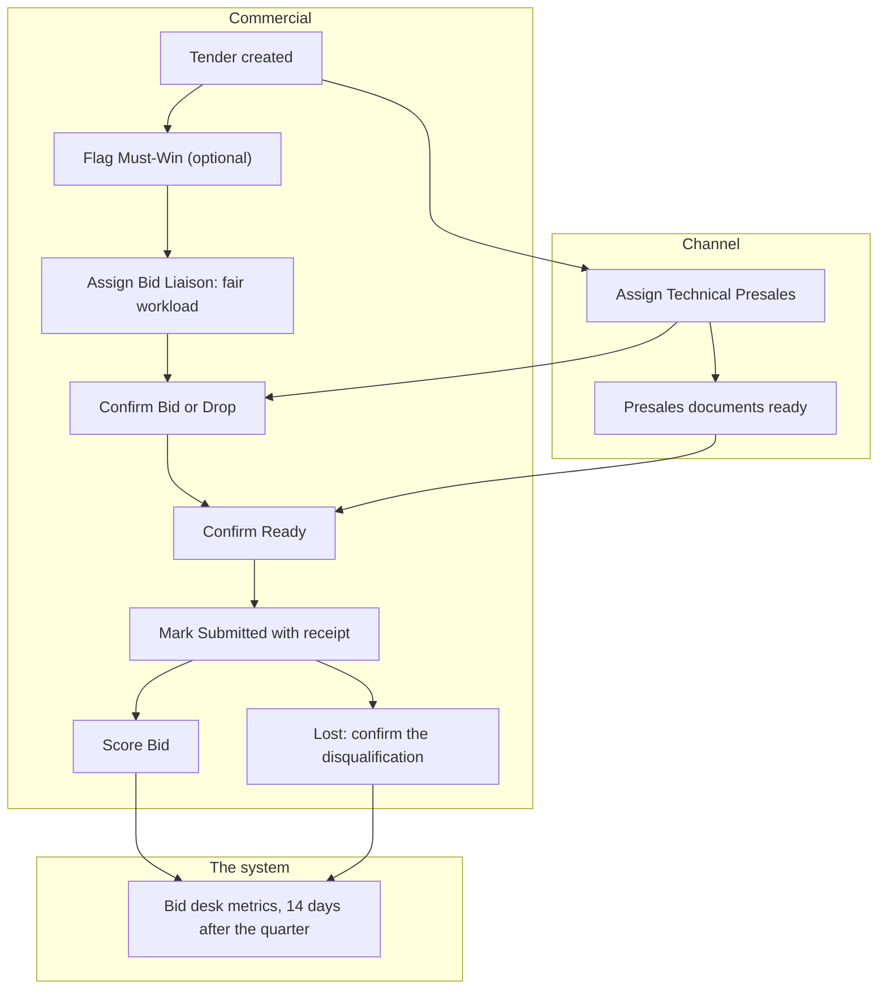

import Illustration from '../../../components/Illustration.astro';

Every bid leaves a trail of times and checks: when the tender was captured, when the decision to bid was made, when the bid was confirmed ready, when it actually went in, how well it was put together, and whether it was disqualified. This journey follows one bid along that trail and shows which measure each step feeds. The Head of Commercial nominates the Bid Liaison with the workload in view; the Bid Liaison and Technical Presales prepare and submit; the Bid Liaison's manager scores the quality; the system turns it all into the bid desk metrics.

## The journey at a glance

## Step by step

| # | Who | Where | What happens | Measured by | Guide |
|---|---|---|---|---|---|
| 1 | Account Manager | **Tender Manager › Tenders › All Tenders** | The tender is created. The time from capture to the **Submission Deadline** is recorded: under 7 days adds a workload point, under 3 days leaves it out of the timing measures. | Workload points | [Create a tender](/tenders/how-to/bids/create-a-tender/) |
| 2 | Head of Commercial | Tender, **Flag Must-Win** | A must-win tender gets extra reminders, 2 extra workload points if flagged before submission, and counts three times for quality. | Bid Quality Score, Bid Compliance | [Flag a must-win tender](/tenders/how-to/bids/flag-a-must-win/) |
| 3 | Head of Commercial; Head of Channel | **Tender Manager › My Actions** | The Bid Liaison is chosen from the **Assign Bid Liaison** window, which shows points, **Over fair share** and **Clash**. Presales is nominated by the Head of Channel. | **Fair Workload Balance**, **Deadline Clash-Free** | [Nominate the team](/tenders/how-to/bids/nominate-the-team/) |
| 4 | Account Manager | Tender, **Confirm Bid** or **Drop** | **Bid Decision Made** is stamped. | **Bid Decision Lead Time** (5 days before the deadline) | [Confirm the bid](/tenders/how-to/bids/confirm-the-bid/) |
| 5 | Bid Liaison and Technical Presales | Tender, **Bid Readiness** tab | Each document is attached; the Bid Liaison clicks **Confirm Ready**. | **Ready at 72 Hours** | [Work the readiness checklist](/tenders/how-to/bids/work-the-readiness-checklist/) |
| 6 | Bid Liaison | Tender, **Mark Submitted** | **Actually Submitted** and the **Submission Receipt** are recorded; the tender moves to **Evaluation**. | **Submission Buffer** (24 hours before the deadline) | [Mark a tender submitted](/tenders/how-to/bids/mark-submitted/) |
| 7 | The Bid Liaison's manager | **Tender Manager › My Actions**, **Bid quality checks to score** | Each guideline is **Met**, **Not met** or **Not applicable**, within 10 days. | **Bid Quality Score**, **Repeat Error Rate** | [Score a bid's quality](/tenders/how-to/bids/score-bid-quality/) |
| 8 | Whoever records the result; then the manager of the person named | **Lost** or **Drop** with a disqualification reason; **Confirm Cause** | The cause is recorded with evidence, then confirmed within 7 days. | **Bid Quality Score** (Bid Liaison), **Bid Compliance** (Technical Presales) | [Record the result](/tenders/how-to/bids/record-the-result/), [Confirm a disqualification](/tenders/how-to/bids/confirm-a-disqualification/) |
| 9 | The system, then the line manager | *Confirm Metric Review* to-do | 14 days after the quarter, a draft review is created for each bid desk target. | All of the above | [Conduct a review](/accountability/how-to/line-managers/conduct-a-review/) |

## Worked example

<Illustration name="end-to-end/e2e-bid-quality-quarter" caption="One Bid Liaison's quarter: a must-win bid counts three times, a confirmed disqualification counts as 0%, and the unscored bid waits." />

## Who is measured on what

| Role | Metrics |
|---|---|
| **Bid Liaison** | **Submission Buffer**, **Ready at 72 Hours**, **Repeat Error Rate** (lower is better), **Bid Quality Score**, and achieved revenue on won tenders |
| **Technical Presales** | **Ready at 72 Hours**, **Bid Compliance**, and achieved revenue on won tenders |
| **Account Manager** | **Bid Decision Lead Time** for their own tenders |
| **Head of Commercial** | **Bid Decision Lead Time** across the desk, **Fair Workload Balance**, **Deadline Clash-Free** |

How each one counts is in [How metrics count](/accountability/calculations/metric-families/).

## What carries across

| From | To | What travels | When |
|---|---|---|---|
| Tender | Workload | Effort points: base, short notice, bid bond, must-win | Shown each time a head opens **Assign** |
| Tender | Timing metrics | The **latest** submission deadline, the bid decision time, the ready time and the submission time | Nightly; reviewed 14 days after the window |
| Quality check | Bid Quality Score, Repeat Error Rate | **Quality Score (%)** and the guidelines **Not met** | Once scored; unscored bids are left out |
| Confirmed disqualification | Bid Quality Score or Bid Compliance | 0% for the person who caused it, in the quarter it was confirmed | Once confirmed |
| Must-win flag | Quality metrics | Counts three times | From when it is flagged |

## Where it can go wrong

| What happens | Effect | Fix |
|---|---|---|
| The tender is created late | Under 3 days before the deadline it is left out of the timing measures; under 7 days it adds a workload point. | Create tenders as soon as they are published. |
| The checklist is never confirmed ready | The bid counts as not met for **Ready at 72 Hours**. | The Bid Liaison clicks **Confirm Ready** when every row is **Ready** or **Not Needed**. |
| The submission is recorded without a receipt, or with the wrong time | The bid sits under **Submissions to record**, and **Submission Buffer** needs the submission recorded. | Add the receipt with **Add Receipt** on the **Bid Quality** tab. The manager can correct the time when scoring. |
| The quality check isn't scored | The bid is left out of the **Bid Quality Score**. | The manager scores it from **My Actions** within 10 days. |
| A disqualification isn't confirmed | It doesn't count against anyone. | The manager it waits on clicks **Confirm Cause**, correcting the cause if the evidence points elsewhere. |
| The bid desk metrics haven't been set up | No figures reach the targets. | An accountability administrator creates them. See [Set up and test a metric](/accountability/how-to/hr-admin/metrics/). |

:::note[Good to know]
- Cancelled tenders are left out of all the bid desk measures. A dropped tender still counts as a bid decision and half a workload point.
- The timing measures compare each tender with its latest deadline, so a deadline the customer extends gives the team the extra time.
:::
