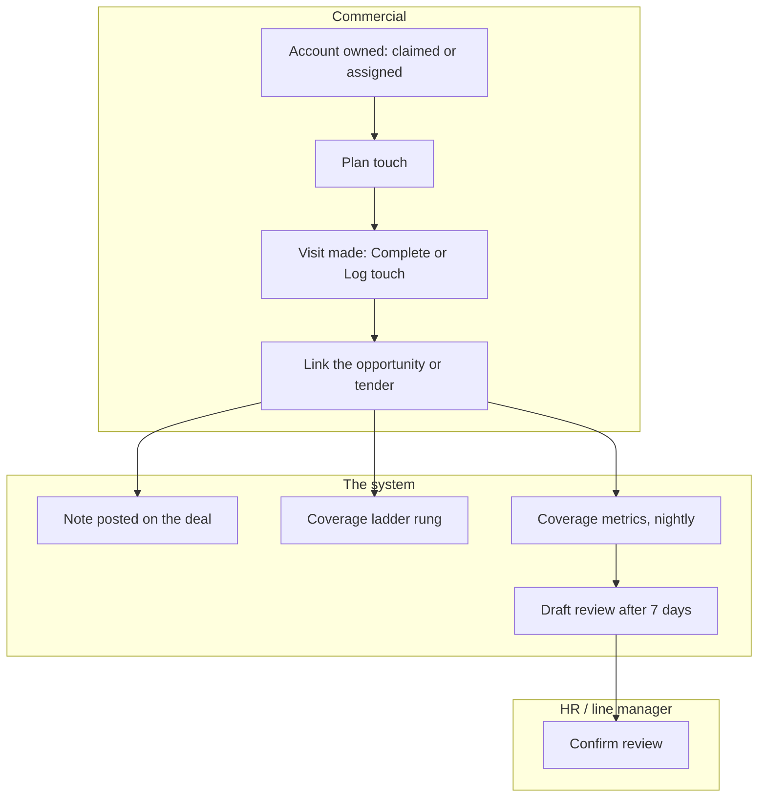

import Illustration from '../../../components/Illustration.astro';

Every customer should have an account manager, and every contact with a customer should be logged as a **customer touch**, linked to the opportunity or tender it was about. This journey follows one customer: it gets an owner, the account manager plans a visit, makes it and logs it, and the touch moves the customer up the **coverage ladder** and counts towards the account manager's activity coverage. Account managers and Technical Presales log the touches; the Head of Commercial looks after ownership and target accounts; line managers confirm the reviews.

## The journey at a glance

## Step by step

| # | Who | Where | What happens | Guide |
|---|---|---|---|---|
| 1 | Account Manager; Head of Commercial | **Tender Manager › Tender Customers › Account Ownership** | The customer gets an **Account Manager**: claimed with **Claim for Me**, or assigned by the Head of Commercial. It now sits on the ladder at **Untouched**. | [Claim, assign and classify accounts](/tenders/how-to/customers/account-ownership/) |
| 2 | Head of Commercial | **Tender Manager › Tender Customers › Classify Accounts** | The customer may be made a target account (**Strategic**, **Growth** or **Maintain**). | [Claim, assign and classify accounts](/tenders/how-to/customers/account-ownership/) |
| 3 | Account Manager | **Tender Manager › Tender Customers › Customer Activities**, **Plan touch** | The visit is planned with a date and linked to its opportunity or tender. A planned touch counts nowhere yet. | [Plan customer touches](/tenders/how-to/customers/plan-customer-touches/) |
| 4 | Account Manager or Technical Presales | **Planned** tab, **Complete**; or **Log touch** | After the visit, the touch is completed (or logged) with **What happened**. It is saved as **Done**. | [Log a customer activity](/tenders/how-to/customers/log-a-customer-activity/) |
| 5 | The system | Linked deal, customer | The note is posted on the opportunity or tender, the customer's **Last Seen** moves, and the touch shows on the heatmap and timeline. | [Customer activities and touchpoints](/tenders/concepts/customer-activities/) |
| 6 | The system | **Tender Manager › Tender Customers › Market Coverage** | The customer's rung is worked out each time someone looks: **Engaged** after a done touch, up to **In play**, **Named** and **Anchor** as deals open and are won. | [Use the Market Coverage screen](/tenders/how-to/customers/market-coverage/) |
| 7 | The system | Nightly | **Pipeline status coverage** and **Tender evaluation coverage** count the updates, and the market coverage metrics count the rungs. **Provisional** values refresh. | [How metrics count](/accountability/calculations/metric-families/) |
| 8 | The system, then the line manager | *Confirm Metric Review* to-do | After the window and its wait, a draft review is created with the figure. The manager checks the worksheet and confirms. | [Conduct a review](/accountability/how-to/line-managers/conduct-a-review/) |

## Worked example

<Illustration name="end-to-end/e2e-touch-coverage-score" caption="Monthly updates added together for the quarter, then scored against the target's floor and ideal." />

## Which metrics read customer touches

| Metric | Counts | Window and wait |
|---|---|---|
| **Pipeline status coverage** | Of your open opportunities each month, the share you logged a done touch against | Monthly, added together; waits 7 days |
| **Tender evaluation coverage** | Of your tenders in **Evaluation** each week (as account manager or Technical Presales), the share you logged a touch against | Weekly, added together; waits 7 days |
| **Named share – my accounts** | Your owned customers with a win ÷ your owned customers engaged (a tender, opportunity or touch) in 24 months | On the review date |
| **Named share – deals led**, **New named accounts**, **Target accounts named** | Wins and target accounts on the **Named** or **Anchor** rung | Over 24 months, in the window, or on the review date |

The four market coverage metrics are switched off until an administrator turns them on. See [Metrics](/accountability/concepts/metrics/).

## What carries across

| From | To | What travels | When |
|---|---|---|---|
| Tender or opportunity | Customer | The deal's account manager becomes the customer's when it has none | When the deal is saved |
| Customer | Tender, plans, early opportunities | A newly assigned account manager moves onto the customer's draft and bidding tenders, planned touches and early-stage opportunities | When assigned |
| Done touch | Linked deal | The note, as *Feedback from customer touch dated …* | When marked done |
| Done touch | Coverage ladder | The customer is at least **Engaged** | Each time the screen is opened |
| Done touch | Activity coverage | Counts for the month or week of its **Date** if the person who made it entered it within 7 days after that month or week ended | Nightly; review waits 7 days |
| Done touch on a won deal | Attribution | **Compute Related Activities** counts it towards the stage points | When a head clicks it. See [Attribute a won tender](/tenders/how-to/bids/attribute-a-won-tender/) |

## Where it can go wrong

| What happens | Effect | Fix |
|---|---|---|
| The customer has no account manager | It shows under **Reached, no account manager** and counts for nobody's owned accounts. | Claim or assign it in **Account Ownership**. |
| The touch isn't linked to its opportunity or tender | It doesn't count as an update for activity coverage or for attribution. | Pick the **Tender** or **Lead/Pipeline** when you log it. See [Log a customer activity](/tenders/how-to/customers/log-a-customer-activity/). |
| The touch is entered more than 7 days after its month or week ended | It is listed in the worksheet but doesn't count for that month's or week's coverage. (Any touch entered more than 7 days after it happened is also flagged **Entered Late**.) | Log touches on the day. |
| The touch is recorded as made by someone else | Coverage counts only the touches the target's owner made. | Set **Touch made by** to the person who made the contact. |
| A planned touch is never completed | It stays **Planned**, turns **Overdue** and counts nowhere. | Click **Complete** with the real date. See [Plan customer touches](/tenders/how-to/customers/plan-customer-touches/). |

:::note[Good to know]
- The ladder reads only **Done** touches. Planning many visits doesn't move a customer.
- Customer Activities shows **Touch Phase** by the date of the touch. Attribution uses a separate **Activity Phase** that follows the day the touch was entered in Odoo. Logging on the day keeps the two in step.
:::
