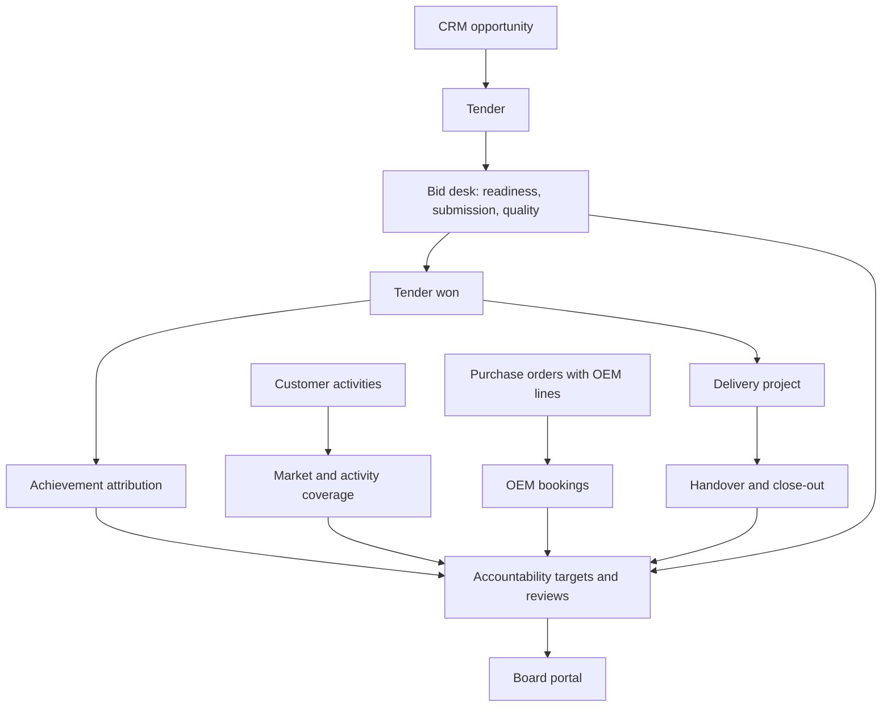

Each system section of this site explains one app. The work itself doesn't stay in one app: an opportunity in CRM becomes a tender, a won tender becomes a delivery project, and what happens in all of them ends up as figures on people's targets and, in the end, on the board's summary. The journeys on these pages follow one piece of work across those handovers, step by step, and link to the guide for each step.

## How the systems feed each other

- **Opportunity to tender.** The account manager creates the tender and links it to its CRM opportunity in **Source/Pipeline**. When the tender is won or lost, the opportunity follows.
- **Tender to bid desk.** The Bid Liaison and Technical Presales are nominated, work the readiness checklist and submit the bid. Every step is timed, and the bid's quality is scored.
- **Won tender to revenue.** The heads attribute the win to the people who worked on it. Those attribution lines are what the Accountability revenue metrics count.
- **Won tender to delivery.** The delivery team opens a delivery project from the won tender. Its handover and close-out decide whether it was on time and on budget.
- **Customer activities to coverage.** Every logged customer touch moves the customer up the coverage ladder and counts towards the account manager's activity coverage.
- **Purchases to OEM revenue.** Purchase lines tagged with an OEM are booked against what the OEM recognises. Confirmed bookings are the OEM-recognised revenue.
- **Accountability to the board.** Metrics read all of these every night. Reviews turn the figures into scores, and the board sees the organisation's results on the **Performance** tab.

## The journeys

| Journey | Follows | Read it if you are |
|---|---|---|
| [From opportunity to your scorecard](/end-to-end/opportunity-to-accountability/) | One opportunity all the way: tender, bid, win, attribution, delivery project, close-out, targets, reviews and the board | Anyone; start here |
| [From an OEM purchase to the OEM revenue target](/end-to-end/oem-booking-to-revenue-target/) | A purchase order with OEM lines, its booking and the OEM-recognised revenue target | Channel, Finance & Accounts |
| [From a customer visit to coverage and activity targets](/end-to-end/customer-activity-to-coverage/) | Account ownership, planned and logged touches, the coverage ladder and the coverage metrics | Account Managers, Technical Presales, Head of Commercial |
| [From bid desk work to bid KPIs](/end-to-end/bid-desk-to-bid-kpis/) | Nomination, readiness, submission, quality and disqualifications, and the bid desk metrics | Bid Liaisons, Technical Presales, Head of Commercial |
| [From a won tender to the Delivery KPI](/end-to-end/project-to-delivery-kpi/) | The delivery project, its Delivery Budget, client delays, handover and close-out, and the delivery metrics | Delivery, Delivery Finance |

## Which journey for your role

| You are | Read first | Then |
|---|---|---|
| Account Manager | [Opportunity to scorecard](/end-to-end/opportunity-to-accountability/) | [Customer activity to coverage](/end-to-end/customer-activity-to-coverage/) |
| Bid Liaison | [Bid desk to bid KPIs](/end-to-end/bid-desk-to-bid-kpis/) | [Opportunity to scorecard](/end-to-end/opportunity-to-accountability/) |
| Technical Presales | [Bid desk to bid KPIs](/end-to-end/bid-desk-to-bid-kpis/) | [Customer activity to coverage](/end-to-end/customer-activity-to-coverage/) |
| Head of Commercial | [Opportunity to scorecard](/end-to-end/opportunity-to-accountability/) | [Bid desk to bid KPIs](/end-to-end/bid-desk-to-bid-kpis/) |
| Head of Channel or a Channel user | [OEM purchase to OEM revenue](/end-to-end/oem-booking-to-revenue-target/) | [Opportunity to scorecard](/end-to-end/opportunity-to-accountability/) |
| Delivery PM, Head of Delivery or Delivery Finance | [Won tender to Delivery KPI](/end-to-end/project-to-delivery-kpi/) | [Opportunity to scorecard](/end-to-end/opportunity-to-accountability/) |
| Finance & Accounts | [OEM purchase to OEM revenue](/end-to-end/oem-booking-to-revenue-target/) | [Won tender to Delivery KPI](/end-to-end/project-to-delivery-kpi/) |
| Line manager, HR or Accountability administrator | [Opportunity to scorecard](/end-to-end/opportunity-to-accountability/) | The "What carries across" section of each journey |
| MD or board member | [Opportunity to scorecard](/end-to-end/opportunity-to-accountability/) | [The Board portal](/board/) |

Each role also has a learning path: see [Commercial](/roles/commercial/), [Channel](/roles/channel/), [Delivery](/roles/delivery/), [Finance and Accounts](/roles/finance-and-accounts/), [Line managers](/roles/line-managers/), [HR](/roles/hr/) and [MD and board](/roles/md-and-board/).

## Timing, in one place

Most handovers between systems are not instant. A figure reaches a target through a nightly job, after a waiting period that gives people time to finish their entries.

| What | When |
|---|---|
| **Provisional** values on targets | Every night, and when you click **Refresh** |
| Automatic metric reviews | Every night, once a window has closed and its wait has passed |
| Wait after the window: revenue and most other metrics | **Metric Settle Period (days)**, 3 by default |
| Wait: activity coverage | 7 days |
| Wait: bid desk and bid quality | 14 days |
| Wait: OEM-recognised revenue and delivery | 30 days |
| Manager confirms an automatic review | *Confirm Metric Review* to-do, due in 5 days by default |
| Budget tracking on delivery projects | Every night |
| Project Manager role check (*Project Delivery: Project Manager role follows the projects*) | Every day, and when a project's manager changes |
| Purchase order budget status (*Purchase: refresh budget status of open orders*) | Every night, and when an order changes |
| Board **As at** month-end figures | Rebuilt from the reviews covering up to that month end |

The full rules are in [How metrics count](/accountability/calculations/metric-families/).
