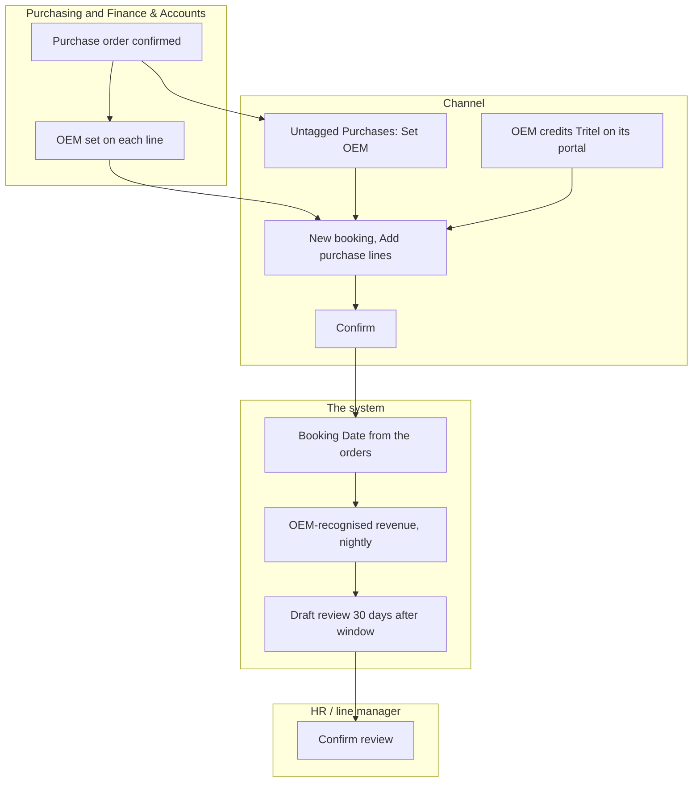

import Illustration from '../../../components/Illustration.astro';

When Tritel buys an OEM's products through a distributor, the OEM credits Tritel with its own figure for the sale on its partner portal. This journey follows that purchase: the purchase order is confirmed, its lines carry the OEM, the Channel team books the portal figure against those lines and confirms it, and the confirmed booking becomes **OEM-recognised revenue** on the OEM revenue target. Purchasing and Finance & Accounts own the orders, the Channel team owns the bookings, and the line manager confirms the review.

## The journey at a glance

## Step by step

| # | Who | Where | What happens | Guide |
|---|---|---|---|---|
| 1 | Channel Manager | **Channel › OEMs(Vendors)** | The OEM, its distributors and the OEM on each product are kept up to date, so purchases are tagged without help. | [OEMs and distributors](/tenders/channel/oems-and-distributors/) |
| 2 | Buyer | **Purchase** | The purchase order is confirmed. Each line gets its **OEM** from the product, or from a distributor that carries only one OEM. | [OEMs and distributors](/tenders/channel/oems-and-distributors/) |
| 3 | Channel Manager | **Channel › Untagged Purchases** | Lines the system couldn't tag are given their OEM with **Set OEM**. | [Set the OEM on untagged purchases](/tenders/channel/tag-untagged-purchases/) |
| 4 | Channel Manager | **Channel › OEM Bookings** | A booking is created with the **Portal Reference**, **OEM**, **OEM-Recognised Amount** and **Portal Date**. **Add purchase lines** links the lines it covers. | [Book OEM purchases](/tenders/channel/book-oem-purchases/) |
| 5 | Channel Manager | Booking, **Reconciliation (USD)** | The margin is checked against the purchase cost, then **Confirm**. | [Book OEM purchases](/tenders/channel/book-oem-purchases/) |
| 6 | The system | Booking | **Booking Date** is the latest confirmation date of the linked purchase orders. It decides the window the booking counts in. | [OEM booking value and booking date](/tenders/calculations/oem-bookings/) |
| 7 | The system | Nightly | **OEM-recognised revenue (USD)** adds the confirmed bookings for the OEM chosen in **Measured For**, by booking date, and refreshes the target's **Provisional** value. | [How metrics count](/accountability/calculations/metric-families/) |
| 8 | The system, then the line manager | *Confirm Metric Review* to-do | 30 days after the window closes, a draft review is created with the figure. The manager checks the worksheet and confirms. | [Conduct a review](/accountability/how-to/line-managers/conduct-a-review/) |
| 9 | Channel Manager, if an order is cancelled | Booking, **Reset to Draft** | Lines from a cancelled order are removed and the booking confirmed again. | [When a purchase order is cancelled](/tenders/channel/cancelled-orders/) |

## Worked example

<Illustration name="end-to-end/e2e-oem-booking-score" caption="Two confirmed Q3 bookings take OEM A's year-to-date figure to USD 120,000. The draft booking doesn't count until it is confirmed." />

## What carries across

| From | To | What travels | When |
|---|---|---|---|
| Product or distributor | Purchase line | The **OEM** | When the line is added to the order |
| Purchase lines | Booking | Each line's **Subtotal (USD)**, at the rate on its order's confirmation date, adds up to **Purchase Cost (USD)** | When lines are added; worked out again when they change |
| OEM portal | Booking | **OEM-Recognised Amount**, **Currency**, **Portal Date** (reference only) | Typed by the Channel Manager |
| Purchase orders | Booking | **Booking Date**: the latest confirmation date of the linked orders | Whenever lines or confirmation dates change |
| Confirmed booking | OEM-recognised revenue | **Recognised (USD)**, in the window that holds the booking date | Nightly; the review waits 30 days after the window |
| Tagged lines with no confirmed booking | Worksheet | Listed as *awaiting OEM confirmation (not counted)* | Nightly |

## Where it can go wrong

| What happens | Effect | Fix |
|---|---|---|
| Purchase lines have no OEM | They can't be booked and don't show as awaiting the OEM. | Tag them in **Channel › Untagged Purchases**. See [Set the OEM on untagged purchases](/tenders/channel/tag-untagged-purchases/). |
| The booking is left in **Draft** | It counts nowhere, whatever its date. | Check the figures and click **Confirm**. See [OEM booking workflow](/tenders/channel/booking-workflow/). |
| A confirmed booking is reset to draft and left there | It stops counting, and a review created in that time misses it. | Confirm it again promptly. |
| A purchase order behind a confirmed booking is cancelled | A red banner appears and the creator gets a to-do. | **Reset to Draft**, remove the lines, check the amount, **Confirm**. See [When a purchase order is cancelled](/tenders/channel/cancelled-orders/). |
| The booking is entered late, or a later order's lines are added | The booking date can fall in a window that was already reviewed, or move to a later one. | Book each portal figure as soon as it appears. The 30-day wait catches most late entries. |

:::note[Good to know]
- **OEM-recognised revenue (USD)** is organisation-wide: everyone whose target uses it with the same OEM sees the same figure.
- The **Portal Date** doesn't decide the window. A booking whose orders were confirmed in March and April counts in April.
- Bookings aren't linked to tenders or opportunities. The worksheet shows each purchase order's tender reference when the order has one.
:::
