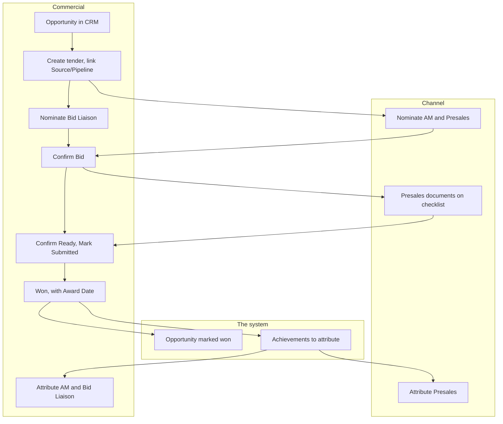
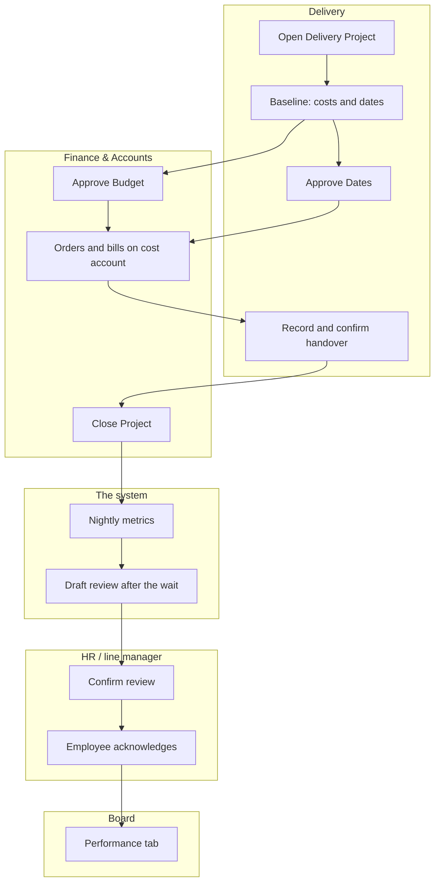

import Illustration from '../../../components/Illustration.astro';

This is the main journey. An account manager works an opportunity in CRM; the customer publishes a tender; the bid team prepares and submits it; the tender is won; the heads credit the win to the people who earned it; the delivery team opens a project, delivers it, hands it over and finance closes it. Along the way the system records the figures that Accountability reads every night: pipeline, achieved revenue, bid desk timings and quality, and the delivery result. Line managers confirm those figures in reviews, and the board sees the organisation's results. Commercial, Channel, Delivery, Finance & Accounts and line managers each own a part.

## The journey at a glance

### Part 1: winning the work

### Part 2: delivering and measuring

## Step by step

| # | Who | Where | What happens | Guide |
|---|---|---|---|---|
| 1 | Account Manager; Head of Channel assigns the account manager and Technical Presales | **CRM** | The opportunity is worked in CRM. Its expected revenue counts in the account manager's open and qualified pipeline. | [Opportunities and tenders](/tenders/concepts/opportunities-and-tenders/) |
| 2 | Account Manager | **Tender Manager › Tenders › All Tenders** | The tender is created in **Draft** with its **Expected Revenue**, **Submission Deadline** and the opportunity in **Source/Pipeline**. The heads get nomination to-dos. | [Create a tender from an opportunity](/tenders/how-to/bids/create-a-tender/) |
| 3 | Head of Commercial (Bid Liaison); Head of Channel (Technical Presales, and the account manager if empty) | **Tender Manager › My Actions** | The team is nominated with **Assign**. The Bid Liaison window shows each person's workload. | [Nominate the team](/tenders/how-to/bids/nominate-the-team/) |
| 4 | Account Manager | **Tender Manager › Tenders › All Tenders** | **Confirm Bid** moves the tender to **Bidding** and builds the readiness checklist. A business case can be prepared now. | [Confirm the bid](/tenders/how-to/bids/confirm-the-bid/), [Prepare a business case](/tenders/how-to/bids/business-case/) |
| 5 | Bid Liaison and Technical Presales | Tender, **Bid Readiness** tab | Each document is attached; the Bid Liaison clicks **Confirm Ready**, ideally 72 hours before the deadline. | [Work the readiness checklist](/tenders/how-to/bids/work-the-readiness-checklist/) |
| 6 | Bid Liaison | Tender, **Mark Submitted** | The tender moves to **Evaluation** with the real submission time and receipt. | [Mark a tender submitted](/tenders/how-to/bids/mark-submitted/) |
| 7 | The Bid Liaison's manager | **Tender Manager › My Actions** | The bid's quality is scored within 10 days. | [Score a bid's quality](/tenders/how-to/bids/score-bid-quality/) |
| 8 | Account Manager (or whoever the team agrees records results) | Tender, **Won** | **Mark as Won** records the **Award Date**. The linked opportunity is marked won and the won alert email goes out. | [Record the result](/tenders/how-to/bids/record-the-result/) |
| 9 | Head of Commercial (Account Manager and Bid Liaison); Head of Channel (Technical Presales) | **Tender Manager › My Actions**, **Achievements to attribute** | Each person gets an achievement line on the **Target Achievements** tab with points for **Pipelining**, **Bid Submission Support** and **Post-Submission Influence**. | [Attribute a won tender](/tenders/how-to/bids/attribute-a-won-tender/) |
| 10 | Delivery PM | Won tender, **Open Delivery Project** | The project is created and linked to the tender, with a cost account, stages, milestones and **Baseline v1** in **Draft**, due 14 days after the award date. | [Open a delivery project](/projects/how-to/delivery-pm/open-a-delivery-project/) |
| 11 | Delivery PM | **Project › Delivery › Delivery Projects** | The costs, payment months, completion date and milestones are entered, then **Confirm for Approval**. | [Build a baseline](/projects/how-to/delivery-pm/build-a-baseline/), [Send for approval](/projects/how-to/delivery-pm/send-for-approval/) |
| 12 | Head of Delivery; Delivery Finance | **Project › Delivery › Waiting for My Approval** | **Approve Dates** and **Approve Budget**. When both are in, the baseline is **Approved** and the Odoo budget is created. | [Approve dates](/projects/how-to/approvers/approve-dates/), [Approve budget](/projects/how-to/approvers/approve-budget/) |
| 13 | Buyers, Finance & Accounts, Delivery Finance | Purchase orders and vendor bills | Orders and bills carry the project's cost account and show as committed and spent, refreshed every night. | [Tag orders to their project](/projects/how-to/approvers/tag-orders-to-a-project/), [Track the budget](/projects/how-to/delivery-pm/track-the-budget/) |
| 14 | Delivery PM; Head of Delivery | **Record Handover**; **Project › Delivery › Handovers** | The handover date is recorded and confirmed. Any client delays are logged and approved. | [Record a handover](/projects/how-to/delivery-pm/record-a-handover/), [Confirm a handover](/projects/how-to/approvers/confirm-a-handover/) |
| 15 | Delivery Finance | Project, **Close Project** | The final cost is confirmed and the result (on time, on budget) is frozen. | [Close or reopen a project](/projects/how-to/approvers/close-a-project/) |
| 16 | The system | Nightly | Metrics on targets refresh their **Provisional** values. After each window closes and its wait has passed, a draft review is created with the figure filled in. | [Metrics](/accountability/concepts/metrics/) |
| 17 | Line manager | *Confirm Metric Review* to-do, or **Accountability › My Team › Review Sessions** | The manager checks the figure (**ƒx** shows the records behind it) and confirms or submits the review. | [Conduct a review](/accountability/how-to/line-managers/conduct-a-review/) |
| 18 | Employee | **Accountability › My Performance** | The employee reads the result and acknowledges it, or raises a concern. | [Check my targets](/accountability/how-to/everyone/my-targets/), [Respond to my review](/accountability/how-to/everyone/respond-to-my-review/) |
| 19 | Board members, MD | **E-Board › Performance** | The organisation's score, won tenders and win rate appear, live or as at a month end. | [Read the Performance tab](/board/how-to/read-performance/) |

## One won tender, worked through

TND-2026-001 is won for KES 10,000,000 on 14 August 2026. The heads attribute it:

<Illustration name="end-to-end/e2e-won-tender-split" caption="The tender's value is credited to each role by their attribution points. All three lines count in Q3 2026, the quarter of the award date." />

The account manager, Employee A, has an **Achieved revenue (attributed) — Account Manager** target of KES 120,000,000 for FY 2026, measured **Period to date**. Their Q3 review picks up the new KES 8,000,000:

<Illustration name="end-to-end/e2e-revenue-target-score" caption="The Q3 review counts every attributed win from 1 January to 30 September." />

The same win also adds to Employee A's **Gross awarded value** and **Awarded tenders**, and, through the Bid Liaison's and Presales' lines, to their own achieved revenue targets. The opportunity being marked won takes its value out of Employee A's open pipeline and adds it to **Qualified pipeline (quarter)** as a deal won in the window.

## What carries across

| From | To | What travels | When |
|---|---|---|---|
| CRM opportunity | Tender | The customer, and the account manager from the customer. The link in **Source/Pipeline** gives the tender a **Pipeline** smart button and the opportunity a **Tenders** smart button. | When the tender is saved |
| Tender result | CRM opportunity | **Won** or **Prequalified** marks the opportunity won; **Lost** marks it lost. **Dropped** and **Cancelled** leave it as it is. | When the result is recorded |
| Tender | Achievement lines | **Expected Revenue** in KES becomes each line's **Gross Value**. The **Award Date** sets the quarter in **Date From** and **Date To**. | When the head adds the line |
| Achievement lines | Achieved revenue metrics | **Achieved Value** = **Gross Value** × points ÷ 100, counted in the window that holds the award date. | Nightly; the review waits the **Metric Settle Period (days)** (3 by default) after the window |
| Tender bid steps | Bid desk metrics | Bid decision time, ready time, submission time, quality score, confirmed disqualifications. | 14 days after the window. See [Bid desk to bid KPIs](/end-to-end/bid-desk-to-bid-kpis/) |
| Won tender | Delivery project | **Won tender**, **Client** and **Award Date**; the project's **Delivery** tab shows the **Tender**, **Award date**, **Contract value** and **Baseline due** (award date + 14 days). | When the project is opened |
| Closed project | Delivery metrics | **On time**, **On budget** and the **Result**, counted in the window that holds the confirmed handover date. | 30 days after the window. See [Won tender to Delivery KPI](/end-to-end/project-to-delivery-kpi/) |
| Reviews | Scores and the board | Signed-off reviews update each target's score. Scores are recalculated every day; the board's **As at** figures are rebuilt from reviews up to each month end. | Daily |

## Where it can go wrong

| What happens | Effect | Fix |
|---|---|---|
| The tender isn't linked to its opportunity | The opportunity stays open in CRM after the win or loss, so pipeline figures still include it. | Pick the opportunity in **Source/Pipeline** (same customer). If the tender is already closed, close the opportunity in CRM. See [Create a tender](/tenders/how-to/bids/create-a-tender/). |
| The win is never recorded, or has no **Award Date** | Nothing is attributed and nothing reaches the revenue targets. Delivery can't open a project. | Record **Won** with the award date. See [Record the result](/tenders/how-to/bids/record-the-result/). |
| The win isn't attributed, or a line has 0 points | It counts as 0 in achieved revenue. The worksheet flags it as *award(s) awaiting attribution*. | Each head adds the line and the points, or clicks **Compute Related Activities**. See [Attribute a won tender](/tenders/how-to/bids/attribute-a-won-tender/). |
| The project isn't linked to its tender | It isn't a delivery project: no baseline, and the Delivery KPI doesn't measure it. | **Link to Won Tender** from **Project › Delivery › Projects to Link**. See [Link an existing project](/projects/how-to/delivery-pm/link-an-existing-project/). |
| The handover isn't confirmed, or finance hasn't closed the project | The project is listed in the delivery worksheet but not counted. | Confirm the handover, then close the project. See [Close or reopen a project](/projects/how-to/approvers/close-a-project/). |
| The target has no metric, or **Automatic Reviews** is off | No draft review appears; the figure must be fetched or typed in the review. | An accountability administrator sets the **Metric** and **Automatic Reviews** in **Data Source**. See [Set up and test a metric](/accountability/how-to/hr-admin/metrics/). |

:::note[Good to know]
- Attribution is the only route from a won tender to achieved revenue. Invoices reach a different metric, **Invoiced revenue**, through the salesperson on each posted customer invoice.
- Attribute wins promptly. The review for a window is prepared from the achievement lines that exist once the window has closed and its wait (3 days by default) has passed.
:::
