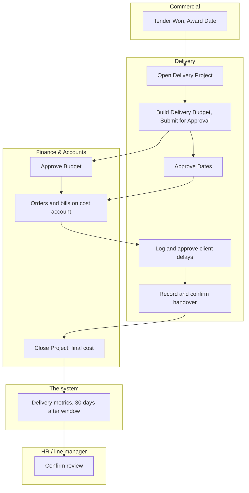

import Illustration from '../../../components/Illustration.astro';

Once a tender is won, the delivery team turns it into a **delivery project** with an approved plan: a budget and a completion date. The project is tracked against that plan, handed over to the client, and closed by finance with a final cost. Closing freezes two answers, **on time** and **on budget**, and those answers feed the project manager's delivery targets. Delivery owns the plan and the handover, Delivery Finance owns the budget approval and the close, the Head of Delivery approves dates, client delays and handovers, and the MD approves large revisions.

## The journey at a glance

## Step by step

| # | Who | Where | What happens | Guide |
|---|---|---|---|---|
| 1 | Account Manager (or whoever records results) | Tender, **Won** | The tender is **Won** with its **Award Date**. | [Record the result](/tenders/how-to/bids/record-the-result/) |
| 2 | Delivery PM (or the Head of Delivery for someone's first project) | **Tender Manager › Tenders › All Tenders**, **Open Delivery Project** | The project is created and linked to the tender, with its project code (for example **P26-049**), its **Cost account** carrying that code, delivery stages, standard milestones and **Budget v1** in **Draft**. Whoever is named **Project manager** gets the Delivery Project Manager role. An older project is linked instead with **Link to Won Tender**. | [Open a delivery project](/projects/how-to/delivery-pm/open-a-delivery-project/), [Link an existing project](/projects/how-to/delivery-pm/link-an-existing-project/) |
| 3 | Delivery PM | **Project › Delivery › Projects › My Delivery Projects** | The cost items, payment months, **Completion date** and milestone dates are entered. The Delivery Budget is due 14 days after the award date. | [Build a Delivery Budget](/projects/how-to/delivery-pm/build-a-baseline/), [Set dates and milestones](/projects/how-to/delivery-pm/set-dates-and-milestones/) |
| 4 | Delivery PM | Delivery Budget, **Submit for Approval** | The budget is locked and the approvers get to-dos. The PM follows it in **Project › Delivery › Projects › My Submissions**. | [Submit a Delivery Budget for approval](/projects/how-to/delivery-pm/send-for-approval/) |
| 5 | Head of Delivery; Delivery Finance | **Project › Delivery › To approve › Waiting for Me** (Finance can also use **Accounting › Project Budgets › To approve › Budgets to Approve**) | **Approve Dates** and **Approve Budget**. The Delivery Budget becomes **Approved**, the accounting budget is created on the cost account and tracking starts. | [Approve dates](/projects/how-to/approvers/approve-dates/), [Approve budget](/projects/how-to/approvers/approve-budget/) |
| 6 | Buyers, Finance & Accounts, Delivery Finance | Purchase orders, vendor bills | Orders and bills carry the cost account, and count as committed and spent every night. Each order shows its **Budget status** against the accounting budget. | [Tag orders to their project](/projects/how-to/approvers/tag-orders-to-a-project/), [Set the cost account on order lines](/projects/how-to/approvers/assign-cost-accounts/), [Check an order against the budget](/projects/how-to/approvers/check-an-order-against-the-budget/), [Track the budget](/projects/how-to/delivery-pm/track-the-budget/) |
| 7 | Delivery PM; Head of Delivery, Delivery Finance, MD | Project, **Delivery** tab, **Request Revision** | If the plan has to change, a revision goes through approval again. The latest approved Delivery Budget is the one measured. | [Request a revision](/projects/how-to/delivery-pm/request-a-revision/), [Approve a large revision](/projects/how-to/approvers/approve-a-large-revision/) |
| 8 | Delivery PM; Head of Delivery | Project, **Log Client Delay**; **Project › Delivery › Projects › Client Delays** | Each period the client held the work up is logged with evidence and approved. Approved days move the deadline. | [Log a client delay](/projects/how-to/delivery-pm/log-a-client-delay/), [Approve a client delay](/projects/how-to/approvers/approve-a-client-delay/) |
| 9 | Delivery PM; Head of Delivery | Project, **Record Handover**; **Project › Delivery › Projects › Handovers** | The handover date is recorded, then confirmed. Delivery Finance gets a *Close delivery project* to-do. | [Record a handover](/projects/how-to/delivery-pm/record-a-handover/), [Confirm a handover](/projects/how-to/approvers/confirm-a-handover/) |
| 10 | Delivery Finance | Project, **Close Project** | The final cost is confirmed, with any adjustment, and the **Result** is frozen. | [Close or reopen a project](/projects/how-to/approvers/close-a-project/) |
| 11 | The system | Nightly | The delivery metrics count the project in the window of its confirmed handover date. | [The Delivery KPI](/projects/concepts/delivery-kpi/) |
| 12 | The system, then the line manager | *Confirm Metric Review* to-do | 30 days after the window, a draft review is created with the rate. The manager checks the worksheet and confirms; the project manager acknowledges. | [Conduct a review](/accountability/how-to/line-managers/conduct-a-review/) |

## Worked example

<Illustration name="end-to-end/e2e-delivery-kpi-result" caption="A project handed over within the grace and below budget, and the quarter's success rate it contributes to." />

The delivery targets are usually quarterly **Threshold / SLA** targets with a **Compliance Floor** of 0 and an **Ideal Target (Full Credit)** of 100, so the review's score is the rate itself: 66.7% scores 66.7%. See [How a target's score is calculated](/accountability/calculations/target-scores/).

## What carries across

| From | To | What travels | When |
|---|---|---|---|
| Won tender | Delivery project | **Won tender**, **Client**, **Award Date**; the **Delivery** tab shows **Tender**, **Award date**, **Contract value** and **Budget due**; the tender's **Projects** button (once called **Delivery projects**) shows the project code | When the project is opened or linked |
| Approved Delivery Budget | Project | The completion date and milestone dates; the accounting budget on the cost account | When the last approval is in |
| Orders and bills | Budget tracking | Committed and spent amounts, on the cost account | Every night |
| Approved client delays | Close-out | **Approved client delay (days)**, overlaps counted once | When approved |
| Confirmed handover | Close-out and metrics | The handover date: on time against the deadline, and the window it counts in | When confirmed |
| Close-out | Delivery metrics | **On time**, **On budget**, **Result**, frozen with the grace and budget at close | When closed; reviewed 30 days after the window |

## Where it can go wrong

| What happens | Effect | Fix |
|---|---|---|
| The project isn't linked to its won tender | It has no Delivery Budget and the Delivery KPI doesn't measure it. | **Link to Won Tender**. See [Link an existing project](/projects/how-to/delivery-pm/link-an-existing-project/). |
| The project is linked to its tender for reference only | The tender's **Projects** button shows it, but it isn't a delivery project: no Delivery Budget, and the Delivery KPI doesn't measure it. Its **Delivery** tab says *Linked to tender Data Centre Upgrade for reference.* | **Make It a Delivery Project** on its **Delivery** tab. See [Make a link-only project a delivery project](/projects/how-to/delivery-pm/link-an-existing-project/#make-a-link-only-project-a-delivery-project). |
| No approved Delivery Budget by close | The project closes as **Not scored** and isn't counted. | Get the budget approved before the handover. See [Submit a Delivery Budget for approval](/projects/how-to/delivery-pm/send-for-approval/). |
| Orders or bills don't carry the cost account | Spending doesn't count against the project, so tracking and the final cost are understated. The order shows **No cost account** as its **Budget status**. | Tag them. See [Tag orders to their project](/projects/how-to/approvers/tag-orders-to-a-project/) or [Set the cost account on order lines](/projects/how-to/approvers/assign-cost-accounts/). |
| A client delay is logged late, rejected or left waiting | Its days don't move the deadline; finance can't close while one is waiting for approval. | Log each delay as it happens, with evidence. See [Log a client delay](/projects/how-to/delivery-pm/log-a-client-delay/). |
| The handover is recorded but not confirmed | Finance can't close and the project isn't counted. | The Head of Delivery confirms or returns it. See [Confirm a handover](/projects/how-to/approvers/confirm-a-handover/). |
| The project is handed over but not closed | It is listed in the worksheet as *handed over but not yet closed by finance* and isn't counted. | Delivery Finance closes it, within the 30-day wait where possible. See [Close or reopen a project](/projects/how-to/approvers/close-a-project/). |

:::note[Good to know]
- With fewer than 3 counted projects in a window, the previous window of the same length is added, so one late project doesn't decide a whole quarter.
- Reopening and closing a project again works its result out afresh. Costs posted after close don't change the result; they show as costs after close.
- While delivery targets are being trialled they may be marked **Development (not scored)**: they are reviewed like any other target but don't count towards a score. See [Exempt staff, withdrawn and development targets](/accountability/concepts/exempt-withdrawn-development/).
:::
