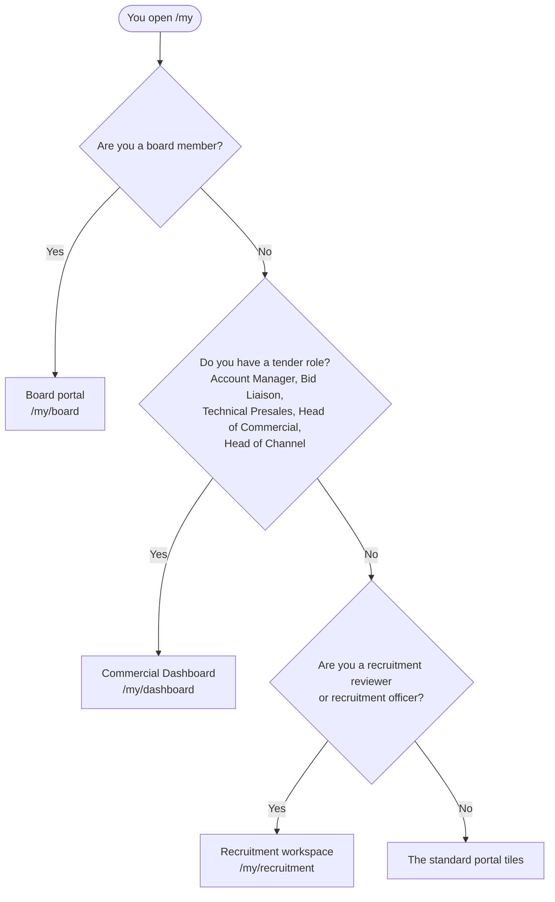

import Illustration from '../../../components/Illustration.astro';

Tritel's systems all live in one place, Odoo. There are two ways in.

| | The back office | The portal |
|---|---|---|
| What it looks like | Odoo's full screens: menus, lists, forms | Simple web pages under **/my** |
| Who uses it | Staff who create and approve records | Staff on the go, and board members |
| How you get there | Log in, then pick an app | Log in, then go to **/my** |

Most staff use both: the back office for detailed work, the portal for a quick look at their own figures.

## Logging in

1. Open the Tritel ERP address your IT team gave you.
2. Enter your work email and password, then click **Log in**.
3. You land on the back office home screen with the app icons.

Forgotten your password? Click **Reset Password** on the login page and follow the email.

## Where the portal sends you

When you open **/my**, the portal takes you straight to your own workspace. If more than one applies, the first in this list wins:

To see all the portal tiles instead, open **/my?tiles=1**.

:::note[Good to know]
The Commercial Dashboard needs your user to be linked to an employee record. If you have a tender role but land on the tiles instead, ask HR to link your employee record to your user.
:::

<Illustration name="general/odoo-screen-parts" caption="The back office after you log in: pick an app, then use its top menu." />
