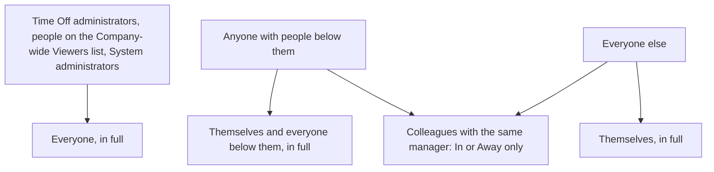

Who you see in the Time Off pages follows the **reporting line**: the **Manager** set on each employee's record. Your leave type and your requests are shown to you, to the people above you and to HR. Colleagues who share your manager only see whether you are in or away.

## In full, or In or Away only

| Shown | What you see |
|---|---|
| **In full** | The leave type (for example **Annual Leave**), half days (**AM** or **PM**), part days, and requests waiting for approval (striped, *Requested: Annual Leave*). |
| **In or Away only** | **Away** on days of approved time off, without the type. Requests waiting for approval are not shown at all. The person's row says *In or Away only*. |

The **Type** and **Status** filters in Team Presence only apply to people you see in full. A colleague's **Away** stays on screen whatever you pick.

Clicking a coloured day opens the request itself only if your normal access to Time Off lets you open it, for example because you are the approver or a Time Off officer.

## Where each rule applies

| Page | Who you see |
|---|---|
| **Team Presence** (and **/my/presence**) | As in the diagram above. |
| **Your team this week** on My Leave | Colleagues with the same manager as you, as **In all week** or **Away Mon, Tue**. |
| **My Team** (and **/my/team-leave**) | Your direct reports, or **Everyone below me**. People on the Company-wide Viewers list (and System administrators) also get **Everyone in the company**, and get My Team even when nobody reports to them. |
| **A person's leave history** (clicking a name on My Team, or **/my/team-leave/…** on the portal) | Your own, anyone below you in the reporting line, or anyone at all if you are on the Company-wide Viewers list or a System administrator. |
| **Approvals** | Only the requests you are asked to decide. See [Approval steps, delegates and escalation](/leave/concepts/approval-steps/). |

Time Off administrators see everyone in Team Presence. To see everyone on My Team and open anyone's leave history as well, they need to be on the Company-wide Viewers list. See [Give HR the company-wide view](/leave/how-to/hr/company-wide-view/).

## Service accounts

Some employee records aren't people taking leave, such as the Administrator account or a shared HR mailbox. HR can hide them with **Hide from Time Off views**. They then disappear from Team Presence (grid, calendar, counts and the Excel download), My Team, the week lists and the approvals lists, and the daily job stops chasing their requests. Their records are kept. A manager can still open a hidden person's leave history if that person is below them. See [Hide service accounts from Time Off](/leave/how-to/hr/hide-service-accounts/).

:::note[Good to know]
- If your user isn't linked to an employee, Team Presence says *There's nobody to show. Your user may not be linked to an employee.* and My Leave has nothing to show. Ask HR to link your user to your employee record.
- Opening the leave history of someone you may not see stops with *You can't see Employee B's time off.* On the portal the page is refused.
- Being a Time Off officer doesn't, by itself, show you anyone's leave history on these pages.
- Who sees what is worked out each time a page opens, so a change of manager applies straight away.
:::
