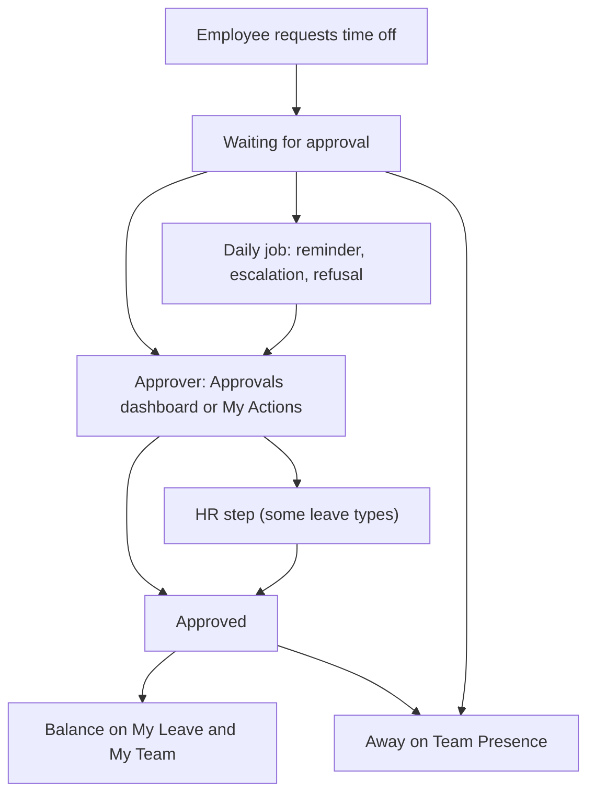

Tritel uses Odoo's **Time Off** app for leave: you request time off there, your manager approves it, and HR keeps the allocations and leave types. Tritel has added a few things on top so that everyone can see their balance at a glance, managers can see who is in, and requests don't sit waiting:

- **The Time Off home.** The app opens on it. Everyone gets **My Leave**: their balance first, then their requests and who in their team is away this week. Anyone with people reporting to them also gets **My Team**: who is in this week, what is waiting for their approval, and their team's balances.
- **Team Presence.** A week or a month of who is in, who is away and who has asked for time off, as a grid or a calendar.
- **Approvals alongside other approvals.** Requests waiting for you appear on the **Approvals dashboard** and in **My Actions**, where you can **Approve**, **Refuse** or **Ask** a question. While an approver is away, the person they delegated to can give the manager's approval.
- **Reminders and escalation.** A daily job reminds the approver, escalates requests that wait too long, and refuses requests whose dates pass while they are still waiting.
- **The portal.** **My Leave**, **My Team's Leave** and **Team Presence** are also on the portal (**/my**).

## How the parts fit together

## Who uses what

| Who | What they use |
|---|---|
| **Everyone** | **Time Off › Home** (**My Leave**) to check their balance and request time off; **Team Presence** to see who is in; the portal pages. See [Check my leave and request time off](/leave/how-to/everyone/my-leave/). |
| **Line managers** (anyone with people reporting to them) | **My Team** on the Time Off home; approving, refusing and asking from the Approvals dashboard or My Actions; delegating approvals while away. See [Use My Team](/leave/how-to/line-managers/my-team/) and [Approve, refuse or ask about time off](/leave/how-to/line-managers/approve-time-off/). |
| **HR** | Everyone's presence and balances, the HR approval step, the reminder settings, the Excel download and hiding service accounts. See [Set reminders, escalation and flags](/leave/how-to/hr/settings/). |

Who sees whose time off depends on the reporting line: see [Who sees whose time off](/leave/concepts/who-sees-what/).

## Where things are

| Menu or page | What it is |
|---|---|
| **Time Off › Home** | Opens **My Team** if people report to you (or you are on the company-wide list), otherwise **My Leave**. |
| **Time Off › My Time Off › My Leave** | Opens **My Leave** directly. Odoo's own **Dashboard**, **My Time Off** and **My Allocations** are next to it. |
| **Time Off › Team Presence** | Who is in, away or waiting for approval, by week or month. |
| **Approvals** (the Approvals dashboard) | **Time Off to Approve**, with **Approve**, **Refuse** and **Ask**. |
| **Time Off › Configuration › Approvals & Presence** | Reminder, escalation and flag settings (Time Off administrators). |
| **Time Off › Configuration › Company-wide Time Off View** | People who see the whole company (Time Off administrators). |
| **/my/leave**, **/my/team-leave**, **/my/presence** | The same pages on the portal. See [Use My Leave and Team Presence on the portal](/leave/how-to/everyone/on-the-portal/). |

## Start here

- [Balances: allocated, taken, requested](/leave/concepts/balances/)
- [Check my leave and request time off](/leave/how-to/everyone/my-leave/)
- [See who is in with Team Presence](/leave/how-to/everyone/team-presence/)
- [Approval steps, delegates and escalation](/leave/concepts/approval-steps/)
- [Time off request workflow](/leave/workflows/time-off-request/)
- [Who can do what](/leave/who-can-do-what/)
