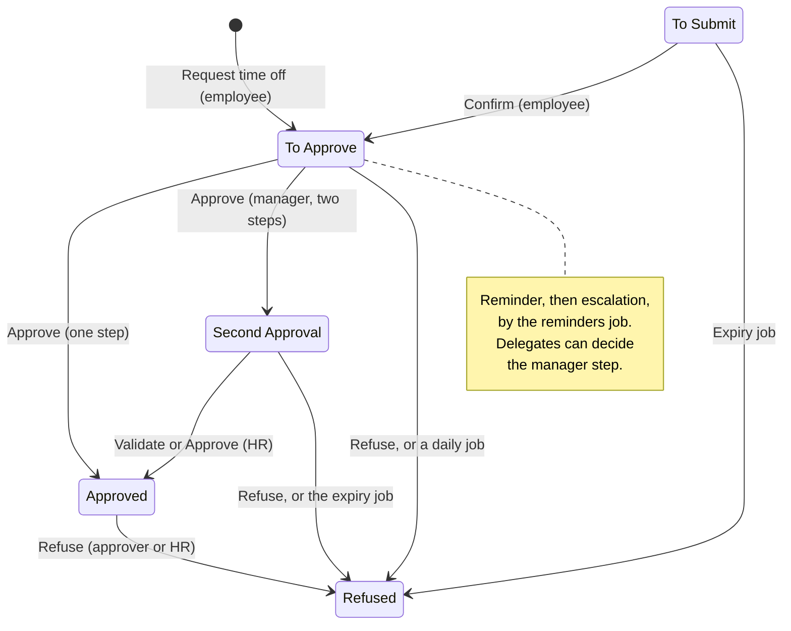
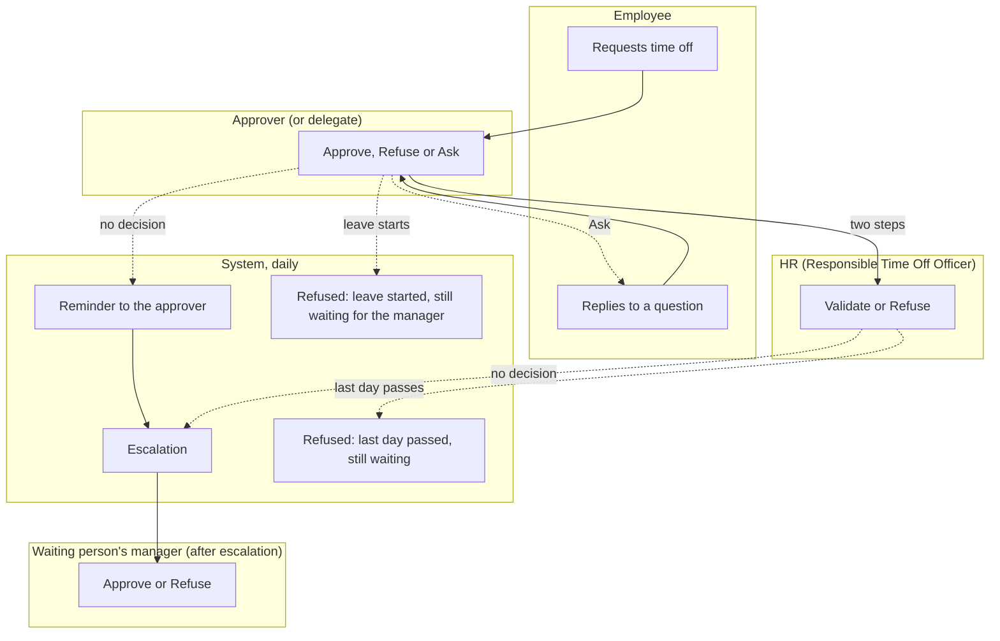

A **time off request** moves through Odoo's own Time Off statuses. Tritel's additions change who can move it (delegates and escalation), and add two daily jobs that chase or close requests that wait too long. How many steps a request has depends on its leave type: see [Approval steps, delegates and escalation](/leave/concepts/approval-steps/).

| Status | What it means | Moves to | Who moves it |
|---|---|---|---|
| **To Submit** | Saved but not sent for approval. Rare: a new request normally goes straight to **To Approve**. | **To Approve** with **Confirm** | The employee |
| **To Approve** | Waiting for its first (or only) step: the manager for most types, HR for HR-only types. | **Approved** (one step) or **Second Approval** (two steps) with **Approve**; **Refused** with **Refuse** | The owner of the step, their delegate (manager step), whoever it was escalated to, or a Time Off officer. Also refused by a daily job (below). |
| **Second Approval** | The manager approved; waiting for HR. | **Approved** with **Validate** (or **Approve** on the dashboard); **Refused** with **Refuse** | The leave type's **Responsible Time Off Officer**, whoever it was escalated to, or a Time Off officer. Also refused by the expiry job (below). |
| **Approved** | Approved. It counts as taken in balances and shows in Team Presence. | **Refused** with **Refuse** | An approver or HR |
| **Refused** | Not granted. The employee is told on the request, with the reason when an approver gave one. | — | — |

## Who does what

## What the system does automatically

Two jobs run every day. The expiry job runs first, in the early hours. The reminders job runs later in the morning.

**HR Leave: Cancel Expired Pending Requests** refuses every request still **To Submit**, **To Approve** or **Second Approval** whose last day has passed. That includes requests waiting for HR. The employee gets Odoo's usual message, *Your Annual Leave planned on … has been refused*.

**Time Off: Approval Reminders and Escalation** looks at each request that is **To Approve** or **Second Approval**:

1. **Refuse once the leave has started:** a request still waiting for the **manager** after its first day is refused on the next run (the leave's second day), with the note *Refused automatically: it was still waiting for approval when the leave started (01 Dec 2026). Request it again if you still need it.* This applies while **Refuse requests still waiting for the manager when the leave starts** is ticked in the settings (it is by default).
2. **Escalate:** after 4 working days of waiting, or from 2 days before the leave starts once it has waited at least a working day, the request is escalated to the approver's own manager. They get a to-do and can decide it.
3. **Remind:** after 2 working days, the approver (and their delegate, for the manager step) gets a reminder note on the request.

Each reminder and escalation happens once per step, and the numbers are company settings. The day counting, with an example: [Reminders, escalation and automatic refusal](/leave/calculations/reminders-and-escalation/).

:::note[Good to know]
- The **Approvals & Presence** settings screen says a request the manager approved that is still waiting for HR is *escalated, never refused*. That is true of the reminders job. But the expiry job refuses any request still waiting once its last day has passed, the HR step included.
- This matters most for leave recorded after the fact, such as sick leave entered on return: approve it the same day it is entered, or the next night's job refuses it. If that happens, the employee requests it again and HR approves it straight away.
- Approved time off stays approved: neither job touches it.
:::
