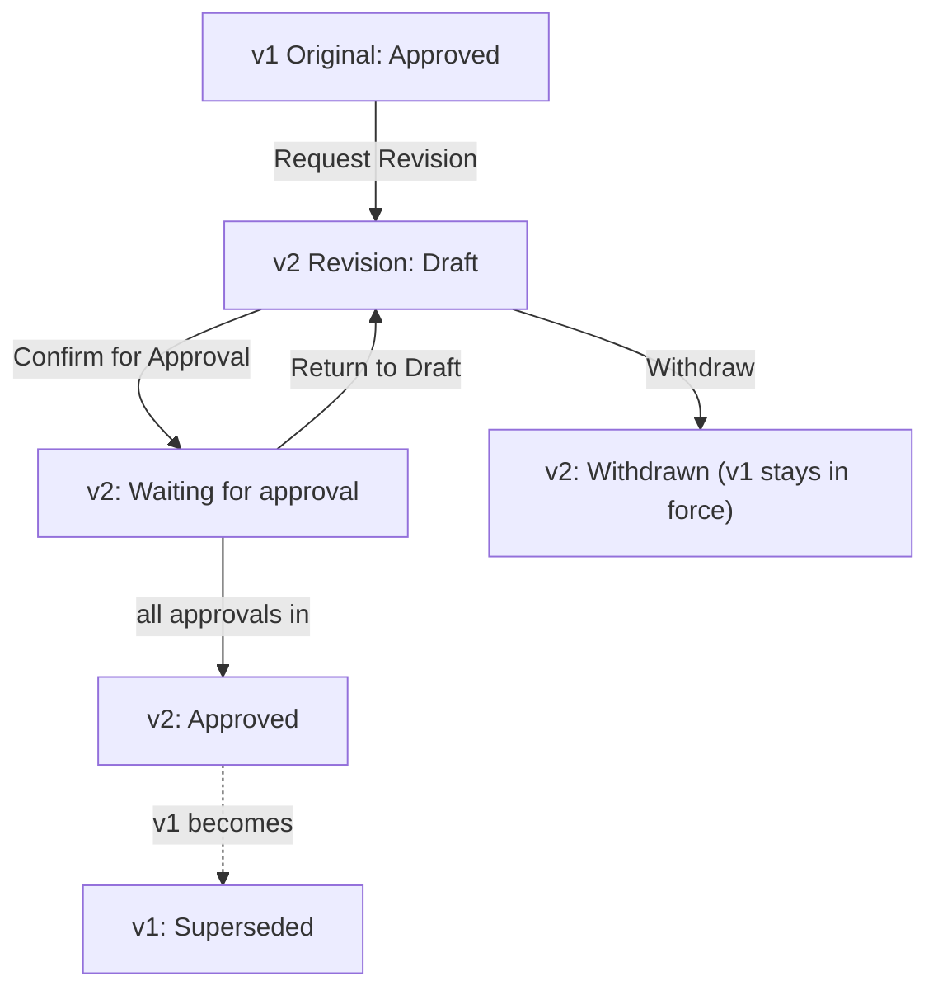

import Illustration from '../../../../components/Illustration.astro';

A **delivery baseline** is the plan a delivery project is measured against. It holds two things:

- **the budget:** every cost item the project will pay for, the month each is paid, and the totals by budget category;
- **the dates:** the **Completion date** and a planned date for each milestone.

Each baseline is a numbered version. **Baseline v1** is the **Original**. Once a version is approved, it can't be edited. If the plan has to change, the project manager clicks **Request Revision** on the project. The system copies the approved version into a new draft (v2, v3 and so on) marked **Revision**, and the changes go through approval again. The approved version stays in force until the revision is approved.

<Illustration name="projects/concept-baseline-form" caption="A revision in draft. The numbers match the list below." />

1. **Confirm for Approval** sends the draft to the approvers. **Withdraw** abandons it; it stays on record but no longer counts.
2. The **Status**: **Draft**, **Waiting for approval**, **Approved**, and later **Superseded** or **Withdrawn**. Only a draft can be edited.
3. **Completion date**, **Budget total** (contingency included) and **Contingency**. Amounts are before VAT and in KES.
4. The **Change** group (revisions only): **Budget vs previous** and **Days vs previous** compare with the version before; **Budget vs original (%)** and **Days vs original** compare with v1. These decide whether the MD must also approve.
5. **Reason for revision**: required on a revision.
6. The tabs: **Costs** (the cost items), **Changes** (items added, changed or removed since the previous version), **Summary by category** (totals and the spend plan by month), **Milestones** and **Approvals**.

## What approval fixes

When the last approval needed is given, the baseline becomes **Approved** and the system:

- sets the project's end date to the **Completion date**, and creates or moves the project milestones to the baseline's dates;
- fixes the exchange rate on every foreign-currency cost item (if finance hasn't already), and the tender's revenue rate;
- creates the Odoo budget for this version on the project's cost account and confirms it;
- marks the previous approved version **Superseded** and cancels its Odoo budget;
- refreshes budget tracking, tells the project manager, and posts a summary in the project's chatter.

## What a revision must have

- A **Reason for revision**. Without it, confirming stops with *Explain the reason for this revision.*
- A real change to the costs, the completion date or a milestone date. If nothing changed, you see *This revision changes nothing compared with v1.* Moving only the **Pay from** and **Pay until** months doesn't count as a change.
- An open project. A closed project can't be revised until finance reopens it.

## The project's baseline status

The project shows one **Baseline** value that sums up its versions:

| Baseline | Meaning |
|---|---|
| **No baseline** | No version is in draft, waiting or approved. |
| **Baseline in draft** | The first baseline is being written. |
| **Waiting for approval** | The first baseline is with the approvers. |
| **Approved** | An approved version is in force and nothing else is open. |
| **Revision pending** | An approved version is in force and a revision is in draft or waiting. |

Expected revenue and margin are shown on the baseline too. If the costs of this and the tender's other delivery projects go over the tender's expected revenue, a red banner says *Costs are over the expected revenue. You can still confirm; the approvers will see this.*

:::note[Good to know]
- Every project user can open and read every baseline, including the costs on other managers' projects.
- The **Delivery baseline overdue** to-do goes out once per project, the day after **Baseline due** passes, to the project manager and every Head of Delivery. It is not repeated. After that the project stays in **My Actions** until its baseline is confirmed for approval.
- Editing an approved or waiting baseline stops with *Baseline v1 is Approved and can no longer be edited. Return it to draft or request a revision.*
:::

## Tasks that use this

- [Build a baseline with the cost item builder](/projects/how-to/delivery-pm/build-a-baseline/)
- [Set the completion date and milestones](/projects/how-to/delivery-pm/set-dates-and-milestones/)
- [Send a baseline for approval](/projects/how-to/delivery-pm/send-for-approval/)
- [Fix a baseline that was sent back](/projects/how-to/delivery-pm/fix-a-returned-baseline/)
- [Request a revision](/projects/how-to/delivery-pm/request-a-revision/)
- [What changed, and which approvals a revision needs](/projects/calculations/revisions-and-approvals/)
- [Baseline workflow](/projects/workflows/baseline/)
