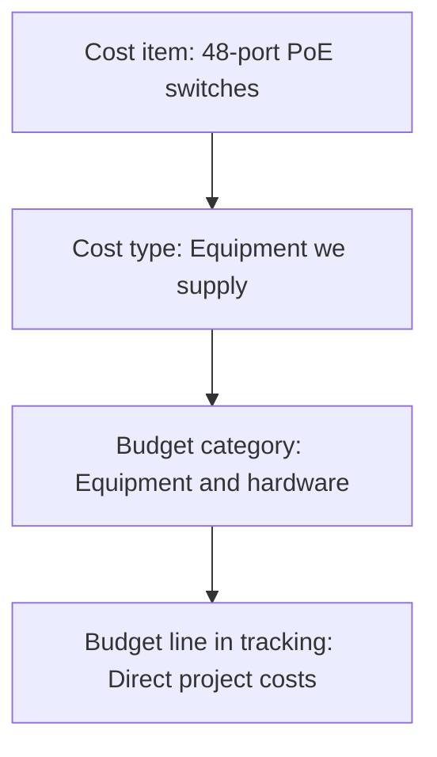

import Illustration from '../../../../components/Illustration.astro';

A baseline's budget is built from **cost items**: one line for each thing the project will pay for, such as *48-port PoE switches* or *Installation by subcontractor*. You list them on the **Costs** tab of the baseline, in plain words, much like a BOQ or cost sheet. The system works out each item's amount before VAT and in KES, and adds the items up by **budget category**. Those category totals are what finance approves and what the Odoo budget is created from.

You never pick a budget category or a ledger account yourself. You pick a **cost type**, such as *Equipment we supply*, and the cost type decides the category.

<Illustration name="projects/concept-cost-items" caption="Cost items on a draft baseline. The numbers match the list below." />

1. Each line is one cost item: **What**, **Type**, **Qty**, **Currency**, **Unit cost**, **Pay from** and **Basis**. **Total (before VAT)** is worked out for you.
2. A price that includes VAT: with **Incl. VAT** ticked, the VAT (16% by default, in **VAT %**) is taken out. KES 58,000 including VAT becomes KES 50,000.
3. Contingency is a share of the other costs (**% of other costs**), not a quantity and price. See [Contingency](/projects/concepts/contingency/).
4. The total of all items is the **Budget total**.
5. **Quoted** and **Foreign currency** show what share of the costs (contingency left out) rests on a supplier quote, and how much is in another currency.

## The fields on a cost item

| Label | Meaning |
|---|---|
| **What** | What you are paying for, in your own words. |
| **Type** | The cost type. It decides the budget category. |
| **Qty** / **Unit** | How many, and of what (units, days, lot, metres). |
| **Currency** | The currency of the price. KES by default. |
| **Unit cost** | The price of one unit, in the item's currency. |
| **Incl. VAT** / **VAT %** | Tick if the price you typed includes VAT; it is taken out. |
| **% of other costs** | Contingency items only. |
| **Pay from** / **Pay until** | The month the money goes out, or the first and last month if it is paid over several. Leave **Pay until** empty for one month. See [Plan when the money goes out](/projects/how-to/delivery-pm/phase-the-spend/). |
| **Basis** | **Quoted** (you have a supplier quote) or **Estimate** (the default). |
| **Reference** | The quote or purchase order number. |
| **Quote file** | An optional copy of the quote. **Quote files attached** on the **Summary by category** tab shows how many quoted lines have one. |
| **Fixed rate** | For foreign-currency items: the exchange rate fixed when the budget was approved. |
| **Total (before VAT)** | The amount in KES, before VAT. |

## Cost types and budget categories

| Cost type (what you pick) | Budget category (what finance approves) |
|---|---|
| Equipment we supply | Equipment and hardware |
| Software and licences | Software and licences |
| Work by a subcontractor | Subcontractors |
| Cables and site materials | Installation materials |
| Shipping and clearance | Logistics |
| Travel and site costs | Travel and site expenses |
| Bonds and insurance | Bonds, guarantees and insurance |
| Contingency | Contingency |

These are the standard lists. The Head of Delivery keeps the cost types under **Project › Configuration › Delivery › Cost Types**, and the Head of Delivery or Delivery Finance keeps the **Budget Categories**. Each cost type has a one-line **Hint** to help you choose, for example *Switches, servers, access points, cameras, racks, UPS*.

## Foreign currency

Until the budget is approved, a foreign-currency item is converted at today's rate, and the baseline says *Foreign-currency amounts use today's rate until finance approves the budget.* When finance approves the budget (or the baseline is approved, if finance isn't needed), each item's rate is fixed and shown in **Fixed rate**. A revision keeps the fixed rate of items you don't touch. If you change an item's quantity, price, currency or VAT setting, it takes the rate of the day it is approved.

## Starter items

Every new baseline starts with the **starter items**: costs most projects carry. The standard set is *Travel and site costs*, *Freight, clearing and delivery to site*, *Performance bond and insurance* and *Contingency* at 5% of the other costs. Price the ones that apply and delete the rest. The Head of Delivery or Delivery Finance keeps the list under **Starter Items**.

:::note[Good to know]
- A starter item left at a unit cost of 0 stops the baseline from being confirmed: *"Performance bond and insurance" needs a quantity and a unit cost.* Delete starter items that don't apply.
- Every cost item except contingency needs a **Pay from** month before you can confirm: *"Travel and site costs" needs the month it will be paid.*
- Budgets are keyed by hand. Older baselines may still show items that were once imported from tender purchase or sales orders; they keep that link as history only.
- The **Budget category** help text on a cost type says it is "set once by finance", but only the Head of Delivery can edit cost types.
:::

## Tasks that use this

- [Build a baseline with the cost item builder](/projects/how-to/delivery-pm/build-a-baseline/)
- [Plan when the money goes out](/projects/how-to/delivery-pm/phase-the-spend/)
- [How a cost item's amount is worked out](/projects/calculations/cost-items/)
- [Maintain cost types, categories, starter items and standard milestones](/projects/how-to/approvers/cost-types-and-categories/)
