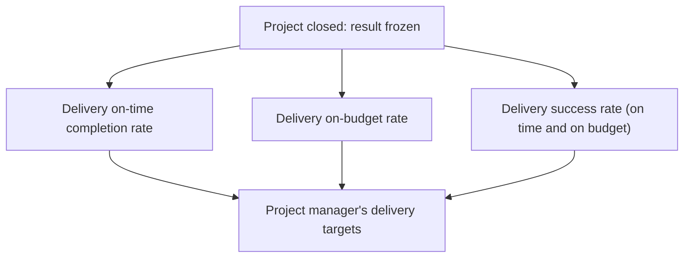

import Illustration from '../../../../components/Illustration.astro';

The **Delivery KPI** asks two questions of every delivery project once it has closed: was it handed over **on time**, and did it finish **on budget**? Finance answers them by closing the project, and the answers are frozen. The Accountability Framework then reads them to score the project manager's delivery targets.

## On time

A project is on time when its confirmed handover is no more than the grace days after its deadline:

- **Deadline** = **Approved completion date** (of the latest approved baseline) + **Approved client delay (days)**.
- **Days late** = handover date minus deadline, or 0 if it was handed over early.
- **On time** when days late is no more than **Completion date grace (days)** in **Delivery Settings**, 7 by default.

## On budget

A project is on budget when its **Final cost (before VAT)**, as confirmed by finance at close, is not above the approved budget total of the latest approved baseline, contingency included. There is no tolerance: one shilling over is over budget.

<Illustration name="projects/concept-kpi-result" caption="A project handed over within the grace and below its approved budget." />

## The result

| Result | When |
|---|---|
| **On time and on budget** | Both. |
| **Late** | On budget, but more days late than the grace. |
| **Over budget** | On time, but the final cost is above the approved budget. |
| **Late and over budget** | Neither. |
| **Not scored** | No approved baseline, no confirmed handover or no completion date at close. |

## How Accountability uses it

Three metrics read these results for the delivery projects a person manages (as **Project manager**):

- A project counts in the window that holds its **confirmed handover date**, not the day it closed.
- Only closed, scored projects count. Projects handed over but not yet closed, or closed as **Not scored**, are listed in the metric's worksheet but not counted.
- The rate is the share of counted projects that meet the test: 2 of 3 on time is 66.7%.
- If fewer than 3 projects count in the window, the previous window of the same length is added.
- The metric waits 30 days after the window ends, so finance has time to close projects.

See [Metrics: targets that update themselves](/accountability/concepts/metrics/) and [How metrics count](/accountability/calculations/metric-families/).

:::note[Good to know]
- **Days late** is recorded before the grace is applied. A project 5 days late with a 7-day grace shows **Days late** 5 and **On time**.
- The budget test uses the latest approved baseline at close. If a revision raised the budget before close, the project is measured against the raised budget.
- The grace and the budget are frozen at close (**Grace at close (days)**, **Approved budget at close**). Changing the settings later doesn't change closed projects. Reopening and closing again works the result out afresh.
:::

## Tasks that use this

- [Close or reopen a project](/projects/how-to/approvers/close-a-project/)
- [Record a handover](/projects/how-to/delivery-pm/record-a-handover/)
- [Log a client delay](/projects/how-to/delivery-pm/log-a-client-delay/)
- [Close figures, the result and the Delivery KPI](/projects/calculations/close-and-kpi/)
