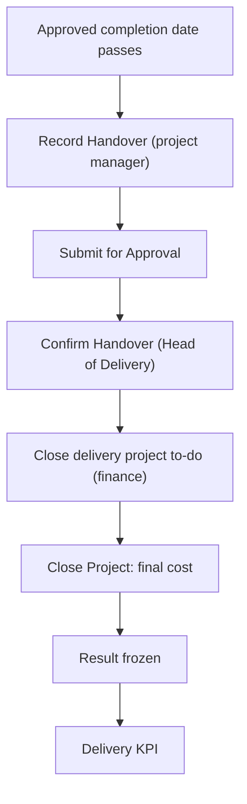

import Illustration from '../../../../components/Illustration.astro';

Every delivery project ends in two steps: the **project handover**, when the client takes over the work, and the **close-out**, when finance confirms what the project cost. Together they decide the project's result: was it on time, and was it on budget?

## The handover

The project manager clicks **Record Handover** on the project and fills in:

- **Handover date**: the date the client took over the work, the date on the certificate where there is one;
- **Handover certificate**: the signed acceptance or completion certificate (optional);
- **Note**: what was handed over, who signed for the client, anything outstanding.

**Submit for Approval** sends it to the Head of Delivery, who clicks **Confirm Handover**, or **Return** with a **Note when returning**. Only a **Confirmed** handover counts. A project can have one handover waiting or confirmed at a time. Returned handovers stay on record, greyed out.

The project's **Handover** smart button shows where it stands: **Not recorded**, **Draft**, **Waiting**, **Confirmed**, **Returned**, or **Closed** once the project is closed.

## The close-out

When the handover is confirmed, every Delivery Finance user gets a **Close delivery project** to-do, and the project appears under **Projects to close** in **My Actions**. Finance clicks **Close Project** on the project.

<Illustration name="projects/concept-close-window" caption="The Close Project window. The numbers match the list below." />

1. **Spent** (posted costs on expense accounts) and **Open orders** (confirmed purchase order lines not yet billed) add up to the **Proposed final cost**. All before VAT.
2. **Adjustment** adds a known late bill, or takes out a cost that isn't this project's. Any adjustment needs a reason in **Why**.
3. The preview shows the result before you commit: the days late against the deadline, and the final cost against the **Approved budget**.
4. **Close Project** freezes the figures. If something blocks the close, the window shows *This project cannot close yet.* with the reasons, and the button is hidden.

A project can't close while a Delivery Budget is in draft or waiting, while a handover or client delay is waiting for a decision, or, if it has an approved budget, until its handover is confirmed.

## What closing freezes

The **Handover & close** tab then shows the **Result** group: **Result**, **On time**, **On budget**, **Final cost (before VAT)**, **Approved budget at close**, **Spent at close**, **Open orders at close**, **Approved completion date at close**, **Approved client delay at close (days)**, **Handover date at close**, **Days late**, **Grace at close (days)** and **Budget version at close**. These stay as they are even if settings, bills or Delivery Budgets change later.

The **Result** is **On time and on budget**, **Late**, **Over budget** or **Late and over budget**. A project without an approved budget, a confirmed handover or a completion date is **Not scored**: its handover and final cost are still recorded, but it doesn't count in the Delivery KPI. How the result is worked out is in [The Delivery KPI](/projects/concepts/delivery-kpi/).

While a project is closed, nobody can record a handover, log a client delay or start a revision on it: *Data Centre Upgrade is closed. Finance can reopen it first.*

## Costs after close and reopening

Bills often arrive after a project closes. A daily check compares spent and open orders now with the figures frozen at close. If they differ, the **Handover & close** tab shows **Costs after close**, every Delivery Finance user gets a **Costs after close** to-do, and the project appears under **Costs after close** in **My Actions**. The result does not change.

Finance then either:

- clicks **Mark reviewed** to keep the project closed. It comes back only if the costs change again; or
- clicks **Reopen** and gives a **Reason for reopening**. This clears the final cost and result (the earlier figures are kept in the chatter), and closing again works out new ones.

:::note[Good to know]
- The Head of Delivery can also **Return** a handover that is already confirmed, for example if the date was wrong. The project manager then corrects it and submits it again.
- **Record Handover** and **Close Project** appear on every project, also ones not linked to a tender. Those close as **Not scored**.
:::

## Tasks that use this

- [Record a handover](/projects/how-to/delivery-pm/record-a-handover/)
- [Confirm or return a handover](/projects/how-to/approvers/confirm-a-handover/)
- [Close or reopen a project](/projects/how-to/approvers/close-a-project/)
- [Review costs posted after close](/projects/how-to/approvers/review-costs-after-close/)
- [Close figures, the result and the Delivery KPI](/projects/calculations/close-and-kpi/)
- [Handover workflow](/projects/workflows/handover/) and [Close-out workflow](/projects/workflows/close-out/)
