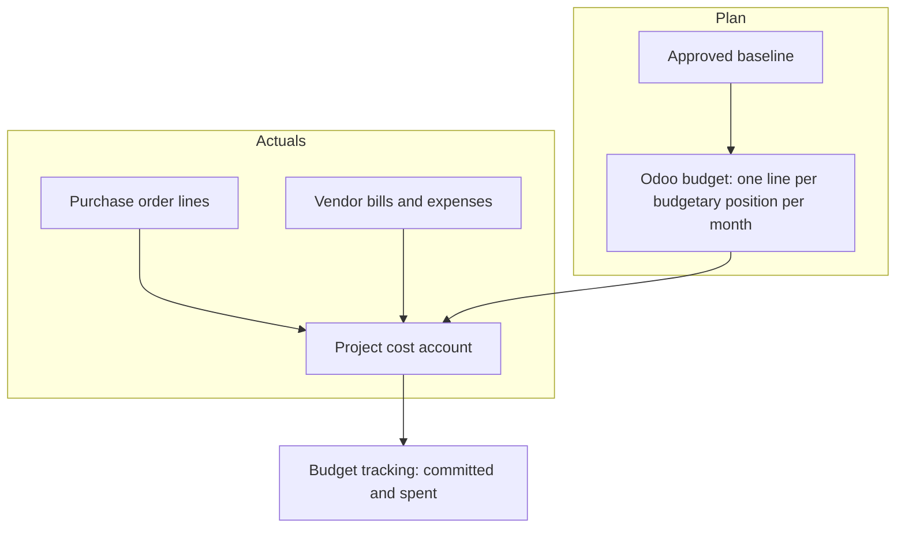

Every delivery project has a **cost account**: an analytic account in Odoo that finance uses to collect the project's costs. A cost counts for the project when the purchase order line, vendor bill line or expense **carries the project's cost account**. That is how Odoo knows a bill belongs to *PRJ Customer A network upgrade* and not to another job.

When an approved baseline creates the **Odoo budget**, that budget is set on the same cost account. So the plan and the actual costs meet in one place: Odoo Budgets for finance, and the **Budget tracking** table on the project for everyone else.

## Where the cost account comes from

When a delivery project is opened, the system uses finance's existing cost account if one is chosen or suggested (it looks for an account named like the project, the tender title or the tender number). Otherwise it creates a new one. **New cost accounts** in **Delivery Settings** decides where: **A new plan per project, named after it** (the default) or **One shared plan for all delivery projects**.

Non-finance users open the **Cost account** smart button to see a read-only card: the account and plan, how many cost lines it has, what has been spent, and any automatic tagging rules pointing at it. Finance users go straight to the account itself.

## How orders and bills get tagged

- **Purchase orders on the tender.** When a purchase order is linked to a tender that has exactly one delivery project, each new line gets that project's cost account at 100% automatically.
- **Tenders with several delivery projects.** The buyer must choose the cost account on each line. The order shows *This tender has 2 delivery projects: choose the cost account on each line.*
- **Automatic tagging rules.** Finance can set rules in Odoo that put the cost account on bills automatically. The **Automatic tagging rules** smart button lists them.
- **Lines that were missed.** Tender order lines with no cost account show on the **Untagged tender order lines** smart button. The Head of Delivery or Delivery Finance uses **Tag tender orders** to tag them in one go. Until then they don't count as committed or spent.

A confirmed purchase order on the tender with lines that carry no delivery project's cost account shows a blue note: **Not tagged to the project.**

## The Odoo budget

When a baseline is approved, the system creates an Odoo budget named like *PRJ Customer A network upgrade · delivery budget v1*, then confirms and validates it. It has:

- one series of lines for each **budgetary position** (a set of ledger accounts), with one line per month that has planned spend;
- dates from the project start to the completion date plus **Budget runs past completion (days)**, 180 by default, so late vendor bills still count.

When a revision is approved, the new version gets its own Odoo budget and the old one is cancelled. Only users with accounting access see the **Odoo Budget** and **Odoo budget lines** buttons.

## Budgetary positions

Finance maps the budget categories to positions once, in **Delivery Settings** under **Odoo budget mapping**, and clicks **Apply mapping**:

| Position | Budget categories | Default accounts |
|---|---|---|
| **Direct project costs** | Equipment and hardware, Software and licences, Subcontractors, Installation materials, Logistics | 500000 |
| **Project travel and site** | Travel and site expenses | 750610, 850000, 750120 |
| **Project bonds and insurance** | Bonds, guarantees and insurance | 791010 |
| **Project contingency** | Contingency | 500900 (a reserve account nobody posts to) |

Each account may sit in one position only, or the same cost would count twice. Spent counts only expense accounts, so payments, bank and VAT lines never show as spend.

:::note[Good to know]
- Until the mapping is applied, the baseline shows *Odoo budget mapping is not finished.* and some categories share one Odoo budget line. Finance completes it in **Delivery Settings**.
- On a tender with several delivery projects nothing is tagged automatically. Each order line needs the right cost account by hand, or tagging afterwards.
- Tagging order lines afterwards does not change bills already created from them. A bill line without the cost account doesn't count as spent, so finance tags it on the bill.
:::

## Tasks that use this

- [Tag orders to their project](/projects/how-to/approvers/tag-orders-to-a-project/)
- [Change the Delivery settings](/projects/how-to/approvers/delivery-settings/)
- [Budget by category, spend by month and the Odoo budget lines](/projects/calculations/budget-lines-and-phasing/)
- [The project form at a glance](/projects/reports/project-at-a-glance/)
