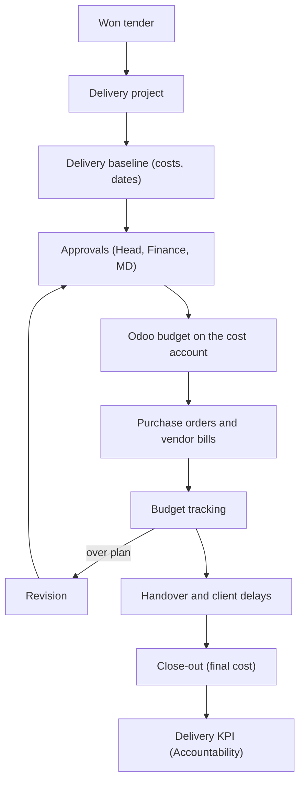
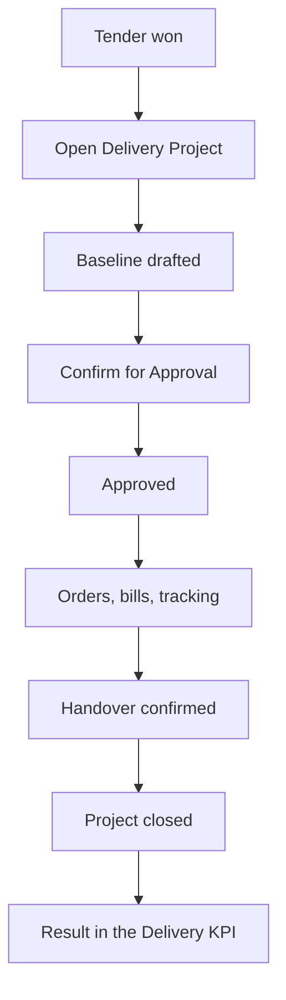

**Project Delivery** is how Tritel plans, approves, tracks and closes the work it has won. When a tender is won, the delivery team opens a **delivery project** from it. The project manager lists everything the project will pay for and when, and sets a completion date and milestone dates. Together these make the **delivery baseline**. Once it is approved, the project is tracked against it, and at the end it is handed over and closed. Closing freezes the result: was it on time, and was it on budget?

You find it in the **Project** app. The **Delivery** menu holds **Delivery Projects**, **Waiting for My Approval**, **All Baselines**, **Handovers**, **Client Delays** and, for the Head of Delivery, **Projects to Link**. **Project › My Actions** lists everything waiting for you. The same list appears in the Projects section of the portal page **/my/actions**.

## How the parts fit together

- **Delivery project:** a project linked to a won tender. Only these are measured. See [Delivery projects](/projects/concepts/delivery-projects/).
- **Delivery baseline:** the list of costs, the months they are paid, the completion date and the milestone dates. Version 1 is the original; every change after approval is a new version, a revision. See [Delivery baselines and revisions](/projects/concepts/baselines/).
- **Approvals:** the Head of Delivery approves the dates, Delivery Finance approves the budget, and the MD also approves large revisions. See [Who approves what](/projects/concepts/approvals/).
- **Odoo budget and cost account:** approval creates an Odoo budget on the project's cost account. Orders and bills count against the project when they carry that cost account. See [The Odoo budget and the cost account](/projects/concepts/odoo-budget-and-cost-account/).
- **Budget tracking:** planned, committed, spent and left for each budget line, refreshed every night. See [Budget tracking](/projects/concepts/budget-tracking/).
- **Handover, client delays and close-out:** the project manager records the handover and any delays the client caused; the Head of Delivery confirms them; finance closes the project with a final cost. See [Handover and close-out](/projects/concepts/handover-and-close-out/) and [Client delays](/projects/concepts/client-delays/).
- **Delivery KPI:** the frozen result feeds the project manager's delivery targets in Accountability. See [The Delivery KPI](/projects/concepts/delivery-kpi/).

## Who uses it

| Who | What they do |
|---|---|
| **Delivery project managers** | Open delivery projects from won tenders, build the baseline and confirm it for approval, request revisions, record the handover and log client delays. |
| **Head of Delivery** | Approves the dates of every baseline and revision, confirms or returns handovers, approves or rejects client delays, links older projects to their tenders, chases overdue baselines and looks after the delivery settings. Can also do everything a project manager does. |
| **Delivery Finance** | Approves the budget of original baselines and of revisions that change costs, tags orders to their project, closes and reopens projects, and reviews costs posted after close. |
| **The MD** | Named in **Delivery Settings**. Also approves a revision that raises the budget or moves the completion date beyond the set limits. |
| **Finance and accounts** | See the Odoo budget, vendor bills and tagging rules behind each project. |
| **Account managers** | See the **Delivery projects**, **Delivery budgets** and **Margin left** buttons on their won tenders. Opening a project needs a delivery project manager. |
| **Buyers** | See a warning on a purchase order that would take a project over its plan. |
| **Every project user** | Uses **Project › My Actions** for overdue milestones and tasks, and can open a project's delivery figures from its smart buttons. |

## The life of a project

1. **The tender is won.** A delivery project manager clicks **Open Delivery Project** on the tender. The system creates the project, its cost account, the standard stages and milestones, and a draft baseline with the starter items.
2. **The baseline is drafted.** The project manager keys the cost items, the months they are paid, the completion date and the milestone dates. It is due 14 days after the award date by default.
3. **It is confirmed and approved.** **Confirm for Approval** sends it to the approvers. When every approval needed is in, it is **Approved**: the completion date and exchange rates are fixed and the Odoo budget is created.
4. **The work is delivered.** Orders and bills on the cost account show as committed and spent. If the plan has to change, the project manager requests a revision, which goes through approval again.
5. **The project is handed over.** The project manager records the handover date, and any period the client held the work up. The Head of Delivery confirms them.
6. **Finance closes it.** Finance confirms the final cost. The result (on time, on budget, or both) is frozen and counts in the project manager's Delivery KPI.

## Where to start

| You are | Start here |
|---|---|
| A delivery project manager or the Head of Delivery | [Delivery](/roles/delivery/) |
| In Delivery Finance or Finance & Accounts | [Finance and Accounts](/roles/finance-and-accounts/) |
| The MD | [MD and board](/roles/md-and-board/) |
| An account manager | [Commercial](/roles/commercial/) |

The statuses of every Project Delivery workflow are listed in [statuses](/reference/states/), and every term is in the [glossary](/reference/glossary/).

:::note[Good to know]
- Every project user can open and read every delivery baseline, handover and client delay, including the figures on other managers' projects.
- The **Project › Configuration › Delivery** menu (**Delivery Settings**, **Cost Types** and the other lists) only shows for users who are also project administrators. If you are the Head of Delivery or in Delivery Finance and can't see it, ask your system administrator.
:::
