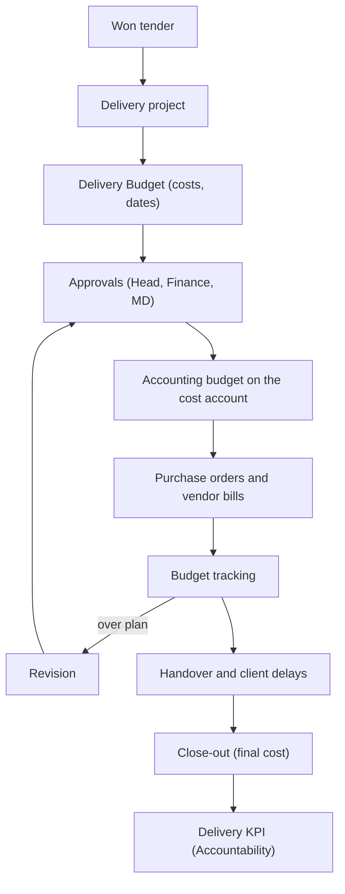
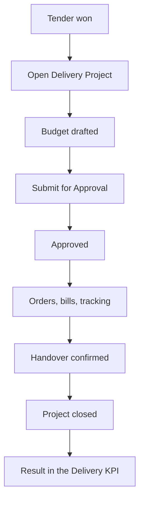

**Project Delivery** is how Tritel plans, approves, tracks and closes the work it has won. When a tender is won, the delivery team opens a **delivery project** from it. The project manager lists everything the project will pay for and when, and sets a completion date and milestone dates. Together these make the project's **Delivery Budget** (once called the delivery baseline). Once it is approved, the project is tracked against it, and at the end it is handed over and closed. Closing freezes the result: was it on time, and was it on budget?

Every project has a **project code**, such as *P26-049*, shown in front of its name: *P26-049 · Data Centre Upgrade*. Its cost account carries the same code, so orders, bills and budgets find the project by it. See [Project codes](/projects/concepts/project-codes/).

## Where things are

Project Delivery lives in the **Project** app under **Project › Delivery**, and finance also has its own menu in **Accounting**. What you see depends on your role. Every menu, role by role, is listed in [Project Delivery menus](/projects/menus/).

| You are | Your menus |
|---|---|
| A delivery project manager | **Project › Delivery › Projects**: **My Delivery Projects**, **Delivery Budgets**, **Budget Commitments**, **My Submissions**, **Handovers** and **Client Delays**. |
| The Head of Delivery | The same, plus **To approve › Waiting for Me**, **Projects › Delivery Projects** and **Projects › Projects Not in Delivery**, and **Setup** (**Delivery Settings**, **Cost Types**, **Budget Categories**, **Starter Items**, **Standard Milestones**, **Cost Accounts to Sort Out**). |
| In Delivery Finance | **Project › Delivery** (**To approve**, **Projects** and **Setup**), and **Accounting › Project Budgets**: **To approve › Budgets to Approve** and **Costs After Close**, and **Tracking › Budget vs Actual**, **Delivery Budgets**, **Budget Commitments** and **Cost Accounts to Sort Out**. The set-up lists are also under **Accounting › Configuration › Project Budgets**. |
| An accounting manager | **Accounting › Project Budgets › Tracking › Cost Accounts to Sort Out**. |

**Project › My Actions** lists everything waiting for you. The same list appears in the Projects section of the portal page **/my/actions**.

On a purchase order, the **Budget status** badge under the order number says how the order stands against the accounting budget its cost account belongs to: **Within budget**, **No cost account**, **No budget line**, **Budget planned at 0** or **Over budget**. See [Check a purchase order against the budget](/projects/how-to/approvers/check-an-order-against-the-budget/). Every open order on a running budget is listed in [Budget Commitments](/projects/reports/budget-commitments/).

## How the parts fit together

- **Delivery project:** a project linked to a won tender. Only these are measured. See [Delivery projects](/projects/concepts/delivery-projects/).
- **Delivery Budget:** the list of costs, the months they are paid, the completion date and the milestone dates. Version 1 is the original; every change after approval is a new version, a revision. See [Delivery Budgets and revisions](/projects/concepts/baselines/).
- **Approvals:** the Head of Delivery approves the dates, Delivery Finance approves the budget, and the MD also approves large revisions. See [Who approves what](/projects/concepts/approvals/).
- **Accounting budget and cost account:** approval creates an accounting budget on the project's cost account. Orders and bills count against the project when they carry that cost account, and confirmed orders not yet billed show on the budget lines as **Committed**. See [The accounting budget and the cost account](/projects/concepts/odoo-budget-and-cost-account/).
- **Budget tracking:** planned, committed, spent and left for each budget line, refreshed every night. See [Budget tracking](/projects/concepts/budget-tracking/).
- **Handover, client delays and close-out:** the project manager records the handover and any delays the client caused; the Head of Delivery confirms them; finance closes the project with a final cost. See [Handover and close-out](/projects/concepts/handover-and-close-out/) and [Client delays](/projects/concepts/client-delays/).
- **Delivery KPI:** the frozen result feeds the project manager's delivery targets in Accountability. See [The Delivery KPI](/projects/concepts/delivery-kpi/).

## Who uses it

| Who | What they do |
|---|---|
| **Delivery project managers** | Open delivery projects from won tenders, build the Delivery Budget and submit it for approval, request revisions, record the handover and log client delays. |
| **Head of Delivery** | Approves the dates of every Delivery Budget and revision, confirms or returns handovers, approves or rejects client delays, links older projects to their tenders, chases overdue budgets and looks after the delivery settings. Can also do everything a project manager does. |
| **Delivery Finance** | Approves the costs of every first Delivery Budget and of revisions that change costs, tags orders to their project, closes and reopens projects, reviews costs posted after close, and sorts out cost accounts that belong to no project. |
| **The MD** | Named in **Delivery Settings**. Also approves a revision that raises the budget or moves the completion date beyond the set limits. |
| **Finance and accounts** | See the accounting budget, with what is committed and still available on each line, and the vendor bills and tagging rules behind each project. Accounting managers sort out cost accounts that belong to no project. |
| **Account managers** | See the **Delivery projects**, **Delivery budgets** and **Margin left** buttons on their won tenders. Opening a project needs a delivery project manager. |
| **Buyers** | See the **Budget status** of each purchase order and a warning when an order would take a project over its plan. They set the cost account on order lines with **Assign Cost Accounts**. |
| **Every project user** | Uses **Project › My Actions** for overdue milestones and tasks, and can open a project's delivery figures from its smart buttons. |

## The life of a project

1. **The tender is won.** A delivery project manager clicks **Open Delivery Project** on the tender. The system creates the project, its cost account, the standard stages and milestones, and a draft budget with the starter items.
2. **The budget is drafted.** The project manager keys the cost items, the months they are paid, the completion date and the milestone dates. It is due 14 days after the award date by default.
3. **It is submitted and approved.** **Submit for Approval** sends it to the approvers. When every approval needed is in, it is **Approved**: the completion date and exchange rates are fixed and the accounting budget is created.
4. **The work is delivered.** Orders and bills on the cost account show as committed and spent. If the plan has to change, the project manager requests a revision, which goes through approval again.
5. **The project is handed over.** The project manager records the handover date, and any period the client held the work up. The Head of Delivery confirms them.
6. **Finance closes it.** Finance confirms the final cost. The result (on time, on budget, or both) is frozen and counts in the project manager's Delivery KPI.

## Where to start

| You are | Start here |
|---|---|
| A delivery project manager or the Head of Delivery | [Delivery](/roles/delivery/) |
| In Delivery Finance or Finance & Accounts | [Finance and Accounts](/roles/finance-and-accounts/) |
| The MD | [MD and board](/roles/md-and-board/) |
| An account manager | [Commercial](/roles/commercial/) |

The statuses of every Project Delivery workflow are listed in [statuses](/reference/states/), and every term is in the [glossary](/reference/glossary/).

:::note[Good to know]
- Every project user can open and read every Delivery Budget, handover and client delay, including the figures on other managers' projects.
- You become a delivery project manager by being the **Project Manager** of an active delivery project; nobody needs to tick it. Someone who doesn't manage one yet can't open a delivery project themselves, so the Head of Delivery opens it and names them. See [Who can do what](/projects/who-can-do-what/).
:::
