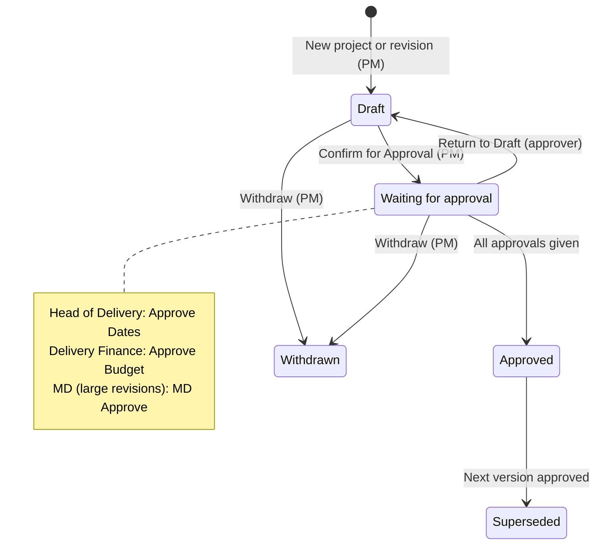
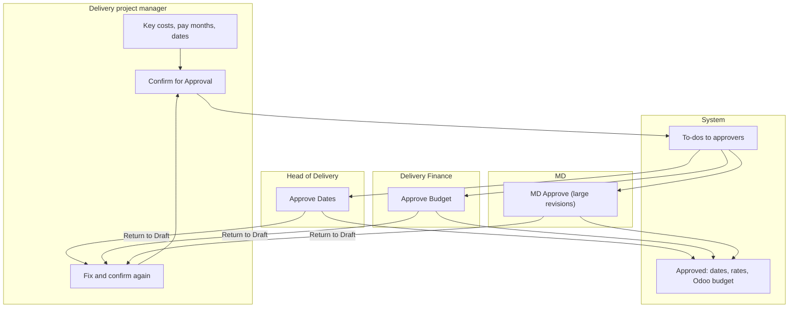

A **delivery baseline** is drafted by the project manager, confirmed for approval, and approved in parts by the Head of Delivery, Delivery Finance and, for large revisions, the MD. The status shows on the baseline's status bar. Each version (v1, v2 and so on) goes through these statuses on its own.

| Status | What it means | Moves to | Who moves it |
|---|---|---|---|
| **Draft** | Being written: cost items, pay months, completion date, milestones and, for a revision, the reason. Only a draft can be edited or deleted. | **Waiting for approval** with **Confirm for Approval**; **Withdrawn** with **Withdraw** | Delivery project manager (or Head of Delivery) |
| **Waiting for approval** | Locked and with the approvers. Each gives their part with **Approve Dates**, **Approve Budget** or **MD Approve**. | **Approved** when the last needed approval is given; **Draft** with **Return to Draft**; **Withdrawn** with **Withdraw** | Head of Delivery, Delivery Finance, the MD; the system; Delivery project manager |
| **Approved** | In force. The project's completion date, milestones, Odoo budget and tracking follow it. Only one version is approved at a time. | **Superseded** when a later version is approved | The system |
| **Superseded** | Replaced by a later approved version. Kept for history; its Odoo budget is cancelled. | — | — |
| **Withdrawn** | Abandoned before approval. It stays on record but no longer counts, and can be deleted. | — | — |

## The project's baseline status

The project's **Baseline** field sums up its versions:

| Baseline | What it means | Moves to | Who moves it |
|---|---|---|---|
| **No baseline** | No version is in draft, waiting or approved. | **Baseline in draft** | Delivery project manager |
| **Baseline in draft** | Version 1 is being written. | **Waiting for approval** | Delivery project manager |
| **Waiting for approval** | Version 1 is with the approvers. | **Approved**, or back to **Baseline in draft** | Approvers; the system |
| **Approved** | An approved version is in force and nothing else is open. | **Revision pending** with **Request Revision** | Delivery project manager |
| **Revision pending** | An approved version is in force and a revision is in draft or waiting. | **Approved** when the revision is approved or withdrawn | Approvers; the system; Delivery project manager |

## Who does what

The approvals can come in any order. The baseline is approved as soon as the last one needed is in.

## What the system does automatically

- **Opening a project** creates baseline v1 as a draft with the starter items, and writes *Draft started with 4 starter items. Price them, delete what does not apply, and add the rest of the costs.*
- **Checks at Confirm for Approval.** Confirming stops if any of these is missing: *Set the completion date.*; *List the costs: what the project will pay for.*; an item without a quantity and unit cost or without a pay month; *The budget total must be above zero.*; *Give every milestone a date: Installation complete.*; *Milestones cannot fall after the completion date: Handover.*; contingency above the cap; a cost paid more than 180 days after the completion date; for a revision, no reason or no change.
- **On confirm:** each approver gets a to-do: **Approve delivery baseline: dates** (every Head of Delivery), **Approve delivery baseline: budget** (every Delivery Finance user, when needed) and **Approve delivery baseline revision (MD)** (when needed). If costs are over the tender's expected revenue, the to-do says *Costs are over the expected revenue by KES 50,000.* Costs paid before the project start are noted in the chatter.
- **On each approval:** that approver's to-do is removed and the chatter says *Dates approved*, *Budget approved* or *MD approval given*. Approving the budget fixes the exchange rates.
- **On the last approval:** the baseline becomes **Approved**; the previous approved version becomes **Superseded** and its Odoo budget is cancelled; the project's end date and milestones follow the baseline; the new Odoo budget is created and validated; tracking is refreshed; the project manager gets a message, not a to-do.
- **On Return to Draft:** a **Note for the project manager** is required. Every approval given so far is cleared, the approvers' to-dos are removed, and the project manager gets a **Delivery baseline returned** to-do. It is marked done when the baseline is confirmed again or withdrawn. The note shows on the draft as a yellow **Returned:** banner.
- **On Withdraw:** the approvers' to-dos are removed.
- **Overdue baselines:** each night, a delivery project with no baseline or only a draft, past its **Baseline due** date, gets one **Delivery baseline overdue** to-do for the project manager and every Head of Delivery. It is sent once per project, and marked done when a baseline is confirmed.
- **My Actions:** project managers see **Baselines to draft**, **Baselines sent back to you** and **Revisions in progress**. Approvers see **Baselines to approve: dates**, **Baselines to approve: budget** and **Revisions to approve (MD)**. The Head of Delivery sees **Baselines overdue on your team**, with **Remind**.

:::note[Good to know]
- **Withdraw** is shown to delivery project managers and the Head of Delivery. Withdrawing a revision leaves the approved version in force.
- A project can't start a revision while it is closed: *PRJ Customer A network upgrade is closed. Finance can reopen it first.*
- Only one draft or waiting version exists at a time. **Open Baseline in Progress** on the project opens it.
:::

## Related tasks

- [Build a baseline with the cost item builder](/projects/how-to/delivery-pm/build-a-baseline/)
- [Send a baseline for approval](/projects/how-to/delivery-pm/send-for-approval/)
- [Fix a baseline that was sent back](/projects/how-to/delivery-pm/fix-a-returned-baseline/)
- [Request a revision](/projects/how-to/delivery-pm/request-a-revision/)
- [Approve a baseline's dates](/projects/how-to/approvers/approve-dates/)
- [Approve a baseline's budget](/projects/how-to/approvers/approve-budget/)
- [Approve a large revision](/projects/how-to/approvers/approve-a-large-revision/)
- [Chase overdue baselines](/projects/how-to/approvers/remind-overdue-baselines/)
