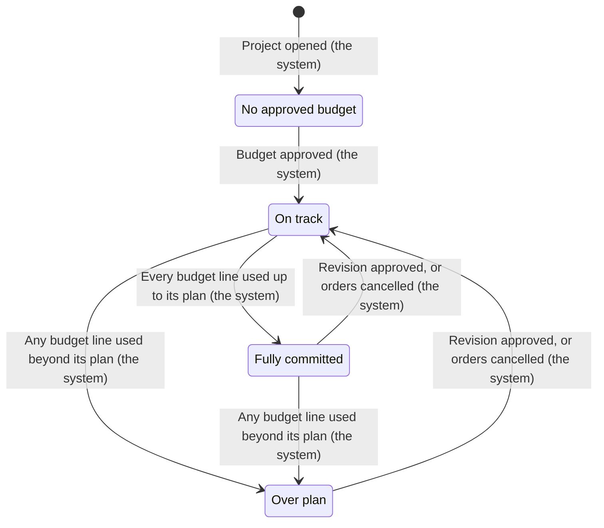
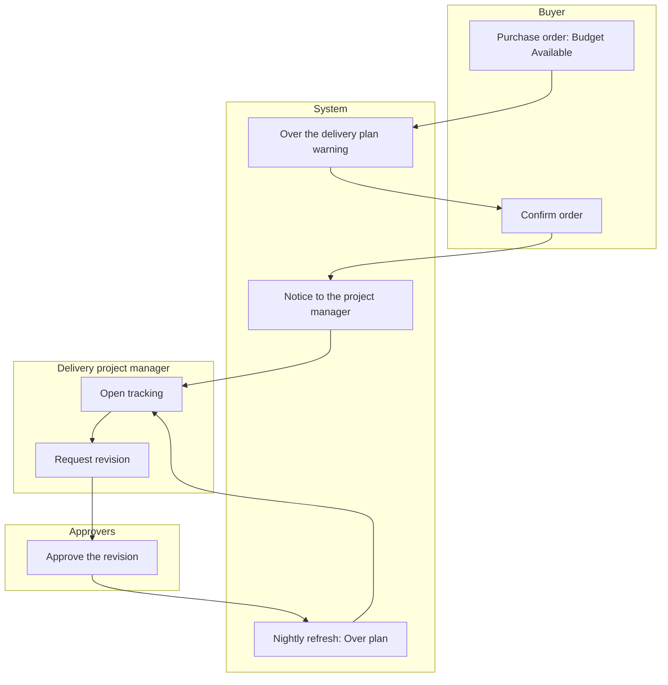

Every delivery project has a **Budget status** for its tracking. (The project's **Budget status** field on the **Delivery** tab, which shows whether its Delivery Budget is drafted or approved, and a purchase order's **Budget status** are different things; see the end of this page.) Nobody sets it by hand: the system works it out from the approved budget and the orders and costs on the project's cost account, every night and whenever someone clicks **Refresh** in **Budget tracking**. It can move in either direction as orders are confirmed, bills are posted, orders are cancelled or a revision is approved.

"Used" means **Committed** (confirmed purchase orders not yet billed) plus **Spent** (posted costs), both before VAT.

| Status | What it means | Moves to | Who moves it |
|---|---|---|---|
| **No approved budget** | No Delivery Budget has been approved yet, so there is nothing to track against. | **On track** when the first Delivery Budget is approved | The system, after the approvers approve |
| **On track** | No budget line is over its plan, and at least one still has room. Shown green. | **Fully committed** or **Over plan** as orders and bills come in | The system |
| **Fully committed** | Every budget line has used at least 99.5% of its plan, and none is over. Shown amber. | **Over plan** if any line goes over; **On track** if room opens up again | The system |
| **Over plan** | At least one budget line has used more than its plan. Shown red. | **On track** or **Fully committed** when a revision adds budget, or orders are cancelled or reduced | The system, after the project manager requests a revision and it is approved |

Each row in the **Budget tracking** table has its own status with the same rules: **On track**, **Fully committed** (at least 99.5% of the row's plan used) or **Over plan** (more than the row's plan used). The project is **Over plan** if any row is, and **Fully committed** only if every row is.

## Who does what

## What the system does automatically

- **Nightly refresh:** every active delivery project's figures and status are worked out again. **Figures as of** shows when.
- **Before an order is confirmed:** a purchase order that would take a budget line over its plan shows **Over the delivery plan.** *You can still confirm; the project manager will be told.* It does not block.
- **When such an order is confirmed:** the order's chatter records *Over the delivery plan when confirmed*, and the project manager gets *Order over the delivery plan: P00123* on the budget.
- **My Actions:** an **Over plan** project appears under **Projects over their approved budget**: for its project manager (with **Open tracking** and **Request revision**) and for the Head of Delivery (all projects). A project that already has a revision in progress is listed under **Revisions in progress** instead.
- **Smart button:** **Budget left** on the project turns green, amber or red with the status, and its subtitle reads, for example, *Left · over plan*.
- **Budget vs Actual:** Delivery Finance's list under **Accounting › Project Budgets › Tracking** opens on the **Over plan** and **Fully committed** filters. See [Projects over their approved budget](/projects/reports/projects-over-budget/).

:::note[Good to know]
- The **Project contingency** row never fills, because nothing is posted to its account. A project with contingency will rarely reach **Fully committed** as a whole, even when every other line is used up.
- The status changes only when the figures are refreshed. After confirming an order or posting a bill, click **Refresh** to see the effect at once.
- **Over plan** doesn't stop anything. It is a signal to act: check the orders, or request a revision.
:::

## A purchase order's Budget status

A purchase order has its own **Budget status**, shown as a badge under the order number, as a column in the purchase order lists and as a **Budget** badge on each line. It compares the order with the **accounting budget** line its cost account, expense account and order date fall in, not with the project's tracking. A request for quotation is assessed as if it were confirmed.

| Status | What it means |
|---|---|
| **Within budget** | Every line falls on a budget line with enough left after this order. |
| **No cost account** | At least one line carries no cost account, so it counts against no budget. |
| **No budget line** | A line's cost account has no running budget line for its expense account and order date. |
| **Budget planned at 0** | A line falls on a budget line planned at 0, such as a month with no planned spend. |
| **Over budget** | After this order, a budget line it touches would have less than nothing left (planned − actual − other confirmed orders − this order below −0.50). |

The order shows the most serious status of its lines, in the order above from least to most serious. The status is worked out when the order changes, and again every night for open orders (*Purchase: refresh budget status of open orders*). In the purchase order search, **Over budget**, **Budget flags** and **No cost account** filter on it, and **Budget status** groups by it. See [Check a purchase order against the budget](/projects/how-to/approvers/check-an-order-against-the-budget/).

:::note[Good to know]
- The order's **Budget status** and its **Budget Available** button (once **Left in delivery plan**) can disagree. **Budget Available** compares the order with the Delivery Budget by budget category, over the whole project; **Budget status** compares it with one accounting budget line for one budgetary position and month. Accounting budgets are phased monthly, so an order dated in a month with no planned spend shows **Budget planned at 0**, and an order bigger than its month's line shows **Over budget**, even when the project as a whole has room.
- Neither one blocks the order. Both are warnings; the buyer can still confirm.
:::

## Related tasks

- [Track the budget](/projects/how-to/delivery-pm/track-the-budget/)
- [Request a revision](/projects/how-to/delivery-pm/request-a-revision/)
- [Projects over their approved budget](/projects/reports/projects-over-budget/)
- [Planned, expected to date, committed, spent, left, forecast and status](/projects/calculations/tracking-figures/)
- [Budget tracking](/projects/concepts/budget-tracking/)
