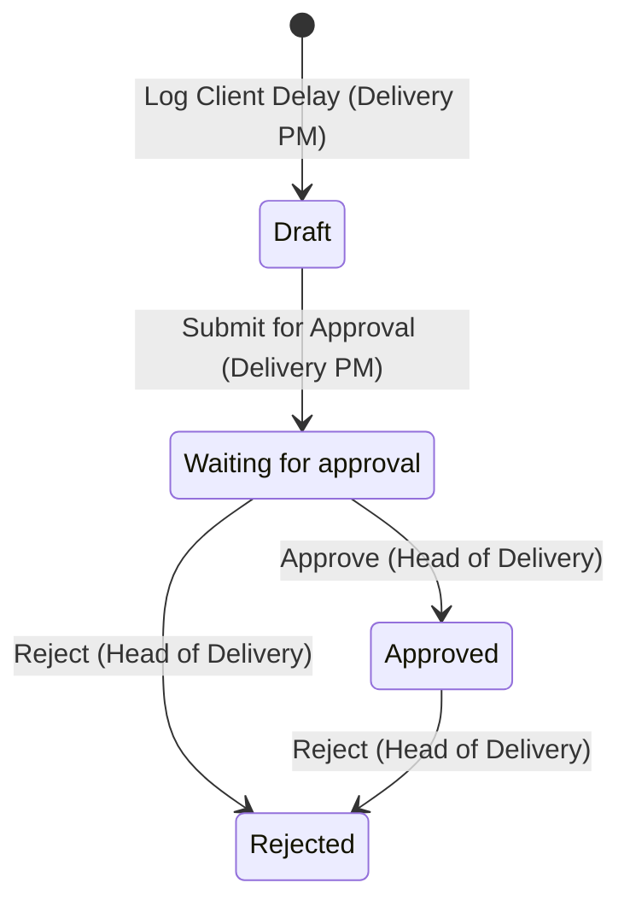
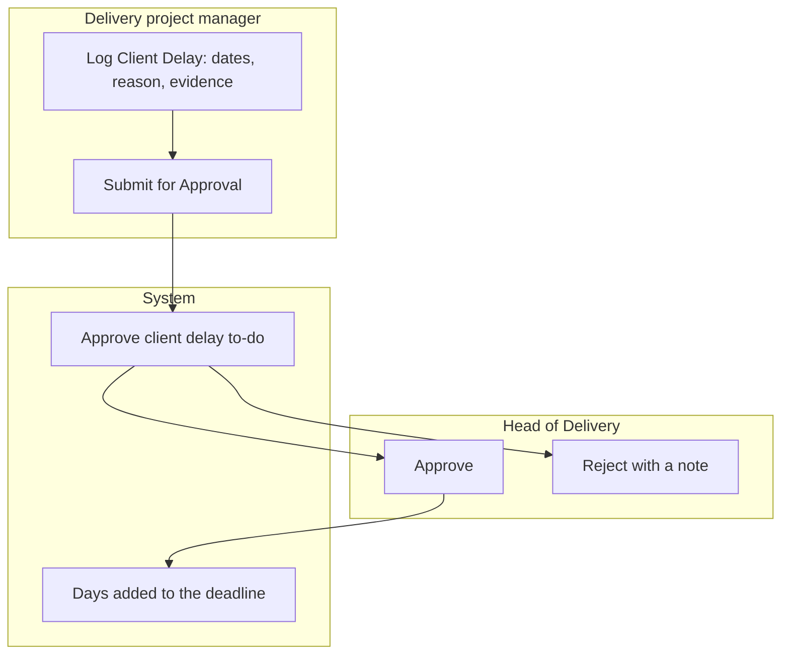

A **client delay** is logged by the project manager and decided by the Head of Delivery. Only approved delays move the project's on-time deadline.

| Status | What it means | Moves to | Who moves it |
|---|---|---|---|
| **Draft** | Logged but not sent. The **From** and **To** dates, the reason and the **Evidence** can be changed, and it can be deleted. | **Waiting for approval** with **Submit for Approval** | Delivery project manager |
| **Waiting for approval** | With the Head of Delivery. It can no longer be edited. While it waits, the project can't be closed. | **Approved** with **Approve**; **Rejected** with **Reject** | Head of Delivery |
| **Approved** | Its days count in **Approved client delay (days)** and move the on-time deadline. | **Rejected** with **Reject** | Head of Delivery |
| **Rejected** | Not accepted. The **Note when rejecting** shows on it in a yellow **Rejected:** banner. Its days don't count. This is final. | — | — |

## Who does what

## What the system does automatically

- **Days:** worked out from **From** and **To**, counting both days. A delay that ends before it starts is refused: *The delay ends before it starts.*
- **On submit:** every Head of Delivery gets an **Approve client delay** to-do (for example *Data Centre Upgrade: 10 days of client delay (01 Mar 2026 to 10 Mar 2026) submitted for approval.*), and the delay appears under **Client delays to approve** in their **My Actions**. The project manager sees it under **Waiting on others**, with **Remind**.
- **On approve or reject:** the to-do is removed and the decision is written in the delay's chatter. Rejecting needs a note: *Write a note explaining why, then reject it.*
- **Approved days:** the project's **Approved client delay (days)** counts every calendar day covered by an approved delay, overlapping days once. At close, these days are added to the approved completion date and frozen as **Approved client delay at close (days)**.
- **Drafts left behind:** a draft delay shows under **Client delays to submit** in the project manager's **My Actions**.
- **Closed projects:** no delay can be logged, changed or decided while the project is closed.

:::note[Good to know]
- A rejected delay can't go back to draft. If it should count after all, log it again as a new delay.
- The Head of Delivery can reject a delay that was already approved. Its days then stop counting.
- The project manager isn't sent a to-do when a delay is decided. Check the status on the project's **Handover & close** tab.
:::

## Related tasks

- [Log a client delay](/projects/how-to/delivery-pm/log-a-client-delay/)
- [Approve or reject a client delay](/projects/how-to/approvers/approve-a-client-delay/)
- [Client delay days](/projects/calculations/delay-days/)
- [Client delays](/projects/concepts/client-delays/)
