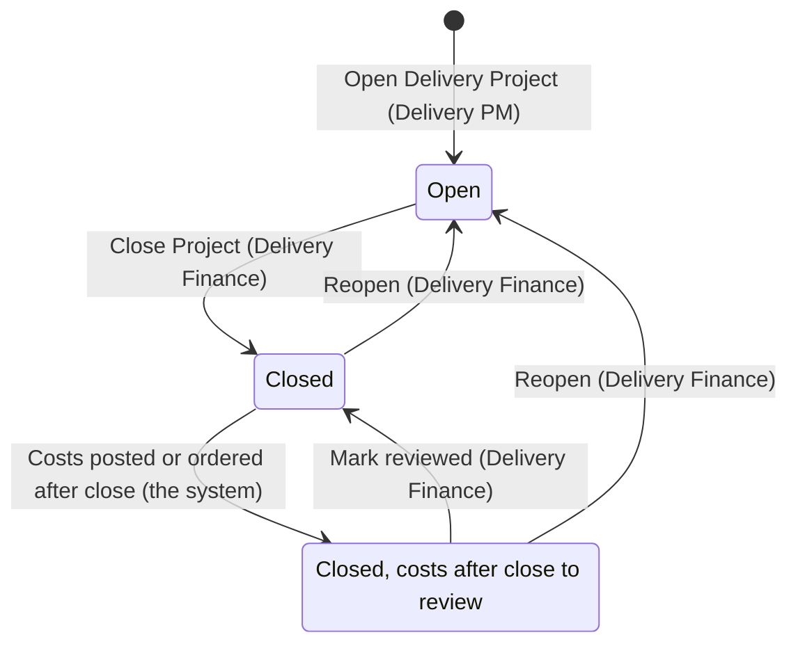
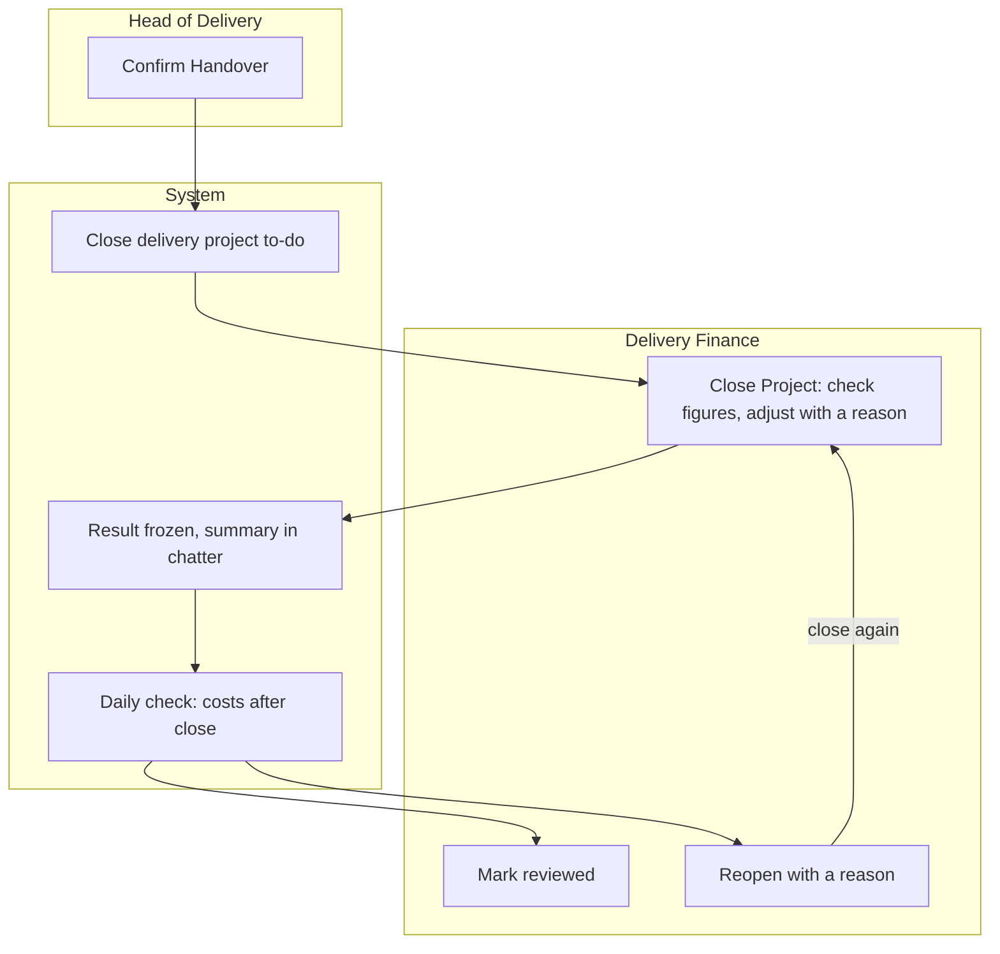

Closing is the last step of a delivery project. Finance confirms the final cost, and the system freezes the result. The project then shows its result on the **Handover & close** tab, and its **Handover** smart button reads **Closed**. On screen, a closed project has the **Close Project** button replaced by **Reopen**.

| Status | What it means | Moves to | Who moves it |
|---|---|---|---|
| **Open** | Not closed. Budgets, handovers and client delays can be worked on. | **Closed** with **Close Project**, once nothing blocks it | Delivery Finance |
| **Closed** | The final cost and result are frozen. No handover, client delay or revision can be started or changed. | **Open** with **Reopen**; **Costs after close** if costs change | Delivery Finance; the system |
| **Costs after close** to review | Still closed, but spent plus open orders differ from the figures at close. The result does not change. | **Closed** with **Mark reviewed**; **Open** with **Reopen** | Delivery Finance |

## Who does what

## What the system checks and does

- **Before closing:** the **Close Project** window lists anything that blocks the close under *This project cannot close yet.*:
  - *Budget v2 is waiting for approval. Approve or withdraw it first.*
  - *The handover must be recorded and confirmed by the Head of Delivery first.* (only for a project with an approved budget)
  - *A handover is waiting for confirmation.*
  - *A client delay is waiting for approval.*
- **Figures in the window:** **Spent**, **Open orders**, **Proposed final cost**, an optional **Adjustment** with **Why** (required when there is an adjustment: *Explain the adjustment to the final cost.*), **Final cost** and **Approved budget**, plus a preview of the result. If the project has no cost account, the window says spent and open orders are 0 and suggests the adjustment.
- **On close:** the final cost, the approved budget, completion date, handover date, client delay days, grace days, days late and the result are frozen. The **Close delivery project** to-dos are removed. The chatter gets a **Project closed** summary. Tracking is refreshed one last time.
- **Every day after close:** the system compares spent plus open orders with the figures frozen at close. When the difference changes and hasn't been reviewed, every Delivery Finance user gets a **Costs after close** to-do, and the project shows under **Costs after close** in **My Actions** with **Mark reviewed**, **Open** and **Reopen**.
- **Mark reviewed:** keeps the project closed, marks the to-do done and notes *Costs after close of KES 15,000 reviewed; the project stays closed.* It comes back only if the costs change again.
- **On reopen:** a **Reason for reopening** is required. The earlier figures are posted in the chatter, the final cost and result are cleared, and the project can be worked on and closed again.
- **My Actions:** finance sees **Projects to close** for every delivery project with a confirmed handover. A project manager sees their own under **Waiting on others** until finance closes it.

:::note[Good to know]
- Only Delivery Finance can close or reopen a project, or mark costs after close reviewed.
- A project without an approved budget can still be closed. Its result is **Not scored** and it doesn't count in the Delivery KPI.
:::

## Related tasks

- [Close or reopen a project](/projects/how-to/approvers/close-a-project/)
- [Review costs posted after close](/projects/how-to/approvers/review-costs-after-close/)
- [Close figures, the result and the Delivery KPI](/projects/calculations/close-and-kpi/)
- [Handover workflow](/projects/workflows/handover/)
