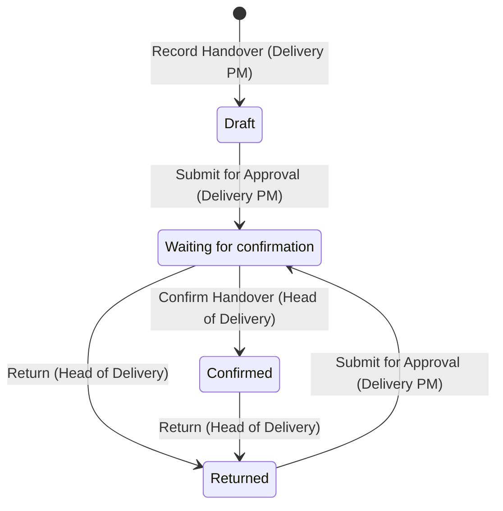
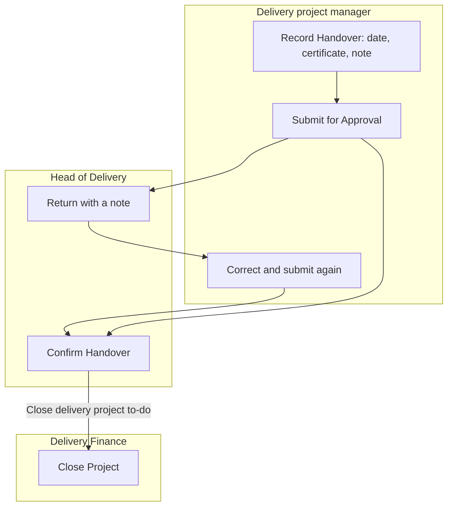

A **project handover** records the date the client took over the work. The project manager records and submits it, and the Head of Delivery confirms it or returns it. Only a confirmed handover counts for the on-time result and lets finance close the project.

| Status | What it means | Moves to | Who moves it |
|---|---|---|---|
| **Draft** | Recorded but not sent. The **Handover date**, **Handover certificate** and **Note** can be changed, and it can be deleted. | **Waiting for confirmation** with **Submit for Approval** | Delivery project manager |
| **Waiting for confirmation** | With the Head of Delivery. It can no longer be edited. | **Confirmed** with **Confirm Handover**; **Returned** with **Return** | Head of Delivery |
| **Confirmed** | The handover date is accepted. It counts for the on-time result, and finance can close the project. | **Returned** with **Return** | Head of Delivery |
| **Returned** | Sent back with a **Note when returning**. The project manager can edit it and submit it again, or delete it. | **Waiting for confirmation** with **Submit for Approval** | Delivery project manager |

## The project's handover status

The **Handover** smart button on the project shows one value for all its handovers:

| Handover | What it means | Moves to | Who moves it |
|---|---|---|---|
| **Not recorded** | No handover yet. | **Draft** with **Record Handover** | Delivery project manager |
| **Draft** | A handover is being recorded. | **Waiting** | Delivery project manager |
| **Waiting** | A handover is waiting for confirmation. | **Confirmed** or **Returned** | Head of Delivery |
| **Confirmed** | A confirmed handover exists. | **Closed** when finance closes the project | Delivery Finance |
| **Returned** | The latest handover was returned. | **Waiting** when it is submitted again | Delivery project manager |
| **Closed** | The project is closed. | **Confirmed** if finance reopens it | Delivery Finance |

## Who does what

## What the system does automatically

- **Handovers to record:** once a project's approved completion date has passed and its handover is still **Not recorded** or in **Draft**, it appears for the project manager under **Handovers to record** in **My Actions**, with **Record handover** and **Log client delay**.
- **On submit:** every Head of Delivery gets a **Confirm project handover** to-do, and the handover appears under **Handovers to confirm** in their **My Actions** (showing whether a certificate is attached). A project manager who isn't Head of Delivery sees it under **Waiting on others**, with **Remind**.
- **On confirm:** the to-do is removed, the project's chatter says *Handover on 15 Apr 2026 confirmed.*, and every Delivery Finance user gets a **Close delivery project** to-do.
- **On return:** a note is required (*Write a note explaining what needs to change, then return it.*). The to-do is removed and whoever submitted it gets a **Handover returned** to-do with the note. That to-do is marked done when the handover is submitted again.
- **One at a time:** submitting stops with *Data Centre Upgrade already has a handover waiting or confirmed.* if another handover on the project is waiting or confirmed.
- **Closed projects:** no handover can be recorded, changed or decided while the project is closed.

:::note[Good to know]
- **Record Handover** opens the existing draft or returned handover if there is one, rather than starting another.
- A confirmed handover can still be returned. If finance has not closed the project yet, it then can't close until a handover is confirmed again.
:::

## Related tasks

- [Record a handover](/projects/how-to/delivery-pm/record-a-handover/)
- [Confirm or return a handover](/projects/how-to/approvers/confirm-a-handover/)
- [Close-out workflow](/projects/workflows/close-out/)
- [Handover and close-out](/projects/concepts/handover-and-close-out/)
