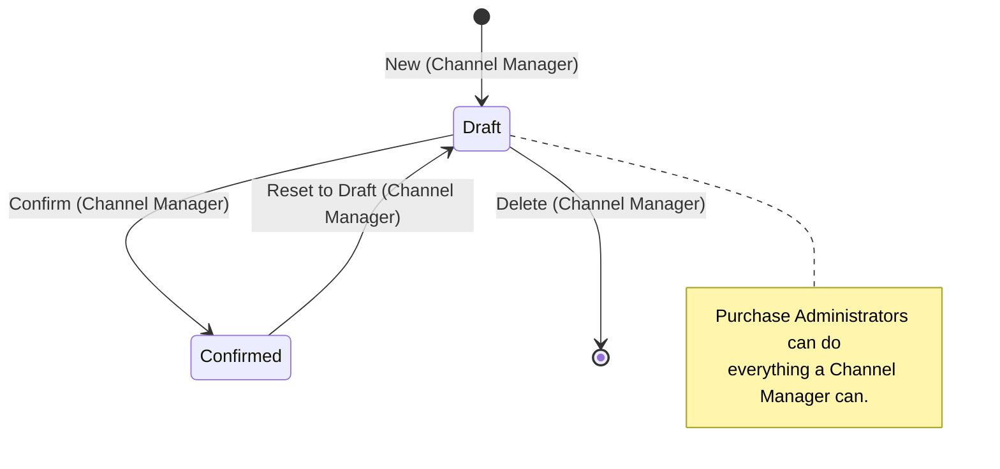

An **OEM booking** has two statuses. It is built in **Draft** and counts only once it is **Confirmed**. Channel Managers, Channel Administrators and Purchase Administrators move it; Channel Users can only look.

| Status | What it means | Moves to | Who moves it |
|---|---|---|---|
| **Draft** | Being put together. The reference, amount, currency and portal date can be changed, lines can be added with **Add purchase lines** and removed with **Remove**, and it can be deleted. It doesn't count anywhere. | **Confirmed** with **Confirm** | Channel Manager or Administrator, Purchase Administrator |
| **Confirmed** | Checked and counting: in the OEM's channel figures and in Accountability's OEM-recognised revenue, by **Booking Date**. The figures and lines are locked and it can't be deleted. | **Draft** with **Reset to Draft** | Channel Manager or Administrator, Purchase Administrator |

## Before Confirm is allowed

**Confirm** stops if any of these is true:

- there are no lines: *'BK-1001': link the purchase lines this booking covers before confirming.*
- the **OEM-Recognised Amount** is 0: *'BK-1001': enter the amount the OEM recognises.*
- a linked purchase order is no longer confirmed: *'BK-1001': remove the lines from purchase orders that are no longer confirmed before confirming: PO-2026-002.*

A margin warning (negative, or above 25%) does not stop it.

## What the system does automatically

- **Adding lines:** only lines tagged with the booking's OEM, on confirmed purchase orders, and not in another booking can be added. The **OEM** is then locked on the booking.
- **Removing a line:** noted in the chatter, for example *Removed PO-2026-001 · Switch 48-port · USD 6,000.00. By Employee A.* Only on a draft booking.
- **Purchase order cancelled, booking in Draft:** that order's lines are removed and the chatter says so.
- **Purchase order cancelled, booking Confirmed:** the lines stay, a red banner appears, the chatter says so, and the person who created the booking gets a to-do. See [When a purchase order is cancelled](/tenders/channel/cancelled-orders/).
- **Figures:** cost, recognised USD, margin and booking date are worked out again whenever lines, the amount or a purchase order's confirmation date change, in both statuses.

:::note[Good to know]
- **Reset to Draft** needs no reason and sends no message. The status change is recorded in the chatter.
- While a booking is back in **Draft** it stops counting, so a review taken in that time misses it. Confirm it again promptly.
:::

## Related tasks

- [Book OEM purchases](/tenders/channel/book-oem-purchases/)
- [When a purchase order is cancelled](/tenders/channel/cancelled-orders/)
- [OEM bookings](/tenders/channel/oem-bookings/)
