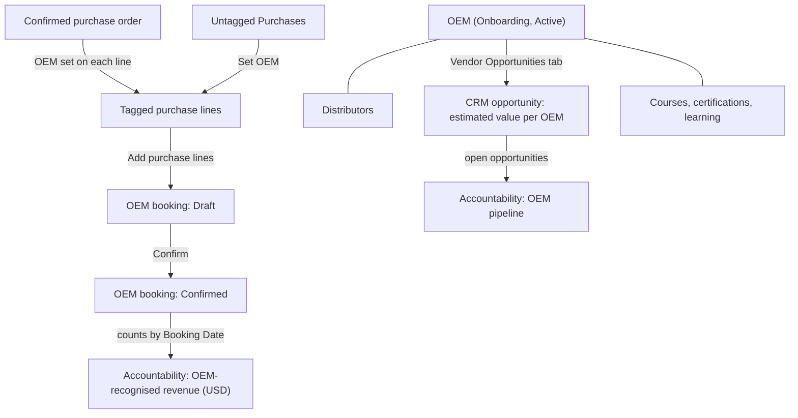

The **Channel** app is where Tritel keeps its relationship with the manufacturers it resells (the **OEMs**) and the distributors it buys their products through. It answers three questions:

- **Who do we sell, and through whom?** The OEMs, their distributors, and which OEMs are on each sales opportunity.
- **What has the OEM credited us with?** Each **OEM booking** records the value an OEM shows on its partner portal and links it to the purchase order lines it covers. Confirmed bookings are the OEM-recognised revenue that Accountability targets measure.
- **Who is certified?** OEM courses, staff certificates and the learning records of people working towards one.

The company's compliance documents (tax, regulator and registration certificates) are kept by the same module, but their menu sits under **Tender Manager › Compliance**, not under **Channel**.

## How the pieces fit

## The menus

| Menu | What you do there |
|---|---|
| **Channel › OEMs(Vendors)** | Keep each OEM's details, distributors and this year's channel figures. |
| **Channel › OEM Bookings** | Record what an OEM recognises on its portal and confirm it. |
| **Channel › Untagged Purchases** | Give an OEM to confirmed purchase lines that have none. Channel Managers only. |
| **Channel › Distributors** | Keep each distributor and the OEMs it carries. |
| **Channel › Certifications** | Staff certificates, grouped by OEM and course. Also under **Employees**. |
| **Channel › Learning Development** | Track people working towards a certification. |
| **Channel › Configuration › Courses** and **Learning Stages** | Set up OEM courses and the learning stages. |
| **Tender Manager › Compliance** | Compliance documents, the issuing bodies, and the expiry calendar. |

On a CRM opportunity, the **Vendor Opportunities** tab lists the OEMs involved. On a purchase order, each line has an **OEM** column and the order has an **OEM** smart button.

## Who uses what

| Role | What they can do |
|---|---|
| **Channel User** | See OEM bookings (read only). Update learning records. |
| **Channel Manager** | Everything a Channel User can do, plus create, confirm, reset and delete OEM bookings, add and remove lines, and use **Untagged Purchases** and **Set OEM**. Create learning records. |
| **Channel Administrator** | Everything a Channel Manager can do, plus delete learning records. |
| **Purchase Administrator** | Create, confirm and correct OEM bookings, add and remove lines. |
| Staff with CRM access | Create and edit OEMs and fill in vendor opportunities. |
| Every internal user | Distributors, courses, certifications and compliance documents. |

See [Who can do what](/tenders/who-can-do-what/) for the full matrix.

## Where to start

- New to the terms: [OEMs and distributors](/tenders/channel/oems-and-distributors/), then [OEM bookings](/tenders/channel/oem-bookings/).
- Recording what an OEM credits: [Book OEM purchases](/tenders/channel/book-oem-purchases/) and the [OEM booking workflow](/tenders/channel/booking-workflow/).
- Keeping the data clean: [Set the OEM on untagged purchases](/tenders/channel/tag-untagged-purchases/) and [When a purchase order is cancelled](/tenders/channel/cancelled-orders/).
- Sales: [Vendor opportunities on a CRM opportunity](/tenders/channel/vendor-opportunities/).
- Bids and HR: [Compliance documents](/tenders/channel/compliance/) and [Certifications and learning development](/tenders/channel/certifications-and-learning/).

:::note[Good to know]
The Channel app sends no emails and has no reminders. Nothing warns you before a compliance document or a staff certificate expires: check the [compliance calendar](/tenders/channel/compliance/) and the certificate dates yourself.
:::
