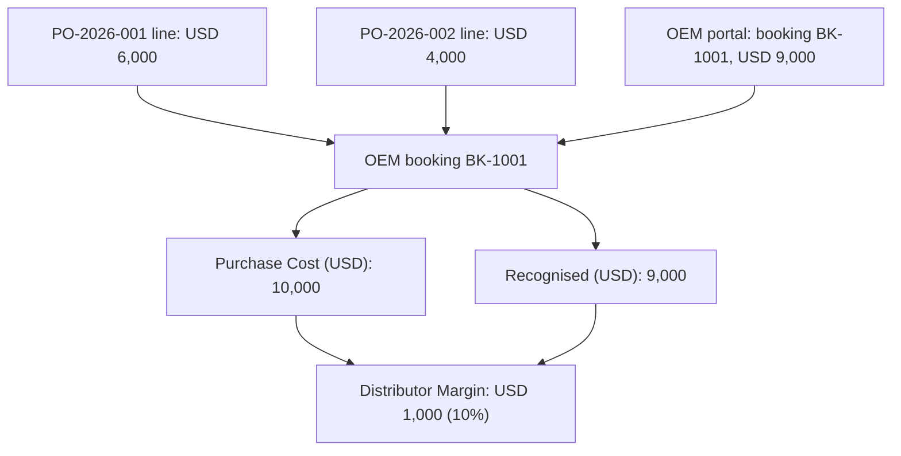

When Tritel buys an OEM's products through a distributor, it pays the distributor's price. The OEM, on its partner portal, credits Tritel with its own (usually lower) figure for the same sale. An **OEM booking** records that portal figure and links it to the purchase order lines it covers. The difference between what Tritel paid and what the OEM recognises is the **distributor margin**.

A booking is **Draft** while it is being put together and **Confirmed** once the figure and the lines are checked. Only confirmed bookings count as OEM-recognised revenue, in Accountability and in the OEM's channel figures.

## The parts of a booking

| Label | Meaning |
|---|---|
| **Portal Reference** | The booking, deal or order reference shown on the OEM's portal. |
| **OEM** | Whose booking it is. It can't be changed once lines are linked. |
| **OEM-Recognised Amount** and **Currency** | The figure from the portal, in the portal's currency (USD by default). |
| **Portal Date** | The date shown on the portal, for reference only. |
| **Purchase lines** tab | The purchase order lines this booking covers. A line can be in only one booking, and only lines on confirmed purchase orders tagged with the same OEM can be added. |
| **Purchase Cost (USD)** | What Tritel paid for the linked lines, in USD. Each line is converted at the rate on its order's confirmation date. |
| **Recognised (USD)** | The recognised amount in USD. |
| **Distributor Margin (USD)** and **(%)** | Purchase cost minus recognised, and that as a share of the purchase cost. |
| **Booking Date** | The latest confirmation date of the linked purchase orders. **This date, not the portal date, decides which month and which review window the booking counts in.** |
| **Distributors** | The suppliers on the linked purchase orders. |

The exact rules, with examples, are in [OEM booking value and booking date](/tenders/calculations/oem-bookings/).

## Warnings on the form

- A yellow banner appears when the margin looks wrong: *The OEM recognises more than was paid for these lines. Check the amount or the linked lines.* (negative margin), or *Distributor margin of 30.0% is unusually high. Check the amount or the linked lines.* (above 25%). You can still confirm.
- A red banner appears when a linked purchase order has been cancelled. See [When a purchase order is cancelled](/tenders/channel/cancelled-orders/).

## Where bookings are counted

- **On the OEM:** **OEM-Recognised YTD (USD)**, **Purchase Cost YTD (USD)** and **Average Distributor Margin (%)** add up this year's confirmed bookings (by booking date). **Awaiting OEM Confirmation (USD)** adds up this year's tagged purchase lines on confirmed orders that are not in a confirmed booking.
- **In Accountability:** the **OEM-recognised revenue (USD)** metric adds the **Recognised (USD)** of the chosen OEM's confirmed bookings whose booking date falls in the review window. Purchase lines without a confirmed booking are listed as awaiting OEM confirmation and don't count. The figure is for the whole company, not per person. See [Metrics](/accountability/concepts/metrics/).
- **In reports:** **Channel › OEM Bookings** opens grouped by OEM. Use the **Confirmed**, **Draft** and **This Year** filters, group by **Booking Month**, or switch to the pivot or graph view.

:::note[Good to know]
- If a booking is confirmed late, or a purchase order behind it is confirmed late, the booking can land in a review window that has already passed. Accountability waits 30 days after a window ends before reviewing this metric, so record bookings promptly.
- A booking is not linked to a CRM opportunity or a tender. The worksheet in Accountability shows the tender reference of each purchase order when the order has one.
:::

## Tasks that use this

- [Book OEM purchases](/tenders/channel/book-oem-purchases/)
- [When a purchase order is cancelled](/tenders/channel/cancelled-orders/)
- [Set the OEM on untagged purchases](/tenders/channel/tag-untagged-purchases/)
- [OEM booking workflow](/tenders/channel/booking-workflow/)
