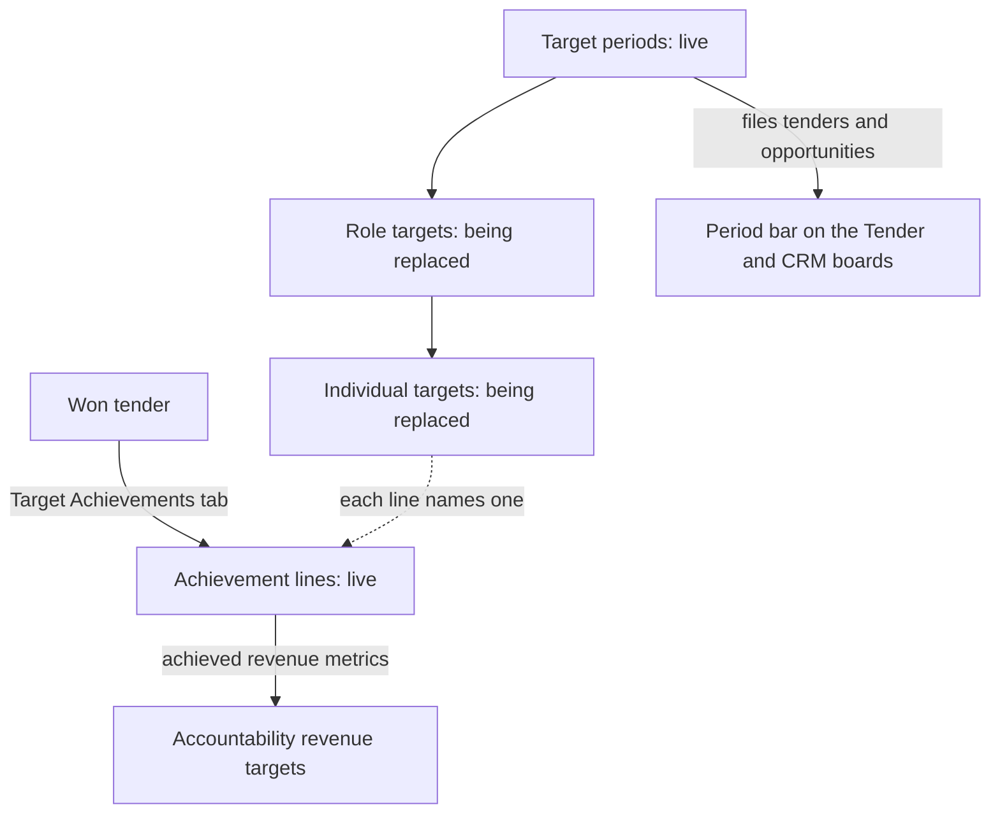

**Commercial Targets** is the older target screen inside the **Tender Manager** app. It has four parts: **target periods**, **role targets**, **individual targets** and **achievements**. Two of them are still in use. The other two are being replaced by revenue targets in the Accountability Framework.

## Live: use these

| Part | Where | What it does |
|---|---|---|
| **Target periods** | **Tender Manager › Configuration › Target Periods** | Name the quarters or years the business plans in. Tenders and opportunities are filed into them, and the **Period** bar on the tender board and the CRM pipeline opens on the **Active** one. See [Target periods](/tenders/commercial-targets/target-periods/). |
| **Achievement lines** | A won tender's **Target Achievements** tab; **Tender Manager › Commercial Targets › Target Achievements** | Credit each Account Manager, Bid Liaison and Technical Presales person with a share of a won tender's value. Accountability's achieved revenue metrics read these lines. See [How achievements are split and counted](/tenders/commercial-targets/achievements/) and [Attribute a won tender](/tenders/how-to/bids/attribute-a-won-tender/). |

The Head of Commercial attributes the Account Manager and Bid Liaison, and the Head of Channel attributes Technical Presales. Won tenders still waiting appear in their **My Actions** under **Achievements to attribute**.

## Being replaced: don't set new quotas here

| Part | Where | Replaced by |
|---|---|---|
| **Role targets** (one figure per role, held by its head) | **Tender Manager › Commercial Targets › Dashboard** | Revenue targets in Accountability, using the achieved revenue metrics. See [Targets](/accountability/concepts/targets/). |
| **Individual targets** (one quota per person) | **Tender Manager › Commercial Targets › Manage Individual Targets** | The same. |
| **Targets & Achievements** tile and the *Performance Targets* page in the portal | **/my/targets** | **My Performance** in the portal. |

These screens still work and still show percentages and statuses (**Exceeded**, **On Track**, **At Risk**, **Behind**), but nothing in Accountability reads them. Set and review revenue targets in Accountability.

:::note[Good to know]
- Every achievement line still has to name an **individual target** for the person, in its **Target** column. Until the replacement is finished, each Account Manager, Bid Liaison and Technical Presales person needs one individual target so their wins can be attributed. Its value doesn't matter for Accountability.
- A role target with the **Target Type** **Number of Tenders** still adds up money, not a count of tenders.
- Closing a target period locks nothing. Targets and achievements in a **Closed** period can still be changed.
- There are no role restrictions on these screens: any internal user can create and edit targets and achievement lines, including their own. Leave attribution to the heads.
:::
